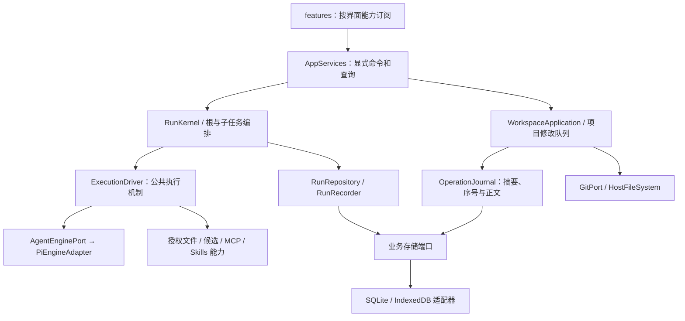

# Agent Mobile 架构与代码质量改进实施方案

日期：2026-10-14。代码基线：`9893b85`。状态：本轮 10 个实施批次已完成；验收证据与发布前限制见 validation.md。

本方案细化 [improvement-plan.md](F:/ReactProject/AgentMobile/docs/improvement-plan.md) 中已经复核的决定，定义接口、数据、事务、当前格式初始化、提交边界和验收。实际状态以 [design.md](design.md) 和 [validation.md](validation.md) 为准；示例类型是目标契约，省略已有领域类型的 import，不代表全部接口已经实现。

开发策略更新：软件未发布，允许内部 API 和存储格式破坏性更新。以当前需求、代码整洁和效率为优先，不提供旧原型格式的前向/向后兼容；原方案中的旧数据迁移、ImportedHistoryRecord、旧轨迹转换及降级转换取消。旧原型兼容路径已删除，开发实例按当前格式明确重建；凭证与项目外数据不在重建范围。

## 1. 目标与范围

目标是统一执行语义、限制查询和写入范围、让权限声明实际生效，并降低修改同一规则的维护成本。保留 React Native、Expo Development Build、TypeScript、Pi 执行循环、三协议、Git、SQLite/IndexedDB。

必须保留：独立项目/对话、跨项目并发、同项目单写、一层子 Agent、固定快照精确授权、writer 私有候选、整批合入预检、用户文件/index 保护、MCP unknown 屏障、Skills 冻结版本、实时资料更新、恢复时不重放模型或未知副作用。

暂不新增自定义角色、插件沙箱、ORM、后台服务、网页执行、国际化平台或在线 GC；不替换 Pi、Git 后端、状态管理库。开发数据可按当前格式重建，不为保存旧原型数据保留常驻分支。当前格式的正常 Git 历史/撤销、日志恢复和外部协议支持仍是功能要求。

| 目标       | 完成标准                                                      |
| ---------- | ------------------------------------------------------------- |
| 正确性     | 取消、截止、预算、引擎故障和回执失败可区分；根/子公共规则一致 |
| 查询范围   | 摘要不读取操作正文或完整历史轨迹；分页在底层查询生效          |
| 安全与恢复 | 权限不扩大，意图先于副作用落盘，完成不先于必要回执；恢复幂等  |
| 维护性     | 当前实体不继承旧展示 DTO；公共契约独立；关键规则只维护一份    |

文件数、代码行数、断言数量和“消灭全部 if”不作为完成标准。性能结论注明设备、样本、构建类型和基线；浏览器通过不能代替原生/真机验证。

## 2. 目标结构与模块落点



| 目标位置                                  | 职责                                             |
| ----------------------------------------- | ------------------------------------------------ |
| src/core/errors.ts                        | 公共错误码与安全错误；不解析提示文案             |
| src/core/runs/termination.ts              | 停止原因与终态判定的纯规则                       |
| src/core/runs/records.ts、queries.ts      | 当前运行实体；独立摘要/详情 DTO                  |
| src/core/workspace/journal.ts             | 明确日志类型、摘要/正文及端口                    |
| src/core/storage/business-store.ts        | 跨日志/运行/KV 的有类型同库原子批次              |
| src/application/runs/execution-driver.ts  | 请求槽、预算、意图 flush、停止和清理             |
| src/application/workspace/journal.ts      | 项目队列内日志用例与恢复读取                     |
| src/application/tools/file-read.ts        | 三种来源共用的受限读取工具                       |
| src/adapters/storage/native、web          | 当前结构初始化、热查询、索引、事务和开发数据重建 |
| src/bootstrap/storage-init.ts、startup.ts | 当前格式检查与明确启动阶段；不建立历史迁移模块   |
| src/application/api、features/workbench   | 独立公共接口与窄界面能力                         |

这是目标落点，未实现的职责不提前创建空框架。现有平台入口可以保留为薄组装文件；模块只在相关提交中迁移。

### 2.1 目录组织与拆分粒度

2026-10-14 本地盘点：src 下有 65 个子目录，8 个没有任何文件（包含仅有空子目录的父目录），20 个单文件叶子目录。Git 不跟踪空目录，所以本地空目录与已提交的目录组织需要分开判断；前者多为模板/删除文件后的残留，不是必须保留的架构。

保留 core/application/adapters/bootstrap/features/shared/app 的层级边界。文件夹表达实际的业务模块、平台实现或路由语义，不机械为每个类型/类/Hook 创建目录；单文件模块优先使用有含义的文件名，形成实际文件簇或确需独立管理后再升为目录。没有“必须三文件才能建目录”的硬规则。

| 当前组织                                                                                        | 收敛方向                                                                        | 判断依据                                                                                             |
| ----------------------------------------------------------------------------------------------- | ------------------------------------------------------------------------------- | ---------------------------------------------------------------------------------------------------- |
| src/components、constants、hooks、theme；core/model、prototype；features/prototype 等无文件目录 | 实施时核对后移除本地残留，包括 components/ui                                    | 无当前代码；不以未来可能使用为理由保留                                                               |
| core/agent 与 core/agents/types.ts                                                              | 将角色定义并入 core/agent/definitions.ts                                        | 同一 Agent 模块，没有第二个独立职责边界                                                              |
| core/projects/types.ts、preferences/types.ts、events/signal.ts                                  | 优先改为 core/projects.ts、preferences.ts、signal.ts                            | 小型单文件模块可保留命名与依赖边界，无须多套一层                                                     |
| core/trace/index.ts                                                                             | core/trace.ts；后续形成多个真实 trace 模块再分目录                              | 当前唯一文件，保留公开模块入口即可                                                                   |
| adapters/agent/pi/engine.ts                                                                     | adapters/agent/pi-engine.ts                                                     | Pi 实现仍在 adapter，专属目录当前只有一个绑定文件                                                    |
| adapters/lifecycle/runs.ts                                                                      | adapters/agent/lifecycle.ts                                                     | 当前仅负责 Agent 生命周期挂接，合并归属而非合并平台实现到 application                                |
| adapters/workspace/service.ts                                                                   | 明确组装工厂，最终归入 bootstrap 的工作区组装                                   | 当前只组合具体 Git/codec 与 WorkspaceApplication，不是另一个文件业务实现；随显式 Skills 模式改造处理 |
| features/git/actions.ts、runs/activity.tsx                                                      | 当前可并入 workbench/git-actions.ts、run-activity.tsx                           | 两者依赖 Workbench/其上下文，尚不是独立可复用 feature；未来有独立页面/契约后再拆                     |
| shared/hooks、state、theme 各单文件                                                             | shared/use-app-services.ts、workbench-state.ts、theme.ts；保留 shared/ui 文件簇 | 保留 Hook/状态/主题职责，用文件名区分即可                                                            |
| application/models、conversations、skills                                                       | 保留业务目录                                                                    | 虽只有一个实现文件，但与领域、适配和界面对应，职责清楚且实现并不微小                                 |
| app/settings、app/mcp、app/skills                                                               | 保留路由结构                                                                    | 文件夹参与 Expo Router 路由语义，不按文件数量扁平化                                                  |
| adapters/git、io、mcp；model/protocols                                                          | 保留实现簇及 .web 配对                                                          | Git/MCP/协议/平台差异真实存在，不为减少目录混合职责                                                  |

这些移动映射已在第一阶段落实，工作区组装使用 bootstrap/workspace.ts。只有类型与参数定义的微型文件（例如 runs 的 persistence/resources/delegation-port）可在共同驱动实施时收敛到明确的 contracts.ts；不是所有短文件都应合并，独立规则和恢复状态机仍单独维护。

机械路径调整作为独立提交，同步 imports、Metro/ESLint/测试/文档引用，不与事务、权限或状态语义修改混在一起。若 types/contracts 在同一模块内很小且总是一起修改，可合并；避免为一次移动新增一批重导出兼容文件。验收看导航是否清晰、职责是否内聚、边界检查是否保留，不规定目标目录数量。

本方案表中的 application/api、storage/native/web 只在多个实际契约或平台模块形成时建目录；单文件阶段可以直接使用 application/api.ts、bootstrap/storage-init.ts 和现有 storage 平台文件。不能把职责清单直接变成一组空目录或一文件目录；不为已取消的历史迁移预留目录。

## 3. 停止原因与执行生命周期

### 3.1 明确停止原因

```ts
type StopReason =
  | { kind: 'user_cancel'; originRunId: string; at: string }
  | { kind: 'deadline'; originRunId: string; at: string; deadlineAt: string }
  | {
      kind: 'budget_exhausted';
      originRunId: string;
      at: string;
      scope: 'run' | 'group';
      resource: 'requests' | 'tools';
    }
  | { kind: 'engine_error'; originRunId: string; at: string; error: PublicError }
  | {
      kind: 'ancestor_stopped';
      originRunId: string;
      at: string;
      cause: 'user_cancel' | 'deadline' | 'budget_exhausted' | 'engine_error';
    }
  | { kind: 'app_interrupted'; at: string };

interface PublicError {
  code: AppErrorCode;
  message: string;
  uncertain?: boolean;
}
```

StopController 每运行一份，首次明确停止原因锁定；AbortSignal 只负责取消派发/网络/引擎，不负责解释终态。祖先停止传递真实来源。组预算停止整组，子配额耗尽只停止该子运行，父运行仍可汇总。

| 情况                           | 状态               | 原因                                             |
| ------------------------------ | ------------------ | ------------------------------------------------ |
| 正常结束且必要回执成功保存     | completed          | 无                                               |
| 用户停止或祖先因用户停止取消它 | cancelled          | user_cancel / ancestor_stopped(user_cancel)      |
| 本运行/整组截止                | failed             | deadline 或祖先的 deadline                       |
| 子配额/组额度耗尽              | failed             | budget_exhausted，保留 scope/resource            |
| 引擎错误、length、未完整结束   | failed             | engine_error；length 明确说明输出上限            |
| 父失败后停止尚未收束的子运行   | cancelled          | ancestor_stopped(engine_error)，不冒充子引擎故障 |
| 重开后发现未完成运行           | interrupted        | app_interrupted 与恢复/unknown 提示              |
| 必要回执/终态保存失败          | 不宣布已持久化终态 | 服务进入 recovery_required，阻断派发并等待恢复   |

recovery_required 是运行服务的可用性状态，不伪装成已保存的 RunState。存储故障阻止发布完成，可以与已有停止原因同时存在。

可处理的单次工具错误仍作为 toolResult 回传，让模型纠正，不自动终止整个运行；预算、不可继续的授权拒绝和存储屏障失败通过宿主停止机制处理。

竞态规则：派发前、取得请求槽后、工具执行前和选择终态前检查截止；计时器只负责唤醒。停止请求先关闭派发闸门并 abort，再串行记录原因，保存失败不继续执行。终态和停止命令按同运行事务顺序线性化：终态先提交则后到停止幂等返回；停止先提交则旧进度/完成候选不能覆盖。重复原因幂等，根/子计时器先后不改变截止失败规则。没有宿主原因的 aborted 生成失败诊断，不推断为用户停止。

### 3.2 小型公共驱动

先在现有两控制器内使用共同 resolveOutcome() 并补回归，再提取 ExecutionDriver。

共同驱动负责 EngineSession、取消订阅、请求槽/预算准入、工具意图 flush、效果授权、结果分类、事件转交与 finally 清理。请求槽在 assistant 返回后释放；异常、取消和收尾幂等兜底，等待子任务及本地文件工具不占槽。

根编排保留项目租约、基线、委派等待、追加汇总及整组最终快照。子编排保留独立历史、受限来源、候选收束及子配额释放。驱动不接收完整 WorkspaceApplication，不自行创建子任务或提交项目文件。

生命周期：准入冻结 → 捕获实际输入 → 执行 → 根/子专属收尾及回执核对 → flush 结果/轨迹并提交终态 → 清理剩余租约 → 发布完成。必要步骤失败进入恢复状态；非关键网络关闭失败记录安全诊断，不丢失原始结果。

## 4. 错误、权限与分层检查

### 4.1 错误契约

保留单一 AppError 与稳定 code，不建立多层错误继承。已知业务错误在源头构造 AppError；原生/Git/HTTP/MCP 适配器按已知含义映射安全错误；完全未知异常使用 UNKNOWN 通用提示，不全部解释成磁盘故障。

对话缺失为 VALIDATION，版本/租约冲突为 CONFLICT，预算为 LIMIT，实际存储为 STORAGE，协议/网络为 REMOTE；远端可能已执行保留 uncertain。publicError() 只透传宿主安全类型或脱敏未知异常。同一交付完成错误源、调用者和测试的更新并删除中文前缀正则，不保留双契约。

UI 不解析 message 决定操作。诊断保存 code、阶段、关联 ID、时间及宿主说明；未知路径、响应正文、密钥和工具内容不自动进入诊断。预算原因持久化 resource/scope，不从错误文字解析数字。

### 4.2 权限必须实际参与执行

defineTool() 去掉可选 effect、工具名推断和默认 read。每个工具明确效果；allowedEffects 与 mayDelegate 在构建和派发时检查。固定三个子角色继续保留。writer 的 workspace-write 只绑定候选能力，效果声明不授予真实工作区权限；后端再次检查项目、路径、修订号和归属。

| 来源           | 文件读取                             | 文件写入               | Git/MCP/委派             |
| -------------- | ------------------------------------ | ---------------------- | ------------------------ |
| live root      | list/read/search；图片开启时 inspect | 版本检查的真实写入     | 按冻结角色及项目授权提供 |
| snapshot child | 相同读取算法，仅固定授权路径         | 无                     | 无                       |
| proposal child | 相同读取算法，搜索候选当前版本       | 候选 write/move/delete | 无                       |

图片关闭时不构建 inspect。Skills 资源是独立能力，不继承项目文件 grant；子输出和提案不能扩大权限。

文件格式按语义命名 canImportFile/canAgentWriteText/canMoveWithinFormat/classifySkillResource；相同格式算法共享，不合并不同产品范围。

### 4.3 静态边界

core 只依赖 core 和平台无关 schema 类型；application 依赖 core/application；features 使用公共应用 API；共享 UI 不引用 features/adapters。拆开 ESLint 的 core/application 规则，覆盖 alias、相对路径、type import。动态 import/require 如未被现有规则覆盖，增加语法或路径检查。禁止项和允许项都测试，不能误禁 TypeBox。

## 5. 操作日志、序号与恢复

### 5.1 header/body 分离

```ts
interface JournalScope {
  namespace: 'projects' | 'skills';
  projectId: string;
}
type OperationKind = 'files' | 'index' | 'commit' | 'files_commit';

interface OperationHeader {
  schemaVersion: 2;
  id: string;
  scope: JournalScope;
  sequence: number;
  kind: OperationKind;
  phase: 'prepared' | 'applied' | 'checkpointed' | 'committed' | 'recorded';
  ownerRootRunId?: string;
  actorRunId?: string;
  mergedByRunId?: string;
  proposalId?: string;
  expectedHead: string;
  changedPaths: readonly string[];
  bodyFingerprint: string;
  checkpoint?: string;
  indexBefore?: string;
  indexAfter?: string;
  commit?: string;
  message: string;
  createdAt: string;
}
interface OperationBody {
  fileChanges: readonly FileChange[];
  indexChanges: readonly IndexChange[];
}
```

header 不含 Base64，body 在 prepared 后不可变，阶段推进只改 header。UI 的 OperationSummary 进一步只含归属、相对路径与阶段，恢复字段不暴露。重复 ID 核对 scope/归属/效果参数/指纹，一致返回原记录，否则冲突；不分配新序号。

kind 与阶段组合使用判别类型/运行校验：files/index 不提交公开 HEAD，commit 使用固定目标树，files_commit 表示 Skills 保存。不能任意组合 kind/phase。

### 5.2 查询和事务端口

OperationJournal 提供 prepare、getHeader/getBody、advance、listSummaries、listPending、queryRunEffects；list 均有游标和上限。snapshot、nextSequence、taskFinal、undo、Git ownedPaths 全部迁移，正常用例禁止 all('operations')。

queryRunEffects 返回已记录路径、最后文件/index 检查点、提交等聚合证据，不取正文；恢复按项目序号逐项读待完成正文。暂保留已验证的 Base64 内容语义，不在同一提交改成新 BlobStore；单项正文峰值仍需测量。

| SQLite 当前目标表 | 主键/索引                                                     | 内容                       |
| ----------------- | ------------------------------------------------------------- | -------------------------- |
| operation_headers | `(namespace,id)`；唯一项目/序号；项目/阶段/序号；rootRun/序号 | 可查询列、紧凑 header JSON |
| operation_bodies  | `(namespace,id)`                                              | 不可变正文/指纹            |
| project_sequences | `(namespace,project_id)`                                      | 最后已分配序号             |

records 继续承载低频配置、凭证引用、组预算和既有提案回执。新增 BusinessWriteBatch 只接受指定日志/运行/轨迹变更与 MetadataEntry，适配器检查 revision/终态条件并在同连接/写队列/事务提交，不开放任意 SQL。

IndexedDB 使用对应 stores 和复合索引；同库跨 stores 批次仍原子。records.all(bucket) 改键前缀范围，业务列表/恢复使用有界查询，不先 getAll 后 slice；不增加旧记录扫描搬迁端口。

prepare 在同项目修改队列内完成整批预检后：同事务查重复 ID → 递增计数器 → 写 header/body → 需要时写 proposal applying 等关联回执；提交后才改真实文件/index/HEAD。阶段与业务元数据原子推进，recorded 后通知界面。

计数器只读当前值/重复 ID，在同一数据实例内允许间隙、不回退、不复用；重建开发实例初始化新计数器，不扫描旧日志求最大值。Git 成功而数据库回执失败仍用当前日志的固定树/检查点/提交标记恢复，SQLite 缓存不是唯一成功证据。事务不包含 Git、文件或 SecureStore。

## 6. 当前运行实体和有界查询

### 6.1 模型与接口

RunRecord v3 独立定义，不继承 TaskRecord。包含身份/归属、角色与配置快照引用、状态、revision、创建/开始/结束时间、停止原因、输入/结果引用；prompt、response、trace、children 不内嵌进摘要行。

排队阶段没有基线；开始后 root 必须有 working/index/head 基线，child 必须有授权输入快照。使用 root/child 和执行阶段判别类型，不简单将所有字段改成必填。LaunchSnapshot 保存冻结设置/模型/MCP/Skills/grant；凭证由租约持有，不写入 snapshot。必需输入丢失时报告 STORAGE，不能使用空值继续写入。

不定义 ImportedHistoryRecord，不导入旧任务/旧轨迹。当前格式的正常历史运行仍使用同一规范实体，不因成为历史就换成另一套 DTO；必要证据损坏按当前格式故障处理，不以旧版本兼容解释缺字段。

```ts
interface RunSummary {
  id: string;
  projectId: string;
  conversationId: string;
  rootRunId: string;
  parentRunId?: string;
  kind: 'root' | 'child';
  state: RunState;
  revision: number;
  promptPreview: string;
  responsePreview: string;
  childCount: number;
  changedFileCount: number;
  createdAt: string;
  error?: PublicError;
}
interface RunsApi {
  list(query: RunListQuery): Promise<Page<RunSummary>>;
  getDetail(runId: string): Promise<RunDetail>;
  listChildren(rootRunId: string, cursor?: string): Promise<Page<RunSummary>>;
  listTrace(runId: string, cursor?: string): Promise<Page<TraceNodeSummary>>;
  readTraceText(nodeId: string, cursor?: string): Promise<TextPage>;
  subscribe(listener: (change: RunChange) => void): () => void;
}
```

RunDetail 不递归包含 children/trace。完整回答通过详情或正文查询取得，不能把 responsePreview 当作最终结果。跨项目运行跳转先切换/核对 projectId 与 conversationId，不能把其他对话详情混入当前界面。

### 6.2 底层分页

SQLite 增加 runs 的 project_id/conversation_id/root_run_id/state/created_at/admission_sequence/id 可查询列，input/result 正文分离；IndexedDB 增加对应复合索引。admissionSequence 在接受运行的同一元数据事务中单调分配，createdAt 保留显示用途。子创建、组预算分配、去重回执、父 trace 链接在同 BusinessWriteBatch 提交，不能因分表拆掉原子性。

运行摘要按 admissionSequence 降序，默认 30、最大 100。第一页记录序号高水位，游标绑定范围/高水位/最后序号；后页限定 sequence 不大于高水位且小于最后序号。新运行通过通知更新首屏，不插入已开始翻页的历史集合；同毫秒创建或系统时钟回拨不改变分页集合。底层直接按索引范围 LIMIT/游标取页，不先读完整 ids 数组。游标失效返回 CONFLICT 并重读，不能静默漏项。

开发实例直接初始化当前序号体系，不导入历史原型记录。游标同时绑定 dataInstanceId，开发数据重建后旧游标失效；当前实例的序号用于稳定排序，createdAt 继续用于显示。

子列表有明确顺序；trace 使用宿主 runSequence，根/子交错使用 groupSequence，不能依赖时间戳。当前对话首屏只取摘要，可见项/展开再取回答和轨迹；长历史回答提供“展开全文”，短回答保持当前展示。

启动取消所有项目 runs.views 全量 hydrate。对话归属按当前索引核对；仅对仍有草稿内容的 conversationId/draftRevision 查询已接受运行，修复精确消费回执。删除旧 tasks 扫描、稳定原有对话补写和格式迁移标记。

## 7. 轨迹与 transcript 的持续写入

### 7.1 节点与文本块

节点保存稳定 ID、run/root/parent、runSequence/groupSequence、kind/state/revision、内容引用和紧凑预览；文字/推理按块追加，工具 input/output 预览继续使用当前脱敏/截断。

SQLite/IDB 新增 trace_nodes、trace_text_chunks、transcript_frames。文本块 `(nodeId,ordinal)` 唯一，重复幂等、同键不同内容拒绝；节点更新检查 revision，旧进度不能覆盖结束状态。首次创建才分配顺序，文本追加不创建新序号。

数据库正文沿用 200ms 合并窗口，界面通知按渲染帧独立合并；工具状态和终态及时通知，资料更新仍由 recorded 变更触发。持久化节流不能成为界面实时刷新的前置条件。

分页长度单位明确为 UTF-16 code units；SQLite length/substr 不直接等同 JavaScript length。块元数据保存应用计算的长度，分页边界避免切开代理对。节点默认页 50，文本默认页 12,000 单位，上限集中定义。

### 7.2 必要持久化屏障

- 每个工具的身份、参数意图和归属先 flush，然后通过权限/预算准入执行；存储失败不执行副作用。
- spawn 的子记录/预算/去重/父 trace 链接原子创建。
- MCP 派发、unknown 和重复参数屏障继续按独立回执协议处理。
- 终态、最后必要节点/结果和活动索引同批提交；背景旧写不能复活终态，失败的 Recorder 写链不能被下一次成功掩盖。
- 切后台暂停新派发并发起 flush；不承诺 OS 允许它完成。重启按最后可信数据收束 interrupted。

### 7.3 引擎输出的 transcript frame

AgentEnginePort 增加版本化 transcript frame 事件；PiEngineAdapter 对 finalized message 发出稳定 ordinal，而非每轮深拷贝全部 agent.state.messages。system/user/assistant/toolResult 都覆盖，取消后的已产生消息也收束；流式 assistant 暂由 trace 承载，完整消息只保存一次。

opaque provider 字段与签名由 adapter 管理，普通 UI 不读取。只支持当前 frame 格式，不保留旧完整 Pi transcript 读取/转换器；SDK 格式破坏性变化时更新当前实现及测试并重建开发数据。当前 transcript 仍不自动重放或恢复模型执行。

## 8. 受限文件工具、修订复用与 Git 查询

### 8.1 共享最小读取能力

```ts
interface ScopedFileReader {
  list(query: FileListQuery, signal?: AbortSignal): Promise<Page<FileDescriptor>>;
  read(path: string, signal?: AbortSignal): Promise<FileContent>;
}
```

reader 已绑定项目/来源/grant，不接受任意 projectId、ref、绝对路径、GitPort 或数据库。live、固定 snapshot、proposal 当前候选分别实现授权读取。共享工具负责 schema、分页、搜索和图片结果；后端每次核对路径并返回真实 revision。写入另外注入专用命令，snapshot 没有空写接口。

文件列表默认200项，上限按工具结果大小策略限制；工具说明和演示传输随新的 files/cursor 返回契约更新。搜索逐页迭代，达到结果上限或取消即停止。快照页固定输入ref，候选页绑定candidateRef，live页绑定文件清单版本；跨页版本变化返回CONFLICT，避免混合两个版本的文件集合。

read_text 统一返回 path/revision/text/offset/totalCharacters/truncated/nextOffset/source；source 保留来源上下文。search_text 统一包含 path/revision/line/excerpt，writer 搜索当前候选。说明仍解释各自权限，不将 live 与不可变快照描述成相同语义。

### 8.2 文件读取与修订

先在项目查询队列内共享一次刷新视图，避免 files/status/preview 重读同文件；workingTree 合并路径遍历与一次正文读取，不能先为列表读全部内容再读第二次。

随后用 recorded 操作中已知修订维护文件描述索引；mtime/size 只作失效提示。冷启动、恢复失败、未知修改和索引不一致时重建/验证；保存/提案合入的写前内容检查保留。预览根据选中文件实际需求读取。

Git checkpoint/diff 仍可能需要全树内容，不把它们承诺成 O(1)。相关成本单独测量，进一步优化独立设计。

### 8.3 Git 游标与恢复

GitPort 提供 historyPage(projectId,{head?,cursor?,limit})，第一页固定 head，后页按 commit OID 继续，默认 30、上限 100。Skills 逐页扫描到足够相关版本或链结束，不全读再 slice。

operationId→commitOid 只作缓存，命中核对 Git 对象/标记；缺失则逐页查实际提交链。不能仅查前 50 条认定“没提交”。Git 成功而 DB 回执失败的窗口专门测试，内部 checkpoint ref 和提交标记保留。

## 9. Skills 显式版本保存

删除 WorkspaceService 的位置布尔 automaticCommits；GitSkillRepository 调用 saveSkillRevision，用 kind=files_commit 表达保存。

同一个私有库队列执行：核对 expectedHead/包名/资源范围 → 准备固定目标树/不可变 delta → 原子 prepared → 应用文件 → checkpoint → 按目标树与操作标记提交 → recorded/通知。复用文件应用、指纹、序号和恢复底座，但保留自身提交阶段。

已提交、回执丢失时确认原提交并补记录，不能增加第二个技能版本；应用文件后未提交时恢复该固定目标，不能夹带后来文件。index 变化明确记录，不能用普通项目 stage/commit 两个独立用户动作替代整体恢复编排。

Skills 调用者与明确 files_commit 日志在同一变更改好，直接删除缺失 kind 的旧 apply、automaticCommits 及相关旧格式测试；旧库开发数据可重建，不搬迁旧日志。技能保存仍即时生成可冻结版本，普通项目保存仍不自动公开提交。

## 10. 当前格式初始化、开发重建与启动

### 10.1 只维护当前格式

每个开发版本声明唯一 CURRENT_DATA_FORMAT 和当前物理 schema。标识用于检查结构是否匹配，不决定一串历史读取/升级/降级分支。空开发实例按当前结构创建；相同格式正常打开并恢复；不匹配则报告开发数据需要重建，阻断内核派发，不尝试解码旧业务记录。

结构改动直接更新当前初始化 DDL/IndexedDB stores 和所有调用者。删除无条件 PRAGMA user_version=1；使用当前格式标记，不能把旧库伪装成新库。IndexedDB versionchange 关闭旧连接并提示刷新；格式不匹配不自动执行旧页面写入。

| 实施步骤 | 当前结构变化                         | 开发数据处理                                          |
| -------- | ------------------------------------ | ----------------------------------------------------- |
| F1       | 日志 header/body/sequence            | 更新当前格式，开发实例可重建                          |
| F2       | run header/input/result 与索引       | 直接使用当前 RunRecord/DTO，不导入旧记录              |
| F3       | trace nodes/chunks/transcript frames | 仅当前 trace/frame，删除 events/旧 transcript 路径    |
| F4       | Web 文件内容版本键与轻量 stat 索引   | 当前格式 agent-mobile-f4 / 物理版本 5，开发实例可重建 |

F1/F2/F3/F4 是开发提交顺序，不是启动时执行的迁移链。每次需要变化时更新当前格式和 fixture，测试相同格式初始化/重开/恢复及不匹配处理。不建立 MigrationRecord、legacy snapshot、双写或保留旧来源的机制。

以下旧代码应随对应改动直接删除：core/legacy ModelSettings、模型旧配置/旧凭证迁移专用逻辑、tasks/transcripts 搬迁、原有对话补写、legacyTraceMissing/旧 events 展示、缺失 kind 兼容和相关迁移测试。模型当前配置变更中的凭证意图/租约恢复保留；当前工作区内容历史也继续作为产品功能。

### 10.2 启动顺序

```text
打开存储并检查版本
→ 当前格式初始化/校验；不匹配进入开发重建状态
→ 恢复项目/技能库日志和 MCP 回执
→ 恢复 proposal 候选/合入回执
→ 子到父收束未完成运行
→ 核对对话归属、修复精确草稿回执
→ 初始化界面查询、冻结资源工厂
→ 发布 AppServices 并允许派发
```

恢复所需配置/凭证引用可提前读取；配置图/凭证清理仍按自身日志执行。某项目内容冲突保持该项目 blocked，健康项目可继续；同库格式/事务失败不创建可派发服务。

阶段使用命名函数、结果和阻断条件，bootstrap 显式顺序调用，不建设通用 DAG/插件管道。每次同格式启动都执行必要的 MCP/文件/提案/运行/草稿恢复，不扫描历史格式来源。

### 10.3 开发重建与源码回退

允许重建明确的开发实例：停止其内核/写队列和连接，关闭 DB，清理该实例应用私有 DB/工作区/Git 数据，按当前格式初始化并重新载入测试 fixture。不得触及源代码仓库、其他应用、凭证或外部 MCP 服务器的数据；重建不会调用模型或重试远端动作。

重建成功后刷新/重开服务，注销旧订阅、缓存和游标，不能让旧内存任务向新库写入。正常启动遇到不匹配只报告重建状态，不默默清空；实施格式切换时可直接重建指定开发实例，不要求编写数据迁移或保留旧数据后端。自动化隔离测试使用临时实例，按当前格式重建。

源码通过 Git 回退；回退代码不支持现有开发格式时重新创建匹配的开发数据，不维护逆向转换器、自动备份版本链或多版本解析器。需要保留的个别文稿可由开发者单独导出，不成为主运行链兼容需求。

当前格式下的在线 GC 是另一个功能，仍需核对 undo/proposal/Skills/checkpoint/恢复引用；允许整体重建开发实例不意味着运行中可以任意删除恢复证据。本次仅修订约定/方案，没有执行实际重建。

## 11. 界面契约与维护质量

AppServices 按 workspace/runs/models/conversations/skills/mcp/settings/io 显式定义接口，实现满足契约并通过 facade 投影；不使用 Pick<ServiceClass> 或类型断言替代独立接口。命令输入从领域 DTO 导出。

useWorkbench 保留组装/导航，输出 conversation/editor/files/git/runs/dialogs 六组窄能力。组件只接收所需组并按相应范围订阅；运行分片不刷新整个文件/Git 历史，项目通知只刷新对应项目/路径。Zustand 仍只保存界面状态，不保存运行/日志业务事实。

editor/composer 各有唯一 update/replace 入口，ref 只供异步读，不向调用者暴露写入。保存捕获文档/对话身份、修订、编辑代数；返回后身份匹配才更新保存基线，新输入不被旧结果覆盖。保存失败有反馈，导航确认仍在成功保存或明确放弃后执行。

小型 SerialQueue 保证本调用得到自己的结果，前次失败不阻塞下一次；队列仍按项目/服务实例独立。Recorder 的失败阻断链和 RequestScheduler 公平队列不是这种语义，不能机械替换。JSON clone/freeze 只处理已校验 JSON DTO，不泛化到工具、Uint8Array、Map、租约或循环对象。

错误、事务、恢复、并发代码优先展开单行多语句；排版独立提交，可在语义重构前处理目标文件。关键非空断言改由输入验证/状态类型保证，合理不变量和观察者隔离保留说明。阈值按语义集中，不创建万能 constants/util 文件或复杂错误继承树。

## 12. 提交拆分与依赖

每个 PR 是可回归的小交付；编号用于未来实施拆分，本次未创建远程 PR。

| PR  | 交付                                              | 前置              | 验收重点                                                    |
| --- | ------------------------------------------------- | ----------------- | ----------------------------------------------------------- |
| 01  | StopReason/共同终态规则，先在现有控制器内使用     | 无                | 根/子 deadline、停止竞态、子配额和回执失败                  |
| 02  | 错误源转换，effect/角色和 ESLint 约束             | 无；按模块拆提交  | 正确错误码，文案独立；缺 effect 编译失败；非法导入拒绝      |
| 03  | Web bucket 范围扫描、测量工具/基线                | 无                | 不复制无关 bucket；可复现，不调用付费模型                   |
| 04  | BusinessStore、OperationJournal 与 F1 当前结构    | 02、03            | 当前初始化；header/body/序号/回执原子，重试无重复           |
| 05  | 所有日志调用者有界查询、显式 Skills 保存          | 04                | snapshot/taskFinal/Git归属/恢复不全取正文；技能版本幂等     |
| 06  | RunRecord v3/DTO、F2/RunsApi，删除旧任务/配置兼容 | 01、02、04        | 当前实体独立，fixture更新，草稿回执恢复，启动不全量 hydrate |
| 07  | 会话摘要/详情加载、Git/Skills历史分页             | 06                | 首屏有界；完整回答可展开；翻页期间新增不漏重                |
| 08  | trace/frame 增量、F3/通知合并，删除旧轨迹路径     | 06、07            | 当前frame完整；意图/终态屏障保留，过期异步写不复活任务      |
| 09  | ExecutionDriver、共用读取工具、单次文件视图       | 01、02、05、08    | 公共规则一致；授权来源不扩大；重复读取下降                  |
| 10  | 窄工作台、唯一编辑入口、公共接口与维护整理        | 06、07；09 可分开 | 保存期间输入/切换、未保存状态与外部修改正确                 |

01–03 是近期第一里程碑；04–07 解决存储与有界读取；08–10 收敛持续写入、公共机制与界面。相关排版单独穿插。测量可调整拆分，但同一交付必须更新当前调用者/测试/文档并删除被替换路径，不以旧原型兼容为由保留常驻桥接。

## 13. 验证矩阵与性能验收

| 范围        | 必须验证                                                                                          |
| ----------- | ------------------------------------------------------------------------------------------------- |
| 终止        | fake clock 根/子先后；终态提交与停止两种事务顺序；预算/用户停止接近；准备/排队/运行取消           |
| 请求槽      | assistant 后释放；工具失败、汇总、等子任务、后台挂起无泄漏；组间公平                              |
| 日志        | prepare中途失败；文件/index/Git成功但阶段记录失败；同ID重试/冲突；counter中断后单调               |
| 权限        | snapshot无写端口；writer不能访问live/index/HEAD；根冻结grant；跨项目/根/路径拒绝                  |
| 格式/初始化 | 当前格式创建/重开；初始化事务失败；不匹配阻断；开发重建作用域；Skills scoped batch；IDB旧连接关闭 |
| 轨迹        | 块重复/乱序/旧revision；终态与尾节点同批；frame含toolResult与取消尾部；unknown重开不重放          |
| 界面        | 对话/项目隔离；首屏与全文；分页新增；保存期间输入/切换；外部改动不覆盖草稿                        |
| 原生        | Android SQLite当前初始化/事务回滚/恢复、Hermes执行；iOS只有JS导出时明确标注，真机性能单独记录     |

结构性性能条件先验收：

- 首屏最多 30 条摘要，不读完整 trace/children/transcript；trace默认50节点，正文默认12,000 UTF-16单位，上限集中定义。
- 分配序号只读计数器和重复ID；摘要/归属只查相关轻量索引，不读取历史正文。
- 每次 trace flush 只提交变化节点/新块和紧凑进度，不重写旧轨迹/完整父子树。
- 启动只处理当前格式，不扫描 tasks/transcripts 等旧来源；当前待恢复正文逐项读。
- 单次刷新重复读取/哈希消除，修订失效验证通过；必要全树 Git 成本单列。

建立三个隔离样本：普通项目（20 文件、50 根运行、200 操作）；历史项目（200 文件、1,000 根运行、3,000 操作摘要）；大内容样本（1 MB文本、4 MB/20 MB图片、32次混合大内容操作、长轨迹）。允许共享不可变 Git 对象，操作正文分布按真实存储构造，不能用同一字符串引用模拟内存。仅在隔离目录/设备执行。

采集冷启动、首屏、保存、刷新、JS堆/原生内存峰值、读取/写入字节；同设备至少五次，记录中位数和最大值。耗时/内存目标在基线后写入 validation，不编造必然降低比例。读写范围有界、数据正确和安全屏障是硬条件。

所有语义变更运行 npm run check；相关UI跑浏览器回归；F1/F2/F3及日志/恢复变化加当前格式SQLite/IDB故障注入和Android实存验证；依赖/Expo配置变化跑Expo Doctor。删除专为旧接口/旧数据迁移服务的测试，保留并更新真实行为/当前格式恢复验证；不以保住既有测试数量阻止破坏性改进。排版不增加镜像实现测试。结果写入 design/validation，未验证与未实现项明确标注。

本次方案文档验收只检查链接、结构和基线检查结果，不将这些结果记为上述整改已经通过。

## 14. Pi 与后续工作

AgentEnginePort 继续作为替换边界。共同生命周期、停止语义、工具和存储收敛后，可用同一契约测试比较自有引擎与Pi；去Pi不是本轮验收条件。

Pi provider/message 类型留在 adapters，业务持有自己的事件/错误/查询 DTO。transcript frame的opaque字段只标识当前格式，不把SDK内部结构承诺为业务实体。未来若替换，文件/Git、MCP、Skills、组预算及当前格式的持久化/恢复应无需重新设计，也不为旧引擎数据增加转换器。

## 16. 本轮完成审计

2026-10-15。以下对应本方案的交付范围，指实现与开发验收完成，不代表发布、真机性能或未纳入本轮的产品功能已经通过。原始外部审计不改写。

| 批次 | 最终实现                                                               | 证据                                                                |
| ---- | ---------------------------------------------------------------------- | ------------------------------------------------------------------- |
| 01   | 首因 StopController、根/子共同终态、收尾截止检查、回执失败阻断         | termination/run-kernel/delegation/proposals 测试；Android 取消/中断 |
| 02   | AppError、effect/角色执行授权、实际路径 ESLint 分层                    | 错误/协议/授权与边界正反测试；无错误子类                            |
| 03   | IDB bucket 范围查询、可复现存储/性能脚本                               | actual Chrome source adapter；三样本各五次                          |
| 04   | BusinessStore、日志 header/body/counter、当前格式原子初始化            | SQLite 初始化/prepare/CAS 回滚，Chrome IDB；F4 原生重建/恢复        |
| 05   | owned/pending 有界摘要，Skills 显式 files_commit 固定目标              | Git 后回执失败的原生 trigger、元数据回滚与不重复提交                |
| 06   | RunRecord v3、独立 DTO、准入序号、精确草稿回执，旧接口删除             | 归属/游标/同时间/时钟回拨/事务测试；原生当前表核对                  |
| 07   | 30 条摘要、可见详情、Git/Skills 固定游标分页，完整回答独立展示         | 44 条浏览器回归；超过 100 Git 提交与 62 步长轨迹                    |
| 08   | trace/chunks/frame 增量、意图/终态屏障、独立帧通知                     | 块乱序/重复/代理对/终态尾帧原子测试；Pi 原生帧/unknown              |
| 09   | ExecutionDriver、三来源读取、单次视图、可信文件索引、Git blob 校验复用 | 文件 I/O/失效/冷启动/授权测试；损坏对象阻断；原生三样本             |
| 10   | 六组能力、范围隔离、唯一编辑入口、显式 AppServices、适用队列/DTO 规则  | 存储阻塞/保存新输入/项目切换回归；187 项检查通过                    |

当前无空目录、兼容转发、旧任务/配置迁移或平行引擎。必要的 Git/SQLite 协调、操作意图、权限、幂等和进程恢复仍保留。modules 占位文档归入 docs/native-modules.md，真实原生实现产生时再创建模块目录。

测量完成不等于大内容性能已达到发布要求。Native 全树 I/O/哈希/解压、图片和长轨迹渲染仍有显著成本；Android 开发模拟器的大内容保存中位约 124 秒，不能隐藏或外推为真机指标。优化原生 Git/内容传输、真机与 iOS 原生验证、真实断电保证、后台执行、IntelligentUI/WebView、角色编辑、多层委派、token/费用硬预算、自动压缩/合并与 GC 仍在本轮范围之外。
