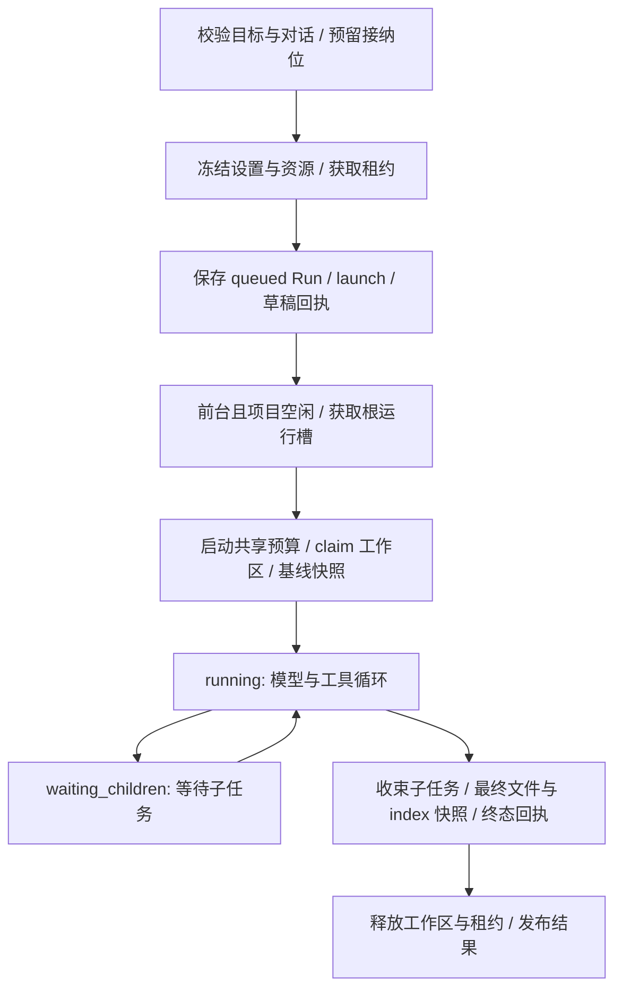

# Agent 执行内核、预算与子任务

## 文档更新历史

| 文档版本 | 更新时间                  | 最新 Git 提交 ID（代码基线）             | 内容变化                                                                          |
| -------- | ------------------------- | ---------------------------------------- | --------------------------------------------------------------------------------- |
| 1.1.0    | 2026-10-16T23:47:05+08:00 | c6cde1a9724a790e02cbe4488d7e00542d5e1d76 | 同步尚未提交源码：主任务与 writer 支持通用 UTF-8 文本，明确内容校验和不执行代码。 |
| 1.0.0    | 2026-10-15T17:24:30+08:00 | 9ad009be8a41df28a02060c5620ee12a29c3d901 | 描述 Pi 边界、运行状态、调度预算、停止语义与隔离提案。                            |

## 1. Pi 与宿主的分工

Pi Agent Core 负责单个 Agent 的请求/消息循环、工具调用和引擎事件。项目归属、持久化、授权、预算、并发、会话、生命周期和中断恢复均由本项目 application 层控制。当前没有使用 Pi 的完整桌面编码 Agent 或 CLI。

[AgentEnginePort](../src/core/agent/engine.ts) 接收平台无关 EngineInput、受控 tools 与请求/工具前置 controls，返回 execute/cancel/可选 continue 的 session。[PiEngineAdapter](../src/adapters/agent/pi-engine.ts) 将 SDK 消息和事件转换为 EngineEvent；application/core 不导入 Pi SDK。

本项目自有三协议 transport，接入 Pi StreamFn；移动端 `pi-ai-mobile` 仅导出上游公开纯工具。替换引擎时应保留请求准入、工具前置检查、终止状态、流式事件和消息帧语义，不能在替换 adapter 后丢掉宿主控制。

## 2. 主要对象

| 对象                              | 责任                                                         |
| --------------------------------- | ------------------------------------------------------------ |
| RunKernel                         | 根运行接纳、排队、前台准入、跨项目调度、取消与故障停派发     |
| RunRepository                     | 当前实体持久化、冻结 launch、摘要/正文查询和同数据库回执     |
| startRun / child-controller       | 根/子任务各自的基线、工具范围、执行与收束                    |
| ExecutionDriver                   | 引擎请求许可、预算预留、工具 effect 校验、截止计时和释放     |
| RunRecorder                       | 增量轨迹、结果与消息帧、界面通知和有失败屏障的写链           |
| GroupBudget                       | 根与后代共享 requests/tools/deadline；子额度分配             |
| RequestScheduler                  | 公平请求池、全局/连接并发和后台暂停派发                      |
| DelegationSession                 | 创建子任务、范围冻结、等待/取消、结果回收和提案服务          |
| ProposalService / ProposalOverlay | writer 私有候选、冻结授权、整批合入与回执恢复                |
| RunResourceFactory                | 运行准备时获取模型/MCP租约、Skills快照和引擎；组合根提供实现 |

## 3. 根任务生命周期

`start()` 在入队后返回，不等执行完成。接纳期间一个对话只能有一个 preparing/queued/running 根任务，准备失败保留草稿并释放资源。

运行时冻结角色、设置、模型、已授权 MCP descriptors 和 Skills 版本。排队期间用户改变模型默认、Key、授权或技能库，也不自动替换该 Run 的输入。文件基线在真正执行时创建，与配置冻结时点不同。

资源 release 幂等；引擎不由 UI effect 拥有。切页面、查看设置或卸载工作台不会取消运行。

## 4. 状态与终止原因

RunState 为 queued、running、waiting_children、cancelling、completed、failed、cancelled、interrupted。前四个是非终态，后四个是终态；数据库拒绝终态再转 running，也拒绝修改冻结归属和输入。

[RunStopController](../src/core/runs/termination.ts) 保存第一个接受的 StopReason。AbortSignal 是停止机制，不是原因；后续引擎 aborted 不能覆盖用户取消或预算失败。

| 原因                                       | 结果                                                                        |
| ------------------------------------------ | --------------------------------------------------------------------------- |
| 正常 stop 且无错误                         | completed                                                                   |
| user_cancel                                | cancelled                                                                   |
| deadline、budget_exhausted                 | failed，保留具体资源/范围                                                   |
| engine_error                               | failed，公开安全错误                                                        |
| ancestor_stopped                           | 记录来源根任务；用户取消/引擎错误继承可为 cancelled，预算/截止继承为 failed |
| app_interrupted                            | interrupted，保留之前原因供追溯                                             |
| length / 不完整结束 / 无宿主原因的 aborted | 视为引擎失败，不显示正常完成                                                |

取消不是文件回滚。已进入关键写入区的操作应完成/恢复必要回执；随后保存最终快照，再释放工作区。任务撤销另走版本冲突检测流程。

## 5. 调度默认值

来源：[defaultSchedulerLimits](../src/core/runs/scheduling.ts)。当前为内核常量，没有 UI 并发设置。

| 项目               | 默认               |
| ------------------ | ------------------ |
| 同时执行根任务     | 2，且同项目仅 1 个 |
| 全局模型请求并发   | 2                  |
| 单连接模型请求并发 | 2                  |
| 待启动根任务       | 16；每项目 4       |
| 单组并行子任务     | 2                  |
| 单组总子任务       | 4                  |
| 最大委派深度       | 1                  |

根任务槽与模型请求槽不同。等待工具或子 Agent 不应长期占着模型请求许可；ExecutionDriver 在 assistant 结束、工具前置与 finally 中释放。RequestScheduler 按任务组轮转，连接达到上限时选择其他可派发请求，避免一个组连续占用全部请求。

## 6. 用户设置与全组预算

来源：[AgentSettings](../src/core/agent/settings.ts)。设置保存带 revision，启动复制并冻结。最终系统提示词是不可通过设置移除的 workspaceSystemRules，加用户 systemPrompt，再按实际资源追加 MCP/Skills/委派说明。

| 可配置限制       | 默认    | 当前允许范围                     |
| ---------------- | ------- | -------------------------------- |
| maxModelRounds   | 50      | 1–200                            |
| maxToolCalls     | 200     | 1–2,000                          |
| maxRuntimeMs     | 20 分钟 | 1–120 分钟                       |
| requestTimeoutMs | 5 分钟  | 5 秒–30 分钟，且不超过任务总时长 |
| historyTasks     | 12      | 0–50                             |

requests 统计真实派发前预留的模型请求次数，不是 UI 消息轮数；tools 统计宿主允许调用前预留的工具次数。根与子任务共同消耗同一 GroupBudget，不能每个子任务复制全量额度。预算入库成功后才派发，失败停止派发；已预留次数不因网络失败自动返还。

子任务分配正整数 requests/tools 配额，分配与 child/receipt 同库原子保存。分配时计入未消耗预留额度，并为父任务保留 2 次模型汇总请求。子任务结束释放未用 allocation；局部子额度耗尽可以收束该子任务，全组耗尽则传播到任务组。

deadline 在根开始执行预算时建立，排队时间不计入运行总时长；运行开始后等待许可、工具和子任务的时间都计入。单请求超时是 transport 约束，不替代组级截止时间。没有金额或 token 费用硬预算，Pi model cost=0 也不是供应商免费。

## 7. 内容硬限制

| 项目                            | 上限/默认                                                             |
| ------------------------------- | --------------------------------------------------------------------- |
| 草稿/目标正文、可配置系统提示词 | 各 16,000 UTF-16 单位；内部目标拼接允许少量引用说明余量               |
| 文本文件 / 一般文件             | 1 MiB / 20 MiB                                                        |
| 转发模型的单张图片              | 4 MiB                                                                 |
| 工具文字输入/处理上限           | 240,000 UTF-16 单位，仍受文件 UTF-8 bytes 限制                        |
| 序列化模型请求 / 模型流响应     | 8 MiB / 4 MiB                                                         |
| 最大输出 tokens                 | 默认 8,192；可设 16–65,536，不能超过已知模型上限                      |
| 单轮模型工具调用                | 32                                                                    |
| 历史上下文选择                  | 最多设置的 historyTasks；字符预算最多 96,000，按 contextTokens 等估算 |

字符预算是启发式，不是真正 tokenizer。历史只投影本对话同模式根任务的 prompt/response，单条分别截至 8,000/12,000 字符，不重放之前的全部工具结果或引擎帧；详见 [对话与轨迹](conversations-and-trace.md)。达到限制时应分段任务/资料，不能只增大界面输入框。

## 8. 工具权限

ControlledTool 必须声明 effect：read、workspace-write、git-index、git-commit、remote-effect 或 delegate。引擎拿到的工具先按冻结 AgentDefinition 过滤，实际工具调用前再次校验并预留预算。

| 内置角色 | 工作区来源            | 允许 effect           | 委派 |
| -------- | --------------------- | --------------------- | ---- |
| main     | root 真实工作区       | 六类全部              | 可   |
| reader   | snapshot 固定资料快照 | read                  | 不可 |
| reviewer | snapshot 固定资料快照 | read                  | 不可 |
| writer   | proposal 私有候选树   | read、workspace-write | 不可 |

文件工具：list_files/read_text/search_text/inspect_image/write_text/delete_file/move_file。write_text 整文件写回 UTF-8 文本，不限扩展名，仍要求当前修订号（创建为 null）；主工作区和隔离提案均在记录操作意图前拒绝含 NUL 或无效 UTF-8 内容，1 MiB 文件与 240,000 UTF-16 工具输入限制继续适用。默认系统提示词允许编写代码和配置，但不授予执行能力。Git：git_status/git_diff/git_stage/git_unstage/git_commit；Skills：load_skill/read_skill_resource；MCP：由冻结目录生成 `mcp_<serverIndex>_<toolIndex>`；委派工具见下文。模型图片工具只有允许图片输入时才提供或转发。

系统提示词、技能 allowed-tools、远程工具说明与子任务返回内容不授予额外 effect。代码级控制与提示约束都要维护，不能只让模型“自行遵守”。

普通工具校验/冲突错误经 defineTool 转为 isError 工具结果，模型可读取错误后调整动作，不一定立即结束整条 Run。派发预算、停止、必要持久化或最终恢复校验失败则由宿主收束；不能将“工具返回错误”和“运行终态失败”混成一个事件。

## 9. 子 Agent 流程

根任务可调用 spawn_agent、wait_agents、get_agent_result、cancel_agent、get_proposal、apply_proposal。

spawn 选内置 role、目标（最多 8,000 字符）、paths（1–64 个）和预算。第一次委派固定本组 inputSnapshotRef，之后子任务共用这一时点的文件快照；不会因父任务后续改资料而悄悄改变已委派来源。

reader/reviewer 的路径须在该快照存在；writer 可包含新的授权 UTF-8 文本路径，包括代码、配置、自定义扩展名和无扩展名文件，也可包含图片路径；只能写文本或移动/删除图片，不能生成图片 bytes 或执行代码。子任务的授权 paths 固定存于 launch，读取、搜索和修改必须在范围内。

子任务使用独立 Pi session、RunRecord 和轨迹，不共享可变 messages。继承父模型/设置/Skills 冻结版本，当前不向子任务传递 MCP runtime、Git 提交工具或再次委派能力。

委派 ID 按 parent + invocation 建立幂等回执，相同调用不重复创建子任务，参数变化则冲突。工具轨迹关联 childRunIds，避免 UI 把无关任务接到当前步骤。

父正常结束但仍需汇总时进入 waiting_children，待所有子任务收束再用同 session continue 汇总；此阶段禁止新增子任务。父停止则传播原因、收束已排队/执行的子任务，不留脱离组预算的后台子任务。

## 10. writer 提案与合入

writer 修改 ProposalOverlay 的 Git candidate，不修改真实 worktree/index/HEAD。每次候选写入先保存 ProposalWrite，再生成私有 checkpoint，再原子更新候选与回执；中断由 ProposalService 恢复。

提案状态为 draft、ready、conflicted、applying、applied、cancelled、interrupted。只有 source Run completed 且提案 ready/conflicted，活跃根任务才可 apply。

合入时在唯一项目队列内对整批 paths 预检：当前文件等于 base 可应用；等于 candidate 表示已满足；不同于二者视为冲突。任一路径冲突则整批不写入，没有自动文本三方合并。合入 operation 带 root owner、child actor、proposalId 与 mergedByRunId，重复 apply 利用同一回执返回。

公开 API 当前只提供提案 preview；Agent 的 get_proposal 返回受限预览，根任务决定是否根据用户目标合入。子任务声称“用户要求”不构成授权。提案合入不自动公开提交，所有已合入路径计入根任务变化和撤销。

## 11. 前后台与重启

原生监听 AppState，Web 监听 visibilitychange。后台暂停根任务启动和模型请求新准入，并保存活跃任务 checkpoint；已经在途的网络/关键写入不保证立刻暂停，也没有操作系统后台保活服务。

进程被杀后不继续原 Pi 会话，不自动重发模型/工具。启动恢复将旧非终态 Run 变 interrupted，并展示已保存内容和回执。用户核对后可发起新任务；这与“无缝断点续跑”是不同能力。

## 12. 验证与扩展入口

[run-kernel.test](../tests/run-kernel.test.ts)、[group-budget.test](../tests/group-budget.test.ts)、[request-scheduler.test](../tests/request-scheduler.test.ts)、[termination.test](../tests/termination.test.ts)、[delegation.test](../tests/delegation.test.ts)、[agent-grants.test](../tests/agent-grants.test.ts)、[pi-request-lifecycle.test](../tests/pi-request-lifecycle.test.ts)、[proposals.test](../tests/proposals.test.ts)。

当前尚无可编辑角色、多层委派、本地推理、自动压缩、费用硬预算或持久后台执行。添加这些能力必须重审授权传播、共享预算、快照来源与恢复状态，不能仅调整数量常量。
