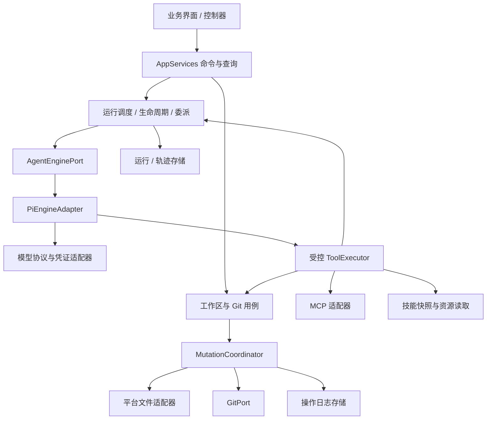
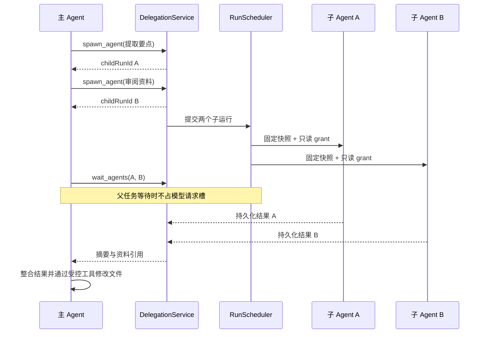

# Agent Mobile 新架构方案

日期：2026-10-14。状态：实施中。R0–R3 已完成；R4–R5 尚未完成。

基线：`42403cf`，现有 React Native / Expo / TypeScript、Pi Agent Core、三类模型协议、远程 MCP、Agent Skills 和真实 Git 工作流。基线已通过 130 项单元测试和 35 项浏览器回归；这些结果不代表本文提出的多 Agent 能力已通过验证。

本文定义后续重构与扩展的架构目标；当前实施状态仍以 [design.md](design.md) 第 2 节和 [validation.md](validation.md) 为准。文件版本语义延续 [git-workflow.md](git-workflow.md)，MCP 与 Skills 的现有兼容范围分别见 [remote-mcp.md](remote-mcp.md)、[agent-skills.md](agent-skills.md)。

## 1. 目标与决策

本次整理解决三个问题：界面与执行实现耦合、多个职责集中在大模块、现有单任务调度无法表达父子 Agent。保留现有技术栈和已验证的文件/Git 语义，分阶段迁移；本次设计不要求更换 Pi、Git 后端或同时重建数据库。

| 决策 | 方案 | 原因 |
| --- | --- | --- |
| 执行引擎 | 每个运行实例使用独立 Pi Agent，Pi 留在适配层 | 复用模型/工具循环，宿主掌握任务编排与权限 |
| 多 Agent | 多个运行实例，由应用调度器管理 | 独立上下文、模型、状态与取消，不依赖操作系统子进程 |
| 子 Agent 首阶段 | 一层委派、固定输入快照、只读本地资料、结果回传父任务 | 并行分析与单一工作区写入可以共存 |
| 项目写入 | 同一项目只允许一个根任务持有修改租约 | 保持 index、HEAD、用户改动保护与整次撤销的一致性 |
| 不同项目 | 可并发根任务，共享全局请求配额 | 文件隔离，仍需控制移动端内存、费用与服务限流 |
| 子 Agent 写作 | 先返回建议/内容，由父 Agent 修改文件；后续增加隔离提案 | 子 Agent 的产出需要确定基线和合入规则 |
| 状态来源 | Git 管理文件历史与内部快照；SQLite 管理运行树与业务元数据；Zustand 保存 UI 状态 | 保持现有存储约定 |
| UI / 网页扩展 | 通过应用命令与受控能力访问资料 | 多 Agent、IntelligentUI 和网页使用同一权限边界 |

首阶段不包含同项目多个根任务同时写入、任意递归委派、跨设备调度、手机常驻后台执行、shell/脚本执行或自动续跑中断任务。

## 2. 当前结构与主要调整

基线是全局单一 TaskManager → startAgent → 新建 Pi Agent；当时 TaskManager 只保存一个 active 与 cancellation，runner、WorkspaceService 与工作台 hook 各承担多个职责。R0–R2 已将实际入口切为 RunKernel → RunController → PiEngineAdapter；下表记录基线模块的迁移方向，实施细节见第 15 节。

| 现有模块 | 迁移后的责任 |
| --- | --- |
| adapters/runtime.ts | bootstrap 中组装依赖与启动恢复；对界面仅提供 AppServices |
| adapters/agent/task-manager.ts | application/runs 中的调度、运行控制、租约与生命周期 |
| adapters/agent/runner.ts | PiEngineAdapter、工具绑定、上下文构建、预算拦截、轨迹记录分别负责 |
| adapters/workspace/service.ts | WorkspaceCommands/Queries、GitService、RunSnapshots、MutationCoordinator；保留统一项目队列 |
| core/prototype/types.ts | 按 projects/workspace/git/runs/trace 分配正式类型；旧 DTO 留在兼容模块 |
| features/workbench/use-workbench.ts | 项目/对话、编辑器、任务、Git 控制器和工作台组合入口 |
| features/workbench/ui、theme、icons | shared/ui 与 shared/theme，供所有功能界面使用 |
| model/protocols.ts | chat-completions、anthropic、gemini 各自编码/解析；共享 HTTP/SSE 管线 |

模块名代表职责，不要求每个职责都变成一个类。小模块可以先合并实现；接口围绕真实调用者定义。现有未进入执行路径的 WorkspacePort、AgentRun、ModelPort 等需要核对后替换或移除，不再维护两套不同的运行概念。

## 3. 分层与目录

```text
src/
  app/                       Expo Router 路由与页面入口
  bootstrap/                 平台选择、依赖组装、恢复、AppServices provider
  core/
    projects/ conversations/ agents/ runs/ trace/
    workspace/ git/ models/ mcp/ skills/ storage/
    legacy/                  旧类型与格式识别，仅供迁移和兼容读取
  application/
    projects/ conversations/ settings/
    runs/                    调度、执行控制、上下文、委派、预算、轨迹
    tools/                   工具策略、执行协调、标准结果
    workspace/               文件与 Git 用例、项目写入协调、运行快照
    models/ mcp/ skills/      配置用例、诊断、运行资源租约
    recovery/                启动恢复与问题报告
  adapters/
    agent/pi/                Pi 实例、消息转换、工具绑定、事件映射
    model/                   三协议、HTTP、SSE、目录与检测
    git/ storage/ io/ mcp/ skills/
    lifecycle/               前后台、网络和平台生命周期
  features/
    workbench/ conversations/ agents/ runs/ git/
    model-config/ mcp/ skills/ agent-settings/
  shared/
    ui/ theme/               通用界面组件与外观
```

依赖方向：core 不依赖其他业务层；application 只依赖 core 定义的规则和端口；adapters 实现端口并封装第三方/平台库；features 通过 AppServices 和查询 DTO 调用 application；bootstrap 负责组装。app 只处理路由与页面挂载。共享 UI 不依赖任何业务 feature。

通过 ESLint 检查导入边界：core/application 禁止 React、Expo、Node、Pi SDK 和原生库；features 禁止访问存储、Git、凭证与 Pi 实现。界面中的 Expo Image 等展示库可以继续使用。AppServices 不包含 fs、metadata、credentials、git 实例或底层 SDK 客户端。



application 内发出业务事件，界面按项目/对话/rootRunId 订阅。事件用于状态通知；持久化命令仍调用明确的服务方法，不依赖广播事件完成关键事务。

## 4. 业务实体与运行模型

必须分开项目、对话、Agent 定义和运行实例：

| 实体 | 生命周期与责任 |
| --- | --- |
| Project | 共享文件、Git、项目授权；包含多个独立对话 |
| Conversation | 用户消息、草稿、附件、模型选择；只展示根任务的交互 |
| AgentDefinition | 可复用角色配置：名称、说明、指令、模型策略、工具上限、Skills、委派策略；有 revision |
| Run | 一次执行实例；独立模型上下文、预算分配、状态、快照、轨迹与取消 |
| RunGroup | 一个根运行及其后代；共享截止时间、总预算、项目写入归属与结果收束规则 |
| ToolExecution | 工具调用意图、执行回执与副作用状态；归属于具体 Run |
| FileOperation | 文件/index/commit 的恢复日志；记录根任务归属与实际执行者 |
| ChangeProposal | 后续阶段的隔离文件提案；包含输入基线、候选树、路径和审核/合入状态 |

逻辑类型示意，字段名称在实施时与兼容 DTO 对齐：

```ts
type RunState = 'queued' | 'running' | 'waiting_children' | 'cancelling'
  | 'completed' | 'failed' | 'cancelled' | 'interrupted';

interface RunRecord {
  schemaVersion: 2;
  id: string;
  rootRunId: string;
  parentRunId?: string;
  projectId: string;
  conversationId: string;
  kind: 'root' | 'child';
  agentDefinitionId: string;
  agentDefinitionRevision: number;
  depth: number;
  state: RunState;
  inputSnapshotRef: string;
  launchSnapshotRef: string;
  createdAt: string;
  deadlineAt?: string;
}
```

rootRunId 是任务组 ID，也对应用户看到的一次任务；每个 child 有自己的 id。对话历史只带入根任务的用户目标/最终答复。子 Agent 的原始 transcript 单独保存，结果通过明确回执回传；不自动复制父对话或将子任务显示成用户发送的新消息。

LaunchSnapshot 保存启动时的 Agent 定义、模型参数、系统提示词、工具授权、Skill 版本与预算。运行中的配置修改只影响新根任务；子任务从父任务冻结的能力集合中取子集，不因项目后来新增授权而扩大权限。

根请求入队时冻结这些执行配置并持有必要的凭证/资源租约，取消排队也释放租约；文件基线与对话上下文在实际开始时获取。排队期间前一个任务可能修改资料，界面明确展示实际开始基线，不能用入队时的旧 revision 静默覆盖。队列不是已开始的模型执行，不预占请求槽。

根任务模型选择延续现有会话 → 项目 → 全局规则。子任务默认继承父任务冻结模型，也可使用允许委派的 AgentDefinition 指定模型；另一模型的上下文/图片能力仍独立校验。宿主规则、用户设置与角色说明组合为执行指令，配置中的指令不能扩大工具权限。

AgentDefinition 与 Skill 分开：定义决定角色和可申请能力，Skill 是可按需加载的知识/流程。内置主 Agent 兼容现有全局设置；首阶段只需内置角色和固定版本引用，角色编辑器可后续实现。

## 5. 执行引擎、工具与宿主控制

AgentEnginePort 负责创建执行实例、流式输出标准事件、接受宿主控制消息、取消和释放资源。PiEngineAdapter 负责 Pi 的消息/工具格式与生命周期。模型协议适配器保留 thinkingSignature、thoughtSignature 等必要回传数据；这些属于内部 transcript，不进入界面事件 DTO。

RunController 负责一次 Run 的上下文、权限、资源租约、事件记录与终态。RunScheduler 负责资源准入和排队。DelegationService 负责父子关系和结果回传。引擎不负责数据库恢复、项目写锁、全局配额或创建用户对话。

资源由单一运行资源管理器持有，释放可重复调用；成功、启动失败、取消与保存失败都经过同一清理路径。根任务的会话租约覆盖整组，子任务不会再获取一个排他的会话运行租约；模型/MCP 资源按实际使用的 Run 隔离，子结束不释放父资源。

工具按 workspace/git/mcp/skills/delegation 分组定义。ToolRegistry 声明参数 schema、权限和副作用类型，ToolExecutor 统一做参数校验、grant 校验、预算预留、取消检查、幂等记录及错误清理，Pi 层只负责格式绑定。副作用分类至少区分：read、workspace-write、git-index、git-commit、remote-effect、delegate。

凭证由宿主适配器持有。应用层持有不透明租约句柄，模型与 UI 只得到不含密钥的配置快照；lease 释放由资源管理器统一保证。Pi、MCP 和传输层的原始错误经标准 AppError 转换，包含稳定错误码、可展示消息、结果是否未知，不向界面/模型泄露设备路径或响应正文。

## 6. 多 Agent 调度与资源限制

区分三个资源：存活的逻辑运行、正在发送的模型请求、项目修改租约。父 Agent 等子任务时仍存活且保留项目租约，但释放模型请求槽；调度器不能让父任务占住所有槽再等待排队的子任务。

首阶段建议默认值，实施后按设备与服务验证调整：

| 项目 | 默认策略 |
| --- | --- |
| 活动根任务 | 全局最多 2 个；不同项目；同一对话最多 1 个 |
| 同项目根任务 | 1 个持有修改租约，其余 queued；单写模式先保持 |
| 并发模型请求 | 全局 2 个；供应商连接单独设上限，取更小值 |
| 每根任务并发子任务 | 最多 2 个 |
| 每根任务子任务总数 | 最多 4 个，防止依次创建绕过并发限制 |
| 待启动根任务 | 全局最多 16 个、每项目最多 4 个；超出时保留用户草稿，不持有新租约 |
| 委派深度 | 1；首阶段子 Agent 没有委派工具 |
| 任务预算 | 沿用根任务设置，覆盖全部后代；子任务只获得其中一部分 |
| 前后台 | 前台运行；切后台记录状态并限制新派发，不承诺持续执行 |

root 接受请求后先持久化 queued；取得项目租约后保存工作区/index 基线并开始运行。子任务排队不提前占用网络槽。公平队列在任务组间轮转，避免一个任务的子 Agent 持续占满请求容量。供应商退避时释放请求槽，不持有项目 mutation 队列；项目租约是否继续持有由任务生命周期规则控制。

BudgetService 在派发前原子预留一次模型请求/工具额度，统计整组实际使用。根任务总轮数、工具次数和截止时间不会因增加子任务而翻倍；默认仍为 50 次模型请求、200 次工具调用、20 分钟组运行时间。根 deadline 从实际开始起算，子任务的排队、执行和等待都不能延长它。子任务创建前检查剩余额度和数量上限；输入大小也沿用现有每请求限制。

委派时为父任务的结果汇总保留请求额度，默认保留 2 次；剩余额度不足以同时覆盖子任务和汇总时拒绝新增子任务。该保留量计入总上限，不另送额度。预算耗尽时停止新派发并保留部分结果，不能为了完成汇总突破用户设置的上限。

供应商返回 usage 时记录总 token；未返回时标为未知，保守按最大输出预留可选 token 额度。金额只是按价格配置估算，不能承诺精确余额控制。共享 token 硬预算、动态内存预算与计费统计在预算模块具备实际测量后再开放，不能把多 Agent 的运行轮数上限称为精确 token 限额。

## 7. 子 Agent 的委派协议

首阶段提供受控工具：spawn_agent、wait_agents、get_agent_result、cancel_agent。UI 也使用同一 DelegationService 查询子任务；子 Agent 不出现在其他独立对话的消息历史中。

spawn_agent 输入只包含允许的角色 ID、目标、选定资料范围及受限预算。宿主验证后持久化子 Run，返回 runId 并立即结束该工具调用；不会在工具内一直等到子任务完成。这样即使父 Agent 的工具循环串行，也能先创建两个子任务，再调用 wait_agents 等待并行结果。

每次委派记录稳定的宿主 invocationId，并关联父 runId/轮次/toolCallId；同一次调用的重试返回已有子 runId，不产生第二个子任务，参数指纹不匹配则报冲突。子记录和创建回执使用同一个元数据事务，再加入执行队列；不同调用创建相似目标不视为同一次委派。wait_agents 是可取消的有界等待，返回完成集合与其余状态；get_agent_result 读取持久化结果，返回摘要、资料引用、警告和终态。仅允许操作当前任务的后代，模型不能传任意 runId 读取其他对话。

子任务上下文由明确目标、角色说明、输入快照与选定资料组成。每个子任务有自己的 transcript、Skill 激活集合和模型请求状态。图片只在子模型具备能力并开启输入时传入，不盲目继承父上下文中的图片/base64。

首阶段本地文件只读；Git 暂存/提交、文件写入、委派和远程副作用工具不进入子任务工具集。MCP 默认不继承；需要开放的工具必须同时在项目授权、父运行授权和宿主认可的只读策略中。远端 readOnlyHint 是声明，不能单独作为安全依据。父/子 Agent 的文字输出和工具返回都是内容，不能替代宿主授权。



## 8. 权限、快照与项目并发

权限分三层：用户/项目允许的能力 → 根任务冻结 grant → 子任务缩小的 grant。工具是否可用由执行时校验决定，不靠系统提示词或模型自律。grant 由宿主生成并与 Run 绑定，模型不能自报 owner、写入者身份或权限 token。

根任务持有项目修改租约。读取当前工作区的 UI 通过项目队列获取一致快照；文件/index/HEAD 修改通过同一个 MutationCoordinator 串行执行。子 Agent 读取委派时捕获的不可变 Git 检查点，固定快照读不必争抢当前工作区的修改租约。

同一批分析子任务应共享同一个输入 snapshotRef；父任务在准备阶段捕获并复用，避免两个子任务分析不同文件版本。子任务结果携带对应快照与文件 revision。父任务应用建议时仍读取当前 revision；快照中的旧版本不是覆盖当前文件的授权。

同项目其他根任务默认等待当前根任务收束。独立只读根任务并发可后续开放，需要显式声明只读，不能通过不调用写工具来推断。用户在活动写任务期间继续阅读/准备草稿，保存文件与 Git 写操作延续当前项目写锁规则。

MCP 的重复检查与 dispatched 意图由共享 RemoteDispatchCoordinator 协调，防止多个运行同时检查后都发送同一副作用。端点/工具/规范参数指纹的在途或 unknown 调用形成重发屏障；不同运行不能绕过。结果未知是工具回执状态，不自动等于 Run 还在执行；取消或结束任务也不清除这个屏障。

## 9. 文件、Git、提案与撤销归属

保存不自动提交，真实 index 与 HEAD 的语义保持不变。内部快照继续位于宿主私有 Git 引用，不作为普通提交历史或模型可访问路径。

FileOperation 增加 ownerRootRunId 与 actorRunId；旧 runId 保留兼容读取。前者用于整组差异/撤销和修改租约，后者用于责任归属与子任务轨迹。首阶段写入者只有父 Agent，因此两者一致；后续合入提案时记录提案来源子 Agent 和实际执行合入的根任务。

根任务开始捕获 HEAD、工作区与 index，结束从整组 recorded 操作得到实际涉及路径与净变化。任务前已有未提交内容保留；Git 工具继续只暂存/提交本组修改、且根任务开始前工作区/index 都与 HEAD 相同的路径。子 Agent 不操作真实 index，不自动生成用户提交。

整次撤销以根任务基线为准，包含所有已经合入的子任务提案，校验相关路径的最终工作区/index；无关路径和公开提交历史保留。未合入提案不属于项目文件变化；可撤回提案。首阶段不提供已经合入子任务的独立撤销，以免破坏父任务后续编辑。

后续写入子 Agent 使用宿主管理的 overlay 与候选 Git 树，读基线快照，写候选内容，不直接改项目文件。ChangeProposal 保存 baseSnapshot、候选树、路径、来源 Run 与状态；Blob/候选树由私有引用锚定，SQLite 仅保存元数据。提案范围不得超过原 grant。

首个提案合入版本按文件处理：当前等于基线则应用候选；候选等于基线则忽略；当前等于候选则视为已满足；其余为冲突。删除、重命名与图片也校验基线，不自动覆盖。整批预检成功后写入可恢复操作意图，再由 MutationCoordinator 应用；冲突保留提案，由父 Agent 重新读取/重新生成或由用户处理。文本自动三方合并属于更后续能力。

隔离写入并不要求首阶段引入原生 Git worktree 或多个 index。overlay/候选树适合现有 VFS 接口；未来 libgit2 替换仍只影响 GitPort 实现。

## 10. 轨迹、结果和前端状态

RunEvent 至少包含 runId、rootRunId、parentRunId、runSequence、事件类型与时间。TraceRecorder 统一写入；单 Run 按递增序号排序，整组展示序号由根组记录队列分配，并保留父子关联。时间戳用于显示，不能用跨运行时间戳排序替代因果关系。

事件包括文字/公开推理增量、工具开始/结果、子任务创建/状态、预算耗尽、提案与运行终态。UI 在父任务的委派节点下显示可折叠子轨迹，保留服务公开推理的既有展示规则。用户主消息流仍显示根任务最终结果；运行列表可按项目查看多个活动根任务，取消动作必须明确带 runId。

界面查询 DTO 不包含凭证、绝对路径、opaque 签名或原始 SDK 对象。React hooks 负责订阅/派发命令、表单草稿、编辑器状态；不会自己协调 Git 与元数据事务。任务数据由运行仓库负责，Zustand 不承担持久化业务状态。

流式增量仍可约 200ms 合并保存；工具派发意图、子任务创建和终态必须可靠持久化。UI 可以展示尚未持久化的流式文字，但完成状态在终态落库后发布，避免已经显示完成却在重启后仍是 running。AppServices 以查询快照配合变更订阅，控制器使用请求序号/生命周期丢弃陈旧读取。

## 11. 取消、终态与中断恢复

取消根任务会递归取消后代，移除未派发请求，向进行中的模型/MCP 调用发出 AbortSignal。文件/index/commit 已进入持久化临界阶段时先完成或留下恢复日志，再释放项目租约。取消子任务只影响对应子树；父任务得到明确结果，可决定继续、换一种分析或结束，不能偷偷重试 unknown 远程副作用。

父引擎给出最终文字时，若仍有活动后代，内核不能发布整个任务组 completed。父运行进入 waiting_children；后代收束后将结果交回父引擎进行汇总，或父任务明确取消不需要的后代再结束。子任务失败不必自动使根任务失败，但结果与最终答复必须保留失败/缺失事实。组完成前所有后代都要终态，避免孤儿运行继续消耗资源。

根任务终态顺序：收束后代并完成父任务汇总/最后修改 → 确认已派发工具与本地操作回执状态 → 保存整组最终结果/工作区/index 快照及轨迹 → 持久化终态 → 释放运行资源 → 发布完成状态。内部回执失败阻止完成状态；本地已成功操作依旧由操作日志恢复。子结果也先落库再通知父任务，不能提前计算根任务最终快照。

启动恢复按以下次序执行，期间不派发新模型或远程请求：

1. 打开存储，执行可重入元数据迁移，恢复配置/凭证操作意图。
2. 恢复项目与技能库文件/index/commit 日志，冻结存在未知本地状态的项目。
3. 将遗留 MCP dispatched 收束为 unknown，保留跨任务重发屏障。
4. 从 recorded 操作和自己的最后检查点重建父子结果，按子到父收束非终态；已完成子结果保留。
5. 非终态运行标为 interrupted/明确取消，报告恢复问题，发布可读取状态并开放无问题项目。

不把数据库 running 当成仍有引擎在内存中，也不自动重放旧模型、spawn 或 MCP 请求。首阶段“继续”表示以已保存结果发起新运行；恢复原 Pi transcript 的自动续跑单独设计，尤其需要处理签名、队列与未知副作用。

移动端以前台运行作为能力基线。后台事件持久化运行树、预算与取消意图，限制新请求派发；若 OS 冻结/终止进程，重开按上述恢复。多 Agent 不意味着多个原生服务；未来后台执行通过独立 LifecyclePort/原生模块接入。

## 12. 存储端口与旧数据迁移

用 ProjectRepository、ConversationRepository、RunRepository、TraceRepository、OperationJournal 等类型化端口替代界面和用例直接使用 metadata.all/get/put。提供按项目、对话、rootRunId 和游标查询；读取列表不加载全部 transcript。必要的索引与分页由适配层实现。

首阶段保留 records 表与现有文件布局。应用实体增加 schemaVersion；仓库/轨迹结构使用单独版本，不将业务 JSON 版本等同于 SQLite 表版本。需要多记录一致性的纯元数据操作通过存储事务端口实现（SQLite 事务 / IndexedDB transaction）；它不覆盖 Git、文件和 SecureStore。

迁移采用添加新记录与兼容读取：

- 旧 TaskRecord 映射为 kind=root、rootRunId=id、无 parentRunId，保留原 id、conversationId、快照、公开历史和旧轨迹。
- 新 Run 保存到版本化记录命名空间；迁移时先提交目标及索引，再记录迁移完成标记。重试按同一 id 幂等，不重复创建任务。
- 读取优先使用已迁移目标，未迁移记录通过兼容投影展示；新执行只写新格式，避免两套运行状态互相覆盖。
- 旧 Operation 无 ownerRootRunId 时以 runId 作为根归属；缺失 kind 的自动提交恢复继续保留。既有 Git 提交不改写。
- 缺失的 Agent 定义/公开推理/模型证据显示为兼容默认或未知，不伪造旧记录。旧 ModelSettings 仅留在迁移模块，运行入口统一配置快照。

保留旧记录直到迁移和导出/备份策略明确；迁移失败保留来源。暂不同时实施全文搜索、规范化全部 SQL 表、GC 和大仓库优化。引入这些能力时由仓库端口隔离变化。

## 13. IntelligentUI 与网页接入点

IntelligentUI 采用带 schemaVersion 的受限声明式组件树，动作只引用已注册 application action ID。ActionDispatcher 复用参数校验、能力授权、项目队列与结果事件；渲染和页面重建不触发副作用。调用模型的动作进入 RunScheduler，不能绕过运行预算创建隐形 Agent。

网页阶段通过 ResourceResolver 映射允许的项目快照资源，通过 SandboxBridge 将请求转换为同样的 application 命令。网页能力按页面实例、项目、动作范围、有效期和请求 ID 绑定；导航/销毁撤销。桥接不提供 Runtime、原生路径、Git、SQLite 或密钥。静态页面、声明式 UI 与 JavaScript WebView 沙箱仍是分别验收的阶段；网络隔离与平台审核不由这次代码分层自动解决。

## 14. 分阶段实施与验收

| 阶段 | 工作 | 验收门槛 |
| --- | --- | --- |
| R0：边界与类型 | 类型归位、AppServices、bootstrap、导入检查、共享 UI；保持单任务行为 | 原有测试通过；界面不再访问底层存储/Git/凭证；旧项目可读 |
| R1：职责拆分 | 拆工作台控制器、Pi 工具/事件、工作区命令/查询/恢复；统一配置快照和错误 | UI 行为保持；传统 Git、MCP unknown、Skills 固定版本回归通过 |
| R2：运行内核 | Run/RunGroup、类型化仓库、共享预算、调度器和迁移；先保持一个根任务 | 生命周期与迁移失败注入通过；terminal 落库后才发布；无泄漏租约 |
| R3：只读子 Agent | 委派工具、固定快照、父子上下文/轨迹/取消；一层最多两个并发子任务 | 父等待不占请求槽；子无写/Git/未授权 MCP；重复 spawn 不重复创建；整组预算不放大 |
| R4：不同项目并发 | 两个项目根任务并行、公平队列、限流与多运行 UI | 文件/消息/凭证租约隔离；单独取消；共享 MCP 重发屏障不会竞态；Android 进程终止恢复 |
| R5：写入提案 | 子 overlay、候选树、提案预检与可恢复合入、组级差异/撤销 | 子不碰真实 index；冲突保留；合入中断可恢复；不夹带用户改动 |

R0/R1 每次只迁移一个职责，使用临时兼容 facade 保持调用者工作。先把现有真实行为落实到接口，再移除旧接口。R2 之后才启用新执行功能；不把整理目录与多 Agent 的行为变化放在同一个无法定位回归的改动里。

每个阶段运行 npm run check，并运行受影响的浏览器流程。持久化、权限、恢复和调度变更需要相应失败注入与 Android 验证；JS/Hermes 导出覆盖 Android/iOS，iOS 原生与 arm64 真机另列实际验证结果。测试验证行为不变量，不为简单文件拆分增加镜像测试。

关键新增测试：请求并发上限和父等待无死锁、全组预算原子预留、双子任务重复 spawn/取消竞态、同项目写租约、不可变快照、终态前崩溃、未知 MCP 跨运行屏障、元数据迁移断点，以及子提案合入/根任务撤销。演示模式保持显式预设，子 Agent 闭环使用本地协议模拟服务；不能把预设输出当成真实模型的规划能力证据。

## 15. 本轮范围与后续

R0 已完成：正式领域类型归位；bootstrap 组装入口与运行时真实裁剪的 AppServices；界面文件/Git/配置/导入导出通过该入口；平台错误清理；共享组件/主题/状态归位；ESLint 分层限制；未使用的早期契约移除。旧任务/轨迹保留兼容导出，不迁移存储数据。

R0 验证：npm run check 通过（134 项测试，包含真实 facade 权限边界与导入限制）；35 条浏览器回归通过；Web 与 Android/iOS JS/Hermes 导出通过。

R1 已完成：WorkspaceApplication 组合 Reader/FileCommands/GitService/RunSnapshots/MutationCoordinator，共享唯一队列与日志；编码由 ContentCodec 端口提供。模型/MCP/Skills/对话/Agent 设置用例迁入 application。工具按四组注册并标注副作用；PiEngineAdapter 只负责 SDK 绑定与事件映射，应用 RunController/RunRecorder/上下文/预算独立。三协议请求编码与流解析拆分。工作台拆出数据订阅、编辑器、Git 和草稿控制器；修复未保存确认后原导航被 busy 锁丢弃的问题。终态落库、释放项目租约后才发布完成，初始任务视图不再引用内部可变任务。

R1 验证：136 项测试、36 条浏览器回归、三平台导出通过。Android API 36.1 x86_64 隔离模拟器完成 Git/index/工作区与回执恢复、两代 MCP/未知回执、Skills 自动/明确加载与版本更新流程；SQLite 和标准 Git 仓库核对通过。R1 未启用多 Agent。

R2 已完成：实际启动、历史、草稿回执和恢复接入 RunKernel/RunRepository，新任务只写 runs-v2；旧 tasks 保留来源并迁移索引、轨迹、transcript、启动证据。配置/凭证资源入队冻结，实际开始捕获文件/index 基线；对话独占、队列上限、前后台准入、取消准备中/排队/启动中任务与统一资源清理已接入。RunGroup 持久化请求/工具预算与截止时间，Pi 每轮请求使用公平资源池，模型返回后、工具执行前释放请求槽。进度不能覆盖取消/终态，终态及轨迹原子保存、资源释放后才向 UI 发布完成；保存故障停止派发并等待重启恢复。

R2 验证：152 项测试、36 条浏览器回归通过；Web 与 Android/iOS JS/Hermes 导出通过。Android API 36.1 x86_64 完成实际 v2 演示任务/预算/transcript、编辑与强制停止持久化、SQLite 迁移批次中途异常的整批回滚/重试、父子/排队记录收束、草稿回执恢复与无工具重放验证。父子记录恢复使用合成运行树，未宣称子 Agent 执行已实现。实际仍限制一个活动根任务；旧 TaskManager/startAgent 仅为现有直接调用测试提供兼容路径。R3 委派/权限/子预算分配与 R4–R5 继续实施。

R3 已完成：主运行接入 spawn_agent/wait_agents/get_agent_result/cancel_agent；内置 reader/reviewer 使用独立 Pi 实例、上下文、transcript 和 Skill 加载集合，继承根任务冻结模型。首次委派捕获并复用固定 Git 输入快照；文件路径精确授权，工具只有快照/Skill 读取，没有工作区写入、Git、MCP 或再委派。子记录、预算分配、稳定 invocation 回执与父轨迹链接同批提交，重试不重复创建。最多并行 2 个、总计 4 个；子限额属于整组额度，并保留父汇总请求。父引擎先结束时，由宿主等待后代并在原 Pi 上下文继续汇总；失败、取消和中断保存公开结果。UI 在委派节点下折叠子轨迹，可定向停止子任务；轨迹项保存宿主 run/root/parent ID 与运行内、组内序号。根任务只在所有后代收束后保存最终快照/终态。

R3 验证：156 项测试通过；37 条全量浏览器回归与两个委派专项流程通过（共 38 个独立流程，覆盖自动汇总、显式 wait_agents 和 UI 定向取消）。Web 与 Android/iOS JS/Hermes 导出通过。Android 隔离模拟器通过实际两子 Pi 并行、固定共享快照、请求并发不超过 2、持久化汇总、根递归取消、强制进程终止恢复；使用本地无认证协议 fixture。此阶段只开放两种内置只读角色；writer、模型角色编辑器与多个根任务并发未开放。

当前继续沿用 isomorphic-git、SQLite/IndexedDB、SecureStore、Pi 与现有三协议；libgit2、后台执行、独立角色编辑器、token/费用硬预算、上下文自动压缩、提案自动合并、仓库导出/GC 与网页沙箱分别列为后续能力，按实际需求和设备验证推进。
