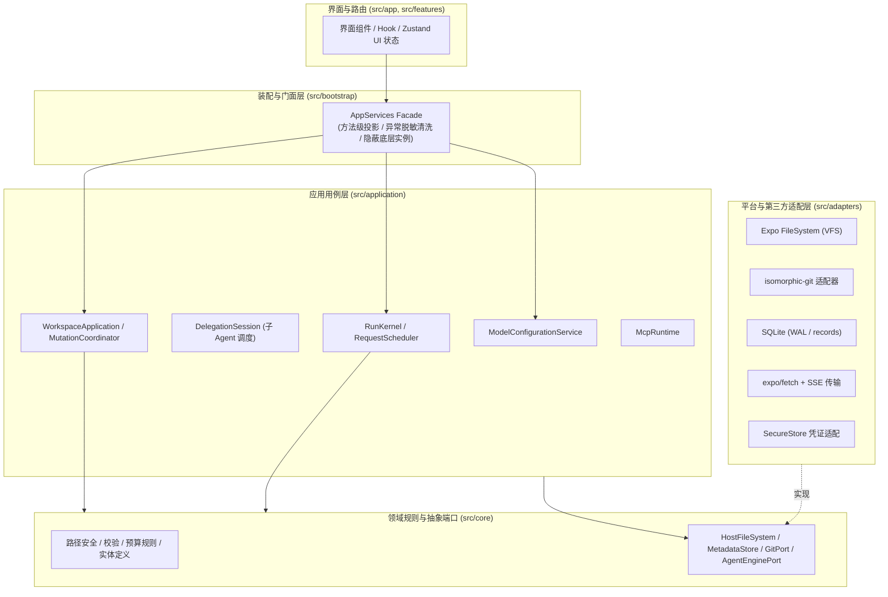
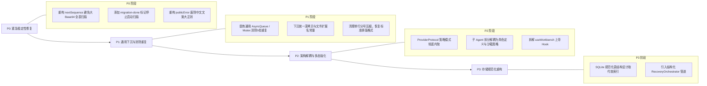

# Agent Mobile 项目全面代码审计与架构质量综合报告

**报告日期**：2026-10-14  
**项目版本**：`0.1.0` (Expo SDK 57 / React Native 0.86.3 / TypeScript 6.0.3 strict)  
**审计基线**：全套 22 个测试套件 (165 项测试全部通过)，ESLint 规则与 TypeScript 静态检查零报错。

---

## 目录
1. [执行摘要与审计综述](#一执行摘要与审计综述)
2. [架构设计与分层规范评估](#二架构设计与分层规范评估)
3. [安全性、沙箱防护与凭证隔离审计](#三安全性沙箱防护与凭证隔离审计)
4. [并发、存储事务与崩溃恢复机制](#四并发存储事务与崩溃恢复机制)
5. [关键性能隐患与资源瓶颈（重点关注）](#五关键性能隐患与资源瓶颈重点关注)
6. [架构缺陷与代码坏味道深度分析](#六架构缺陷与代码坏味道深度分析)
   - [6.1 相同功能的多重实现](#61-相同功能的多重实现)
   - [6.2 不必要的向前兼容与历史包袱](#62-不必要的向前兼容与历史包袱)
   - [6.3 特化设计而非通用模块（抽象反模式）](#63-特化设计而非通用模块抽象反模式)
   - [6.4 硬编码与魔法数值](#64-硬编码与魔法数值)
   - [6.5 工程实践与编码坏味道](#65-工程实践与编码坏味道)
7. [演进重构建议与优先级路线图](#七演进重构建议与优先级路线图)
8. [综合评分与最终结论](#八综合评分与最终结论)

---

## 一、执行摘要与审计综述

**Agent Mobile** 定位为“手机端本地 Agent Harness”，将应用私有文件工作区、受控 Git 版本控制、SQLite 业务元数据、Pi Agent Core 执行引擎、远程 MCP 工具以及多角色子 Agent 委派系统深度结合。

经过全面深入的代码审计，本项目展现出**出色的软件工程架构水准与防御性设计意识**：
- **边界清晰**：严格执行洋葱架构/六边形架构，`src/core` 纯逻辑零外部依赖，`src/bootstrap` 通过真实裁剪的 Facade 隔离平台能力，静态边界由 ESLint AST 与自动化测试强制保障。
- **安全完备**：路径规范化与遍历拦截（`safePath`）、Zip Slip 防护、YAML 实体爆炸防御、凭证短期租约与子 Agent 隔离候选树（Proposal Tree）均达到工业级水准。
- **容灾健壮**：清醒认识到文件、Git 与 SQLite 之间不具备分布式事务，通过可重入的操作日志（Operation Journal）实现启动自愈。

但在高强度的多轮原型演进（R0–R5）中，系统也累积了明显的**重构债务与代码坏味道**：
1. **性能地雷**：`metadata.all('operations')` 在计算序列号与恢复时全量反序列化大文件 Base64，极易引发移动端 OOM 崩溃。
2. **重复造轮子**：9 处独立手写的排他异步队列、5 处深拷贝与冻结逻辑。
3. **特化反噬**：在关系型 SQLite 上硬造单表 KV，导致业务层手写倒排“软索引”；子 Agent 与三个写死角色二元强绑定。
4. **编码坏味道**：基于 40+ 中文词汇正则的异常过滤、322 处单行密集多语句压缩、56 处非空断言级联以及 80+ 属性的“上帝 Hook”。

---

## 二、架构设计与分层规范评估

### 2.1 分层职责与依赖倒置 (Clean Architecture)

系统严格按照如下分层组织，并在 [`eslint.config.js`](file:///f:/ReactProject/AgentMobile/eslint.config.js) 中配置了 `no-restricted-imports` 强制校验，由 [`tests/architecture-boundaries.test.ts`](file:///f:/ReactProject/AgentMobile/tests/architecture-boundaries.test.ts) 进行持续回归验证：



- **`src/core`**：纯领域逻辑，不导入 React、React Native、Expo、Node.js 原生库或 Pi Agent Core SDK。
- **`src/application`**：编排平台无关用例，仅依赖 `core` 接口与规则。
- **`src/adapters`**：封装平台与第三方依赖，抹平 Android、iOS 与 Web 平台差异。
- **`src/bootstrap`**：装配各模块，通过 [`createAppServices`](file:///f:/ReactProject/AgentMobile/src/bootstrap/facade.ts#L36) 构造真实对象投影的只读 Facade，杜绝 UI 直连存储、Git 或底层 SDK。

---

## 三、安全性、沙箱防护与凭证隔离审计

### 3.1 路径穿越防御 (Path Traversal)
- **实现位置**：[`src/core/workspace/path.ts`](file:///f:/ReactProject/AgentMobile/src/core/workspace/path.ts) 中的 `safePath`。
- **安全检查点**：
  - `input.normalize('NFC')`：统一 Unicode 字符，防止规范化绕过。
  - 正则 `/[\\:\u0000-\u001f\u007f]/`：严禁反斜杠、盘符冒号（`C:`）及所有不可见控制字符。
  - 阻断以 `/` 开头的绝对路径。
  - 分段核对：拦截空 part、`.`、`..`，彻底杜绝目录回溯。
  - 强阻断 `.git` 及任何以 `.git` 开头的前缀（如 `.gitignore`、`.gitmodules`）。
  - 防御 Windows 保留设备名（`CON`, `PRN`, `AUX`, `NUL`, `COM1-9`, `LPT1-9`）及结尾点/空格溢出。

### 3.2 Zip Slip 与压缩包炸弹防护
- **实现位置**：[`src/adapters/skills/package.ts`](file:///f:/ReactProject/AgentMobile/src/adapters/skills/package.ts) 中的 `importSkillPackage`。
- **安全检查点**：
  - **Zip Slip 阻断**：解压流中直接对 entry 名称进行深度验证，拒绝 `..`、`\`、`:` 及绝对路径。
  - **流式防解压炸弹**：使用 `fflate.Unzip` 流式分块推入（每块 4KB），在 `entry.ondata` 回调中动态累加实际输出字节，单个文件 > 4 MB 或总解压体积 > 20 MB 立即强行中止，伪造的 ZIP header 无法绕过。
  - **YAML 实体膨胀攻击（Billion Laughs）防御**：解析 `SKILL.md` 时配置 `{ maxAliasCount: 0, schema: 'core', merge: false }`，彻底阻断别名递归展开漏洞，并将元数据严格限制在 8 KB 内。

### 3.3 凭证隔离与租约模式 (Lease Pattern)
- **实现位置**：[`src/application/models/configuration.ts`](file:///f:/ReactProject/AgentMobile/src/application/models/configuration.ts)、[`src/adapters/storage/platform.ts`](file:///f:/ReactProject/AgentMobile/src/adapters/storage/platform.ts)。
- **安全检查点**：
  - API Key 仅存入底层原生 `SecureStore`，SQLite 仅持久化随机 UUID 引用 `credentialRef`。
  - 运行时通过 `acquireModel` 获取带有引用计数的 `ModelRunLease`；UI、存储与 Trace 仅获得剥离密钥的 `ModelRunSnapshot`。
  - 即使用户在界面删除了模型连接，活跃租约期间凭证绝不被提前清理，保证进行中任务的确定性。
  - Web 端降级为纯内存 `Map`（`sessionKeys`），刷新即焚，不在 IndexedDB 留存凭证。

### 3.4 子 Agent 沙箱与写作提案树 (Proposal Tree)
- **实现位置**：[`src/application/runs/delegation.ts`](file:///f:/ReactProject/AgentMobile/src/application/runs/delegation.ts)、[`src/application/runs/proposals.ts`](file:///f:/ReactProject/AgentMobile/src/application/runs/proposals.ts)。
- **安全检查点**：
  - `reader` 与 `reviewer` 子 Agent 仅被注入固定不可变的 Git 输入快照（`inputSnapshotRef`），无写工具、无 Git 工具、无 MCP 工具。
  - `writer` 仅能在私有 Git 候选树（Proposal Overlay）中读写，不触碰真实工作区、真实 index 或 HEAD。
  - 提案合入（`apply_proposal`）强制由父任务在项目写队列中串行执行整批预检（三态比对：相同忽略、已满足通过、基线匹配应用、其余保留冲突），冲突时不破坏现有工作区。

---

## 四、并发、存储事务与崩溃恢复机制

### 4.1 异构存储一致性（操作日志状态机）
- **实现位置**：[`src/application/workspace/mutations.ts`](file:///f:/ReactProject/AgentMobile/src/application/workspace/mutations.ts) 的 `MutationCoordinator`。
- **状态流转**：
  $$\text{prepared} \longrightarrow \text{applied} \longrightarrow \text{checkpointed} \longrightarrow \text{recorded}$$
  1. 获取项目级排他修改锁（`this.owners`）。
  2. SQLite 写入 `prepared` 阶段日志（记录受影响文件前后 Base64 内容及校验指纹）。
  3. 通过 VFS 修改物理文件，标记为 `applied`。
  4. 生成内部 Git 检查点（私有 ref `refs/agent-mobile/checkpoints/...`），标记为 `checkpointed`。
  5. 标记为 `recorded`，释放锁并发布变更通知。
- **自愈保障**：进程中断重启时，`recover()` 会按操作序列号重放未完成项；若实际磁盘文件与日志指纹不符，工作区立即阻断写入（`this.blocked`），绝不盲目覆盖破坏数据。

### 4.2 模型请求并发调度与死锁防御
- **实现位置**：[`src/application/runs/request-scheduler.ts`](file:///f:/ReactProject/AgentMobile/src/application/runs/request-scheduler.ts)。
- **调度机制**：
  - 全局限制最多并发 2 个模型请求，单连接最多 2 个请求，使用 Round-Robin 轮转保证任务组间公平。
  - **死锁防御**：主 Agent 在委派后进入 `waiting_children` 时，通过 `PiEngineAdapter` 的 `afterRequest` 回调**主动释放**自身占用的模型请求槽，避免父任务占死网络槽位导致子任务永久排队死锁。
  - `AbortSignal` 监听与 `finally` 块双重兜底调用 `releaseRequest`，彻底杜绝槽位泄漏。

### 4.3 移动端生命周期挂接
- **实现位置**：[`src/adapters/lifecycle/runs.ts`](file:///f:/ReactProject/AgentMobile/src/adapters/lifecycle/runs.ts)、[`src/application/runs/recovery.ts`](file:///f:/ReactProject/AgentMobile/src/application/runs/recovery.ts)。
- **行为保障**：
  - 挂接 `AppState.addEventListener` 与 `visibilitychange`，切后台立即暂停派发新模型请求，并强制落盘当前任务树状态。
  - 重启时通过 `recoverRuns` 按深度由深到浅（子到父）收束所有非终态任务为 `interrupted`，不重放网络请求，不产生未知副作用。

---

## 五、关键性能隐患与资源瓶颈（重点关注）

> [!CAUTION]
> ### 隐患 1 (高危性能地雷)：`metadata.all('operations')` 引起的大对象全量反序列化与 OOM
> - **位置**：[`src/application/workspace/mutations.ts` 行 112、102](file:///f:/ReactProject/AgentMobile/src/application/workspace/mutations.ts#L112)
> - **机制**：
>   ```ts
>   async nextSequence(projectId: string) {
>     return 1 + (await this.context.metadata.all<Operation>('operations'))
>       .filter((operation) => operation.projectId === projectId)
>       .reduce((max, operation) => Math.max(max, operation.sequence ?? 0), 0);
>   }
>   ```
> - **风险分析**：
>   `Operation.changes` 包含了文件修改前后的**完整 Base64 内容**（大文本可达 1 MB，图片可达 4 MB-20 MB）。底层 SQLite `records` 是单行 KV 存储，`all('operations')` 会把历史所有操作全部查出并在 JS 线程全量执行 `JSON.parse`。每次保存文件、暂存、重命名或恢复都会调用 `nextSequence`！随着项目历史增长，内存瞬间激增数十至数百 MB，在移动端 Hermes 引擎堆限制下**直接引发 OOM 闪退**。
> - **建议方案**：
>   维护专门的独立序列号记录（如 `metadata.get('sequences', projectId)`），原子递增；或在 SQLite 中规范化 `sequence` 列，执行 `SELECT MAX(sequence)`。

> [!WARNING]
> ### 隐患 2 (中危性能瓶颈)：`isomorphic-git` 的 `git.log` 缺乏深度分页
> - **位置**：[`src/adapters/git/repository.ts` 行 37、43](file:///f:/ReactProject/AgentMobile/src/adapters/git/repository.ts#L37)
> - **机制**：
>   `git.log(options(projectId))` 未传 `depth` 参数，导致每次查看版本历史或查找 `operationId` 时遍历整个 commit 链。在移动端 JS 线程进行深层对象解压遍历会导致明显掉帧与卡顿。
> - **建议方案**：
>   为 `git.log` 增加 `depth: 50` 分页；`findOperation` 建议在 SQLite 中直接建立 `operationId -> commitOid` 索引，避免遍历 Git 历史。

---

## 六、架构缺陷与代码坏味道深度分析

### 6.1 相同功能的多重实现 (Duplicated Implementations)

1. **异步排他串行队列（Async Serial Queue）重复 9 次**
   - 遍布在 `conversations`, `mcp`, `models`, `budget`, `kernel`, `proposal-overlay`, `proposals`, `repository`, `skills` 中，每个人都手写了一套 `private queue: Promise<unknown>` 与 `private exclusive<T>`。
   - 写法存在 `.catch().then()` 与 `.then(work, work)` 的隐性差异。
2. **对象深拷贝与递归冻结（Clone & Freeze）重复 5 次**
   - 5 个服务模块顶部机械复制了 `const clone = ... JSON.parse(JSON.stringify)` 与 `function freeze`。
3. **支持的文件格式与扩展名校验规则散落**
   - `/\.(md|txt)$/i`、`/\.(md|txt|png|jpg|jpeg|webp)$/i` 等正则在工具、子任务委派、写作提案、导入导出中重复硬编码了 10 余处。

### 6.2 不必要的向前兼容与历史包袱 (Legacy Baggage)

1. **冷启动时重复全量扫描旧数据**
   - [`RunRepository.initialize`](file:///f:/ReactProject/AgentMobile/src/application/runs/repository.ts#L115) 与 [`ConversationService.initialize`](file:///f:/ReactProject/AgentMobile/src/application/conversations/service.ts#L44) 每次冷启动都会全量读取 `metadata.all('tasks')` 执行迁移比对，即便数据早已迁移完毕。缺乏一次性的 `migration-done` 状态标记。
2. **领域实体中的过渡“僵尸字段”与代码分支**
   - [`RunRecord`](file:///f:/ReactProject/AgentMobile/src/core/runs/records.ts) 中长久保留了 `legacyTraceMissing?: boolean`；
   - [`mutations.ts`](file:///f:/ReactProject/AgentMobile/src/application/workspace/mutations.ts#L67) 保留了旧版缺少 `kind` 字段时的单体自动提交恢复分支（`if (!operation.kind)`），属于死代码路径。
3. **旧配置特定域名嗅探**
   - [`ModelConfigurationService`](file:///f:/ReactProject/AgentMobile/src/application/models/configuration.ts#L53) 硬编码了 `hostname === 'api.deepseek.com'` 的历史配置迁移逻辑。

### 6.3 特化设计而非通用模块（抽象反模式）

1. **SQLite 表面用通用的单一 KV 表，导致业务层手写倒排“软索引”**
   - 底层仅创建一张 `records(bucket, id, payload)` 表。
   - 导致业务层在 SQLite 之上手工维护了 `run-indexes/project/xxx`、`run-indexes/active` 等软倒排索引，每次落库需批量写入多条软索引，易产生脏数据且丧失了关系型数据库的 ACID 与原生查询能力。
2. **子 Agent 委派系统与特定业务角色的强绑定**
   - [`DelegationSession`](file:///f:/ReactProject/AgentMobile/src/application/runs/delegation.ts#L53) 直接把 `reader`、`reviewer`、`writer` 角色与 `snapshot` / `proposal` 沙箱写死在类型系统和参数校验中，未能将“沙箱隔离策略”与“角色定义”正交解耦，无法支持用户自定义角色。
3. **模型协议多态未完全封装**
   - 在 [`rules.ts`](file:///f:/ReactProject/AgentMobile/src/core/models/rules.ts)、[`http.ts`](file:///f:/ReactProject/AgentMobile/src/adapters/model/http.ts) 中散落着大量 `if (protocol === 'anthropic-messages')` 或 `if (protocol === 'gemini')` 的特化参数校验与 URL 拼接，协议策略模式抽象泄露。

### 6.4 硬编码与魔法数值 (Hardcoding & Magic Constants)

1. **预设模型名单写死**：[`presets.ts`](file:///f:/ReactProject/AgentMobile/src/core/models/presets.ts#L20) 仅硬编码了 DeepSeek 的两个特定模型 API ID，新模型上线需硬改源码。
2. **截断阈值魔法数字散落**：`6000`、`12000`、`80000`、`100_000`、`220` 等限制散落在各事件截断、历史组装与 TypeBox 参数中，缺少统一常量管理。
3. **中文提示词硬编码**：内置角色的中文系统指令直接写死在常量数组中，不利于国际化与多模型适配。

### 6.5 工程实践与编码坏味道

1. **基于中文文案正则过滤异常（Stringly-Typed Error Filtering）——【高危】**
   - [`publicError`](file:///f:/ReactProject/AgentMobile/src/core/errors.ts#L13) 使用包含 40 多个中文词汇的前缀正则匹配 `error.message` 来判定是否向用户暴露。未匹配到的合法业务错误会被强制替换为通用报错，导致排查根因丢失。
2. **静默异常吞咽（Silent Error Swallowing）**
   - 全项目 34 处 `.catch(() => {})`，例如写 MCP 尝试记录失败、草稿确认失败时直接将原始异常吞没，未记录日志。
3. **非空断言级联（Non-null Assertion Cascade）**
   - 全项目 56 处 `!` 断言，如 `skillRun!.snapshots.find(...)!.revision` 存在链式断言，破坏编译期类型安全。
4. **单行高密度多语句压缩（Dense One-Liners）**
   - 全项目 322 处分号单行拼接（如 `const x = ...; let y = ...; if (...) return;`），严重阻碍单步调试与异常精准定位。
5. **上帝 Hook 与渲染级联（God Hook）**
   - [`useWorkbench`](file:///f:/ReactProject/AgentMobile/src/features/workbench/use-workbench.ts#L206) 单个 Hook 返回了超过 80 个属性和方法，职责过度集中，极易诱发子组件无谓全量重渲染。
6. **React 状态与 Ref 的双重镜像地狱（Dual Source of Truth）**
   - `editor` + `editorRef`、`composer` + `composerRef` 双写模式，异步路径一旦漏同步就会引发隐蔽竞态 Bug。
7. **启动时序的隐式时间耦合（Temporal Coupling）**
   - `bootstrap/index.ts` 中 11 个恢复与初始化步骤平铺直叙，缺乏显式 Pipeline 守卫。

---

## 七、演进重构建议与优先级路线图



- **P0 阶段（紧急稳定性修复）**：
  1. 修复 `nextSequence` 的 `metadata.all('operations')`，避免大文件 Base64 耗尽移动端内存。
  2. 在数据库记录迁移完成标记，消除冷启动无谓全量读取 `tasks`。
  3. 重构 `publicError`，采用类型化 `AppError` 层次体系，废除中文文案大正则。
- **P1 阶段（通用下沉与消除重复）**：
  1. 提炼通用的 `AsyncQueue` 与深度克隆/冻结工具类。
  2. 统一管理格式白名单与散落的魔法数字常量。
  3. 规范化代码格式，展开 322 处单行分号压缩，恢复单步调试与堆栈精准度。
- **P2 阶段（架构解耦与多态强化）**：
  1. 重构 Protocol Adapter 为完整的策略模式，将 endpoint 拼接、请求头和特定协议限制（如温度范围）内聚在适配器内部。
  2. 解耦子 Agent，支持用户可配置的通用 AgentDefinition 与插件化沙箱。
  3. 拆分 `useWorkbench` 为领域子 Hook（Git、Editor、Conversation 等）。
- **P3 阶段（存储规范化重构）**：
  1. 将 SQLite 单一 KV 表演进为规范化表结构与真实索引，淘汰脆弱易损的业务层软索引。
  2. 建立显式的 `RecoveryOrchestrator` 生命周期管道，消除平铺恢复的时序耦合。

---

## 八、综合评分与最终结论

| 评价维度 | 得分 (百分制) | 核心评价 |
| :--- | :---: | :--- |
| **架构分层与依赖隔离** | **98** | 架构设计优秀典范，ESLint 强制依赖倒置，领域层完全平台无关。 |
| **安全沙箱与防御性设计** | **96** | 路径遍历、Zip Slip、凭证租约与子 Agent 隔离候选树防御严密。 |
| **崩溃恢复与故障容灾** | **94** | 操作日志状态机健全，深刻解决异构存储无分布式事务的难题。 |
| **工程质量与代码规范** | **78** | 存在中文正则过滤、单行分号语句压缩、多处空 catch 与非空断言。 |
| **性能与存储伸缩性** | **75** | 存在 SQLite 大 Base64 全表扫描隐患、Git log 缺乏深度分页与软索引。 |
| **模块通用性与解耦度** | **72** | 存在 9 处排他队列重复、子 Agent 三角色硬编码与协议伪多态。 |

**总体评价**：  
Agent Mobile 拥有**极具前瞻性与扎实理论基础的顶层架构**。当前暴露的坏味道与性能隐患，大多是快速突破原型（从 R0 单任务快速演进至 R5 多 Agent）过程中的典型工程副产物。只需针对上述 P0、P1 优先级进行针对性重构，即可将该系统打造成一个兼具极高安全度、卓越性能与优良可维护性的标杆级移动端 Agent 基础设施。
