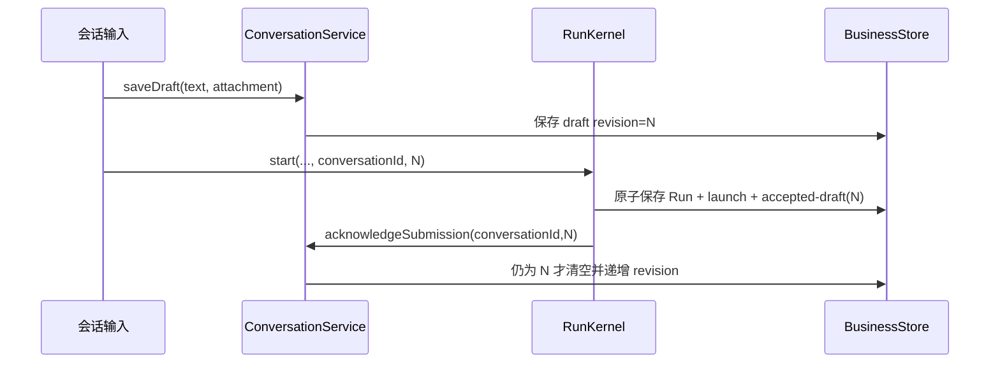

# 对话隔离、草稿提交与执行轨迹

## 文档更新历史

| 文档版本 | 更新时间                  | 最新 Git 提交 ID（代码基线）             | 内容变化                                                    |
| -------- | ------------------------- | ---------------------------------------- | ----------------------------------------------------------- |
| 1.0.0    | 2026-10-15T17:24:30+08:00 | 9ad009be8a41df28a02060c5620ee12a29c3d901 | 说明项目/对话范围、草稿回执、历史投影、轨迹分块与实时刷新。 |

## 1. 项目与对话

Project 管理共享文件、Git 和项目集成授权；Conversation 属于一个项目，隔离标题、目标输入、附件引用、草稿、消息历史与会话模型默认。一个项目可有多个对话；切换对话不会复制工作区，A 修改的文件在 B 可见。

`ConversationState` 当前 schemaVersion=1，保存 conversations、每项目 selected 和按 conversationId 的 drafts。文件与图片 bytes 不内嵌草稿；attachment 是工作区相对路径，不是冻结的附件副本。文件后来移动/删除时引用可能失效，不能把草稿 attachment 视为永远存在的历史资料。

[ConversationService](../src/application/conversations/service.ts) 在初始化时验证项目归属；每项目至少有一个未归档对话，选中项无效则选择现有活跃对话。新项目 ensure/create 才建立对应对话。首个目标自动生成最多 32 字符标题，手工标题为 1–60 字符。

归档保留草稿和 Run，运行/排队占用中的对话不能归档；归档最后一个活跃对话会创建新对话。restore 解除归档并选中。当前没有物理删除对话或其运行历史的公共 API。

## 2. 草稿保存与精确接纳

草稿 text 最多 16,000 字符，保存文本/attachment 实际变化才递增 revision。UI 每次输入通过 service 串行保存，切项目、切对话或发送前 flushDraft 等待并重新确认保存。

若资源准备或入队失败，草稿保留。若 Run 已入队而清空失败，启动后按 `accepted-drafts` 对账修复。旧提交回执只能清理同 project/conversation/revision；用户在等待期间输入的新草稿 revision 不同，不能被旧异步完成清空。

这保证精确的提交确认，不是所有启动请求都具备通用全局去重：调用 start 时服务还会拒绝本进程同对话重复活跃任务。重启 interrupted 后发起新任务是新的 Run。

## 3. 历史消息进入模型的方式

RunRepository 只选择同 projectId、conversationId、mode 的非活跃 root Run。演示与远程记录不会互相污染；子 Run 不直接插入父对话历史，仅通过父总结进入后续消息。

历史使用 prompt/response 的轻量投影，按设置 historyTasks 和字符预算挑选，保持时间顺序；单条 prompt 最多 8,000、response 最多 12,000 字符。某条超出剩余预算可跳过，未完成且无 response 的条目使用提示文字。

历史字符预算最多 96,000，结合 contextTokens 与系统提示、当前目标、Skills目录/正文估算。没有精确 tokenizer、摘要压缩或完整工具 transcript 重放。trace/transcript 用于观察与追溯，不等于下一次模型输入。

## 4. 三种运行表示

| 表示                             | 用途                                | 不包含/不承担                      |
| -------------------------------- | ----------------------------------- | ---------------------------------- |
| RunRecord / Header/Input/Result  | 执行与持久化事实                    | 不作为 UI 大型树 DTO               |
| RunSummary / RunDetail / RunView | 列表、完整答案、实时展示            | 不暴露秘密值或宿主资源             |
| TranscriptFrame                  | Pi 完成消息与协议签名等原始 payload | 不直接渲染、不自动用于重启继续引擎 |

RunHeader 单独保存 promptPreview（300）、responsePreview（1,200）、字符长度、childCount 和 changedFileCount。RunDetail 查询完整输入/结果，最终答案不受 UI 轨迹页大小限制。

TranscriptFrame 当前 schemaVersion=1，ordinal 从 0 连续追加，payload 由 adapter 提供。它包含真实消息内容，属于本地私有资料；不能认为所有字段都等价于 UI 已脱敏的工具预览。诊断导出或将来备份功能必须另做明确的秘密/资料过滤。

## 5. 轨迹结构与顺序

TraceItem 有 text、reasoning、tool 三类，展示模型说明、服务公开推理和工具调用过程。每节点包含状态与起止时间；tool 还含 callId、工具标签、目标、输入/输出预览，可能关联 childRunIds。

宿主分配 runId、rootRunId、parentRunId、runSequence 和 groupSequence。runSequence 在当前 Run 内递增；groupSequence 贯穿一个活跃任务组，用于展示父/子发生顺序。不能用流到达时间或模型自己给的 ID 取代宿主归属。

模型轮数、工具 callId、内容 index 与节点 ID 共同区分多轮内容，避免一轮新的 assistant 文本覆盖旧步骤。公开推理 visibility 为 reasoning、summary、unavailable；含义见 [模型协议](model-providers.md)。

## 6. 分块存储与读取

[TraceNode](../src/core/runs/trace-storage.ts) 保存状态、顺序、revision、textPreview、textCharacters/textChunks。text/reasoning 正文放 TraceTextChunk，ordinal、offset、characters 连续递增；tool 的输入/输出为有界预览，不另按长正文分页。

| 项目         | 公共 API 当前行为                                                               |
| ------------ | ------------------------------------------------------------------------------- |
| Run 列表     | 默认 30，支持 1–100；按 admissionSequence 降序                                  |
| Git 历史     | 默认 30，支持 1–100；详见 Git 文档                                              |
| 轨迹节点     | `listTrace` 固定每页 50；底层常量另有 maxNodes=100，公共 API 未提供自定义 limit |
| 轨迹正文     | `readTraceText` 固定最多 12,000 UTF-16 单位；公共 API 未提供自定义 size         |
| 文本块       | 每块最多 4,000 UTF-16 单位                                                      |
| 节点正文预览 | 最多 200 UTF-16 单位                                                            |

API 返回 nextOffset/cursor 时继续读取。偏移不能位于 Unicode surrogate pair 中间；分块/页末会避开半个代理对。不要用 UTF-8 byte offset 调用 UTF-16 正文接口。

Run 游标包含实例身份、查询 scope、高水位和 beforeSequence；前页后新增 Run 不改变后续页的范围。轨迹游标包含 instance/runId/afterSequence，校验归属但不冻结运行状态，活跃节点可继续增长；读取旧页后需要订阅更新。

## 7. Recorder 与可观察性

RunRecorder 维护脏节点集合和新增 frames。默认约 200 ms 合并持久化，界面通知通过 requestAnimationFrame 合并。工具副作用前强制 persist，使意图轨迹先于效果。

写链一旦失败保留 rejection，最终 finish 不能跳过缺失回执宣告成功；与普通可恢复 SerialQueue 不同。结尾停止增量计时，收束尚在 running 的节点，保存结果和终态。

工具预览一般最多 6,000 字符，对 token/secret/password/authorization/api-key 一类字段隐藏值；MCP 再按运行租约对已知 Token 做精确清理。这不是任意输入内容的通用敏感信息识别器，用户把秘密放进普通文本仍可能进入模型或消息帧。

## 8. 文件实时刷新与 UI 查询范围

文件变化来自 `workspace.subscribe` 的 recorded 通知；Agent 文本 delta 或运行状态本身不是文件变化证据。工作台合并连续通知并按当前 projectId 调用 snapshot，读取文件、Git 与打开文件预览。

Run 历史订阅按 projectId + conversationId 过滤，根变更刷新当前对话列表；child 使用自己的查询/轨迹。切项目/会话时递增查询身份，晚到的旧请求不能覆盖新视图。历史“加载更多”与首批刷新合并去重，不把当前页未包含的旧条目全部清空。

打开的文件若无本地脏修改，外部变化自动刷新内容；存在脏修改则保留用户文字并标 externalChanged，不直接覆盖。文档已删除且无本地修改时关闭编辑器。实现与编辑身份见 [前端文档](frontend.md)。

## 9. 重启后的展示

恢复将非终态 Run 置 interrupted，并收束 text/reasoning/tool 节点。MCP unknown attempt 对应工具轨迹保持 unknown，明确显示可能已执行。最终轮持久化文本尽可能恢复到结果区。

不会重播 transcript frames、不续接旧流、不重试模型；队列中的任务同样 interrupted，并提示当时尚未发送模型请求。用户可以查看资料变化、核对远端状态，再新建目标继续。

## 10. 验证入口

[conversations.test](../tests/conversations.test.ts)、[run-repository.test](../tests/run-repository.test.ts)、[trace-storage.test](../tests/trace-storage.test.ts)、[trace.test](../tests/trace.test.ts)、[多对话 E2E](../tests/e2e/conversations.spec.ts)、[轨迹 E2E](../tests/e2e/trace.spec.ts)、[实时资料 E2E](../tests/e2e/workspace-live.spec.ts)。
