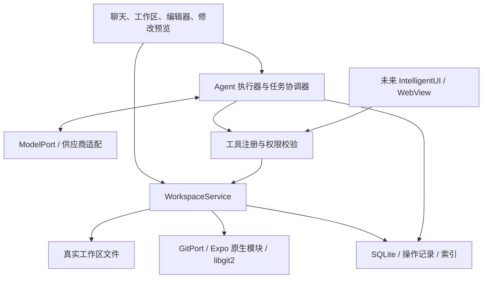
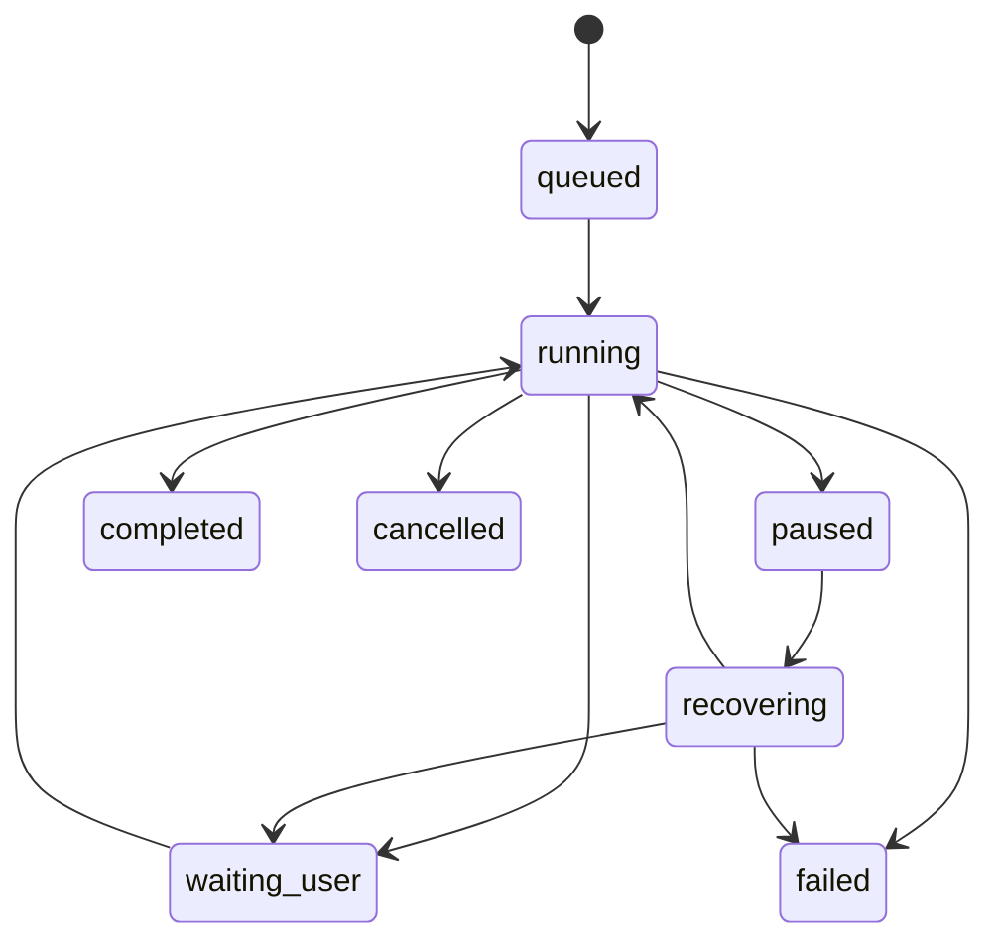

# Agent Mobile 产品与技术设计

日期：2026-10-13
状态：可交互原型。第 2 节记录实际实现，其余章节中尚未实现的首版目标仍为设计方案。

## 1. 产品目标与范围

Agent Mobile 是手机端的本地 Agent harness。用户把文字和图片导入项目，通过对话让 Agent 整理、创建和修改内容，在任务完成后查看成果与修改清单，并可恢复历史版本。

“本地”首先指工作区、工具执行、任务状态、会话和文件历史保存在手机。首版调用云端模型；调用时按需发送选定文本和图片，不宣称完全离线或数据永不出设备。

核心验证场景：导入数张截图和文字备注 → 整理成 Markdown 图文资料 → 根据反馈改写、重排和替换图片 → 查看差异 → 撤销整次修改 → 导出。

首版包含：

- Android 优先验证，保持 Android/iOS 双平台架构。
- 多个独立项目；UTF-8 文本、Markdown，以及 JPEG/PNG/WebP 图片。
- 文件和目录的创建、读取、修改、移动、重命名、删除。
- 文本搜索和局部编辑；图片理解、裁剪、旋转、缩放；保留原始图片。
- 单工作区单写任务，持久化执行记录，暂停、取消和崩溃恢复。
- 本地 Git 仓库；版本保存、文件差异、任务差异和历史恢复。
- 用户自带 API Key；先接通一家支持图片输入和工具调用的供应商。
- 导入、预览、导出和系统分享。

首版不包含：编程、shell、任意代码执行、远程 Git、分支合并、多设备同步、多人协作、常驻后台 Agent、端侧大模型。

图片生成和语义修图作为后续可选模型能力，需独立处理费用、远程任务状态和结果导入；不属于首版必需能力。

长期方向：结构化 IntelligentUI → 静态网页成果 → 受控 JavaScript 网页沙箱。

## 2. 当前原型的交付边界

| 内容 | 状态 |
| --- | --- |
| Git 开发仓库、npm 锁文件、忽略规则 | 已初始化 |
| Expo SDK 57、React Native、TypeScript、Expo Router | 已配置 |
| Development Build、SQLite、文件、图片、SecureStore 依赖 | 已安装并配置 |
| 项目创建、文件列表、文本编辑、导入导出、移动删除 | 已实现 |
| 前端工作台 | 紧凑布局、深浅/系统主题、手机固定输入区、桌面文件侧栏；浏览器和 Android 模拟器操作已验证 |
| 编辑与版本交互 | Markdown 阅读、全屏/侧栏编辑、原生软键盘避让、未保存保护、逐行差异预览 |
| 连续对话 | 带入同项目、同模式最近 6 次目标与回复；不重放旧工具调用 |
| TypeScript、ESLint、Vitest、Playwright | 已配置并验证核心流程 |
| Pi Agent Core 1.1.0 | 已接入；上游核心未修改，Metro 使用纯工具函数入口 |
| SQLite 与文件持久化 | Android 模拟器已验证；浏览器使用 IndexedDB；arm64 真机/iOS 待验证 |
| 模型密钥持久化 | Android SecureStore 保存后强制停止重开调用通过；iOS 待验证 |
| SQLite schema | 原型为版本 1 的 records(bucket,id,payload) 表；第 7 节规范化 schema/FTS 未实现 |
| 本地 Git 提交、历史、任务差异、历史恢复与撤销 | 已实现，原型使用 isomorphic-git 1.44.2 的真实 Git 格式 |
| Android/iOS libgit2 构建与原生桥接 | 待实现 |
| 模型调用与 Agent 循环 | Chat Completions、Anthropic Messages、Gemini 原生 REST/SSE 已实现；三协议模拟工具闭环与图片输入通过；DeepSeek 前版已做官方实测 |
| 服务配置与诊断 | 独立连接与凭证、预设/自定义协议、分页发现、手工模型、文本/工具/图片检测；分平台保存检测结果 |
| 多供应商/模型配置器 | [实施记录](provider-model-configurator.md)；多连接、多模型、能力依据、参数、收藏、分层默认与运行快照已实现；Anthropic/Gemini 官方实测待凭证 |
| 任务运行配置 | 启动时冻结服务/模型/参数版本，凭证通过宿主租约使用；界面关闭或切换配置路由不停止任务 |
| 配置迁移与恢复 | 原单配置迁移为连接与模型；SecureStore 凭证采用可恢复操作意图，旧凭证待配置提交和运行租约释放后清理 |
| 操作日志与崩溃恢复 | 文件/Git/元数据协调已实现并做失败注入；原生掉电/fsync 保证待验证 |
| 任务恢复 | 启动时修复文件一致性并标记 interrupted；不自动续跑模型，不重放未知远程请求 |
| 图片 | 导入、预览、历史对比、可选模型输入已实现；裁剪、缩放、生成尚未实现 |
| IntelligentUI、网页沙箱 | 后续阶段 |

演示模式使用显式预设传输，不进行语义理解；它经过真实 Pi 工具循环、工作区写入和 Git 提交。真实模型模式由用户配置地址、模型和密钥。详细使用与限制见 [prototype.md](prototype.md)，验证见 [validation.md](validation.md)。

## 3. 已选技术栈与架构决策

| 层 | 选择 | 理由 |
| --- | --- | --- |
| 客户端 | React Native + Expo Development Build | 双平台、快速开发，可接入自定义原生模块 |
| 语言 | TypeScript strict | 共享协议与领域类型 |
| 路由 | Expo Router | 文件路由与页面组织 |
| UI 状态 | Zustand | 当前选择、输入草稿、显示进度 |
| 图标和差异显示 | Lucide / react-native-svg、diff | 按需导入 SVG 图标；展示文本逐行变化 |
| 数据库 | expo-sqlite，WAL，FTS5 | 任务状态、会话、元数据、全文搜索 |
| 工作区磁盘访问 | expo-file-system | 私有目录内真实文件 |
| 文件历史 | 原型 isomorphic-git；目标 libgit2 原生模块 | 原型先验证 Git 格式及恢复；后续替换 Git 适配器 |
| 输入校验 | Pi 工具采用 TypeBox；Zod 留作业务/UI schema | 避免重复维护工具 schema |
| 模型通信 | expo/fetch + 自有兼容 SSE 传输 | 作为 Pi streamFn 注入，避开 Node 供应商 SDK |
| 图片 | expo-image、image-picker、image-manipulator | 导入、显示和基础变换 |
| 文件导入和分享 | expo-document-picker、expo-sharing | 使用系统授权入口 |
| 凭证 | expo-secure-store | Keychain/Keystore 支持 |
| 网页 | 后续 react-native-webview | 分阶段开放网页交互 |

Router 所需的 Reanimated、Worklets 和 Gesture Handler 采用 Expo SDK 兼容版本显式锁定；避免传递依赖自动解析到不兼容的 Worklets。初始化的实际检查结果见 [validation.md](validation.md)。

依赖以 package-lock.json 为准；Expo 原生包通过 expo install 选择兼容版本。不使用 canary/next 版本作为默认基线。

主要决策：

1. 虚拟文件系统是受控逻辑 API，底层保留真实目录，便于 libgit2 使用。
2. Git 是文件版本历史的来源，不再另建一套内容寻址版本库。
3. SQLite 是运行状态和业务元数据的来源；文件索引和搜索索引可以从磁盘重建。
4. Agent core 不依赖 React、Expo、Node.js、原生模块，平台能力通过接口注入。
5. 单 Agent 执行循环复用 Pi Agent Core 1.1.0；任务协调、预算、持久化、权限与恢复属于宿主。
6. 首版无需服务端；统一模型额度和账号服务确定后再加 Node.js/TypeScript 后端。
7. 原生工程采用 Expo Prebuild 生成；持久源码放在 modules 和 config plugin。

原型适配补充：Pi 默认 pi-ai 根入口包含 Metro 无法静态解析的 Node 动态导入。metro.config.js 将该根入口映射到 src/adapters/agent/pi-ai-mobile.ts，仅转出上游公开的 transcript/event-stream/json-parse/validation 子路径。没有修改 node_modules，也没有复制或 fork Agent Core。

isomorphic-git 使用官方浏览器构建及自定义 fs 适配，避免 sha.js 的 Node stream 依赖。移动端落盘到应用私有目录；浏览器预览把相同的 Git 文件和业务记录分别存入 IndexedDB。Git 工程本身仍是标准仓库格式。

## 4. 模块结构



src/core：领域接口、执行状态机、上下文策略、工具协议。不保存明文密钥，不直接打开文件。

src/adapters：文件、数据库、Git、模型、凭证、图片适配器。向领域层返回统一结果和错误，不泄漏平台绝对路径。

src/features：后续按工作区、会话、编辑器、历史、设置组织业务界面。路由文件只组装页面。

modules/agent-git：未来本地 Expo 模块。Git 操作在线程池或专用队列执行，不阻塞 JS/UI 线程。

本次的接口是最小起点，尚未覆盖所有 CRUD、历史恢复和搜索功能。新增接口应与实际实现一同提交。

## 5. 工作区与权限模型

每个项目对应应用私有目录内的真实 Git 仓库。用户外部文件经系统选择器授权后复制进入工作区；首版不直接修改外部文件或长期持有任意目录访问权。

```text
app-private/
  state/
    app.sqlite
  workspaces/
    <workspace-id>/
      repository/
        .git/
        documents/
        assets/
        project.json
      runtime/
        staging/
        recovery/
        thumbnails/
```

project.json 可保存可移植的项目名称和格式版本；数据库、会话、运行日志、缓存、凭证和临时文件不进入 repository。

逻辑路径使用相对路径和正斜杠。空字符串仅用于表示工作区根目录；文件操作要求非空路径。

宿主与原生模块共同实施：

- 拒绝绝对路径、盘符、URL、空字节、父目录跳转和保留路径。
- 规范化后验证路径仍位于目标根目录；检查大小写、Unicode 和目录边界。
- 禁止访问任何层级的 .git，不允许创建符号链接或经已有链接跳出根目录。
- 模型只获得 workspaceId 和受控相对路径，不能选择应用任意私有目录。
- 每次工具调用检查任务能力范围、文件类型、文件大小和基础版本。
- Git 桥接只接受宿主管理的 workspaceId；原生侧解析目录，不信任 JS 提供的绝对路径。
- 项目内允许的读写默认自动执行；访问其他项目、发送额外资料、扩大权限由宿主决定并展示给用户。

文件修订号使用当前字节内容的摘要，与 Git commit OID 分开。写入携带 expectedRevision；创建时使用 null 表示文件必须不存在。冲突返回 VERSION_CONFLICT，不静默覆盖。

首版同一工作区仅一个写入者。用户可查看内容；编辑前需要暂停任务并完成恢复/检查点，或把用户修改排入同一写队列。不同项目可以独立排队，模型请求总并发仍受限制。

工具错误至少区分：NOT_FOUND、INVALID_PATH、ACCESS_DENIED、VERSION_CONFLICT、UNSUPPORTED_TYPE、QUOTA_EXCEEDED、INTERRUPTED、STORAGE_ERROR。错误信息不得含凭证。

## 6. Git 集成和版本语义

### 6.1 目标原生集成（尚未实现）

Android：TypeScript → Expo Modules API（Kotlin）→ JNI/C++ → NDK/CMake 编译的 libgit2。

iOS：TypeScript → Expo Modules API（Swift）→ Objective-C++/C → 静态库或 XCFramework 中的 libgit2。

两端固定同一稳定版本；Android 首先验证 arm64-v8a 真机和 x86_64 模拟器，是否支持其他 ABI 由最低机型范围决定。每次原生集成升级都记录源码版本、编译参数与许可证。

首版只启用本地仓库功能，关闭不需要的远程传输依赖。以后 HTTPS/SSH、认证和证书验证独立设计。Android NDK 使用当前 CMake 工具链，不直接照搬 libgit2 README 中的旧 standalone GCC 示例。

原生调用返回结构化错误并正确释放资源；同一仓库的 index、refs 和写操作串行化。TypeScript 层不暴露 git shell 命令或任意底层函数。

libgit2 默认访问真实文件系统。使用 SQLite 虚拟 blob 作为唯一文件存储会增加适配成本，本项目不采用该路线。

原型已通过 isomorphic-git 实现 init/head/commit/log/readBlob/listFiles，并通过标准 Git CLI 验证提交。文件修订号采用 Git blob OID。每个文件工具动作产生检查点，任务记录关联开始/结束提交。libgit2 替换、后台线程性能和两端原生 ABI 验证保留为下一阶段。

### 6.2 用户可见版本

- 创建项目时初始化仓库并提交 project.json，保证初始 HEAD 存在。
- 任务启动前要求工作区干净；已有用户修改先保存为一个用户版本。
- 持久化 baseCommit；任务运行过程中保存必要的恢复检查点。
- 正常结束后保存 finalCommit，展示 baseCommit → finalCommit 的整体变化。
- 检查点可在普通历史页面折叠，但保留用于恢复，不改写已存在的提交。
- 手动编辑经过 debounce/明确保存形成用户版本，不把每个按键提交一次。
- 恢复旧版本时，把目标内容恢复到当前工作区并创建新的恢复提交，保留已有历史。
- 首版整次撤销仅支持当前最新任务且没有后续修改的情形；较早任务可预览或显式恢复整份历史。

“整次撤销”会恢复 Git 跟踪的项目内容，不删除会话和执行记录。文件重命名可能由 Git 启发式识别，SQLite 操作记录保留真实动作供界面展示。

图片的版本对比显示前后预览、尺寸和大小，不承诺像文本一样逐行合并。图片变化可能增加接近整张图片的存储量；暂不引入 Git LFS。

Git 历史不是备份。首版允许导出内容包或包含 .git 的完整仓库包；会话备份另行定义。删除当前文件也不会立即删除 Git 历史中的内容，永久清除需要后续独立功能。

## 7. SQLite 数据设计

迁移按递增 schema version 执行，启用 foreign_keys 与 WAL；确认所选构建中 FTS5 可用。数据库内容不纳入工作区 Git。

| 表 | 主要字段 | 责任 |
| --- | --- | --- |
| workspaces | id、name、relativeRoot、schemaVersion、createdAt | 工作区注册，根目录为相对位置 |
| files | workspaceId、path、kind、mimeType、revision、sizeBytes | 当前文件索引；可重建 |
| assets | id、workspaceId、path、width、height、sourceAssetId | 图片引用和派生关系 |
| conversations / messages | id、workspaceId、role、parts、toolCalls | 用户可见会话与模型协议记录 |
| runs | id、workspaceId、state、baseCommit、checkpointCommit、limits | 持久化任务状态 |
| tool_executions | operationId、runId、modelCallId、toolName、state、result | 幂等执行与恢复 |
| operations | operationId、phase、beforeHash、afterHash、recoveryPath | 跨文件/Git/DB 操作记录 |
| versions | workspaceId、commitOid、runId、kind、createdAt | Git 版本的业务关联 |
| file_search | workspaceId、path、text | FTS5 搜索索引；可重建 |

凭证仅存 SecureStore，SQLite 保存供应商配置和凭证引用。数据库保存的是可解释的执行摘要、工具参数和结果，不依赖供应商私有思考内容。

会话消息、图片资源和工具执行记录可能很大，需要分页读取；工具结果限制长度，完整大结果通过资源引用访问。

## 8. 文件、Git 与数据库的一致性

三者没有共同事务。不能假设“文件写入成功”与“数据库提交成功”同时发生。使用持久化操作记录和可重入的恢复流程。

一组修改的执行步骤：

1. 获得工作区写锁，检查预期 HEAD、文件修订号和空间预算。
2. 在 SQLite 中记录 prepared 操作：受影响路径、前后摘要、恢复位置、所属任务。
3. 在 runtime/staging 写入完整的新内容；保留被覆盖内容或可恢复的 Git 基线。
4. 通过平台适配器替换目标文件，更新 applied 阶段；运行时不允许其他业务读取半完成的批次。
5. 更新 Git index，生成提交，提交中附带宿主生成的 operationId/runId 标记。
6. 在 SQLite 事务中记录 commit OID、工具结果、当前索引和下一阶段，标记 recorded。
7. 释放锁；确认相关记录可恢复后清理临时内容。

一个任务通常由多组修改组成；每组修改都能恢复。多文件批次在崩溃瞬间不具备文件系统层的全局原子性，通过锁、日志和启动恢复向应用提供一致状态。

恢复时先冻结该工作区，检查实际文件摘要、Git HEAD、提交标记和数据库记录：

| 中断位置 | 恢复行为 |
| --- | --- |
| prepared 后、文件尚未改 | 丢弃未应用内容，或验证后继续 |
| 文件已改、Git 尚未提交 | 从基线/恢复内容还原，或完成原操作；不再次调用模型生成修改 |
| Git 已提交、SQLite 尚未记录 | 按 operationId 查到提交并补记结果，禁止重复提交 |
| 日志与磁盘无法对应 | 标记待处理，保留恢复数据并提示用户，不盲目覆盖 |

如果底层文件 API 无法提供需要的持久化/替换保证，在原生模块补充实现。实现阶段必须做进程终止、磁盘不足和跨存储失败验证。

operationId 由宿主持久化生成；模型 toolCallId 用作关联，不能独自作为跨模型重试的幂等键。

## 9. Agent harness 与模型适配

任务状态：



queued 等待执行资源；waiting_user 等待确认或解决冲突；paused 表示已记录中断点。应用启动发现非终态任务时，先进入恢复流程，不能把 SQLite 中残留的 running 当作还在运行。其他非终态也可根据用户操作取消或失败。

执行循环：

1. 获取用户目标、工作区权限和基线版本，持久化任务。
2. 从文件、搜索结果、任务摘要和最近消息组装上下文。
3. 请求支持工具调用的模型，流式更新可见回复。
4. 只在完整参数接收并通过 Zod 校验后执行工具；不执行半截流式 JSON。
5. 检查权限、预算、取消状态和文件修订号，按写队列执行并记录结果。
6. 把有限的工具结果交回模型，继续下一轮。
7. 完成时保存版本并展示成果、修改清单和实际使用量。

最初工具集合：

| 工具 | 行为 |
| --- | --- |
| list_files / read_text / search_text | 获取指定内容，支持分页/范围 |
| create_directory / write_text / apply_text_edit | 受控创建和版本检查写入 |
| move_file / delete_file | 保留可恢复版本，检查目标冲突 |
| inspect_image / transform_image | 按 assetId 读取；变换生成新资源 |

版本提交、回滚和权限扩展属于宿主动作，不把 reset、checkout、任意 Git 命令交给模型。基础工具不包含任意联网、shell 或代码执行。

ModelPort 归一化消息、图片引用、完整工具调用、文本增量、使用量和结束原因。供应商适配器处理资源读取、图片上传/编码、认证与错误转换。任何图片 URL 都不能直接变成任意网络读取。

“兼容某种 API 格式”不代表所有能力一致。每个供应商/模型单独声明 imageInput、toolCalling，并通过真实请求验证。未返回实际 token 用量时展示估计值或未知。

上下文仅包含当前任务相关文件；文本搜索先使用 FTS5 和路径过滤，图片按需缩放输入；暂不引入向量数据库。压缩上下文保留文件引用、版本和已完成动作。

原型实际预算：最多 10 轮请求、30 次工具调用、2 分钟任务墙钟；单次模型输出 4096 tokens，SSE 原始响应 512 KB，请求 JSON 长度 2 MB。文本文件 256 KB、单次工具文字 80,000 字符，文件导入 5 MB、模型图片输入 1 MB。精确 token 预算、配置化阈值和缩图输入仍待实现。超限结束并保留检查点，不无限重试。

断网与远程超时要区分请求未发送、已发送但结果未知和已返回。只能保证本地可验证操作不重复；不能承诺远程请求绝对 exactly-once 或不会重复计费。后续图片生成需供应商幂等键或可查询 jobId，未知结果不能盲目再次提交。

取消时中止网络请求并阻止新工具操作，已进入不可分割写入阶段的动作先完成或恢复到检查点。取消不自动撤销已完成修改；界面提供保留结果或恢复任务基线的明确选择。

## 10. 文本、图片与用户交互

首版文本采用 UTF-8；Markdown 图片链接使用工作区相对路径。现有前端使用原生组件安全展示基础 Markdown（标题、列表、引用、加粗、代码文本与本地图片），不执行 HTML，也不自动加载外部图片。复杂表格、公式等仍待实现。

导入图片时复制原件、记录 MIME/尺寸/大小，生成缩略图。基础变换写到新路径，记录 sourceAssetId；用户选择替换显示引用时仍保留原件和 Git 历史。

图片输入和变换按文件大小及像素数量限制，避免解码超大图片导致内存峰值。大文件下载和复制走流式或原生路径，不通过 JS 层反复传递整文件 Base64。

首版页面规划：

- 工作区：项目列表、文件浏览、导入和创建。
- 会话：任务目标、执行状态、取消/暂停和结果。
- 编辑器：文本编辑、图片预览、受控修改。
- 修改预览：按文件显示新增/修改/删除，文本 diff 和图片对比。
- 历史：用户版本与任务版本，恢复预览。
- 设置：模型、凭证、使用预算、空间、导出。

当前交互：手机使用“会话/资料/版本”底部导航，会话输入框固定在底部；桌面使用项目侧栏与编辑侧栏。未保存编辑关闭、切项目或新建项目之前提供保存/放弃选择；恢复版本前预览逐行差异；原生开发菜单不再启动时覆盖界面或悬浮遮挡设置入口。

主题包含跟随系统、浅色与深色。主题和上次选择的项目保存在偏好记录中，模型连接仍通过独立草稿保存。原生源码相关配置保存在 plugins/with-dev-menu.js，可通过 Prebuild 重建。

项目内常规动作自动执行，任务结束展示成果和可撤销变化。费用、访问范围扩大、清空历史等操作需要清晰的用户决策；不把每个内部小步骤都变成确认弹窗。

导出用户选择的文件或内容包，通过系统分享交付。内容包默认不包含 .git、会话和私有运行记录；完整仓库导出属于单独选项。

## 11. 手机生命周期、隐私与容量

首版以可见前台任务为主要运行方式，切后台先保存状态。按 OS 能力争取完成当前必要操作，但不承诺锁屏后持续运行。

expo-background-task 适用于系统调度的延后工作，不能替代交互式 Agent 的常驻执行器。未来如需 Android 前台服务或 iOS Continued Processing Task，单独开发原生适配和进度展示。

每一步都可中断，重新打开应用先恢复一致性，再让用户继续任务。后台通知、推送和后台模型任务不属于首版必需项。

凭证不进入日志、模型上下文、Git 或网页。首版私有目录和 SecureStore 是基础隔离；数据库和项目文件尚不等于应用层加密。若增加 SQLCipher，仍需同时设计图片、文本文件和备份的加密策略。

选择云模型时明确说明会发送哪些内容；图片 EXIF 保留、去除和外部服务保留策略在实现时确定。导入的文档/图片文字都是资料，不能因此获得工具权限或改写宿主规则。

容量指标分别统计当前文件、Git 历史、缓存和恢复数据。缓存可重建；历史和恢复数据不能随意当缓存清理。预留写入空间并在不足时提前拒绝，不删除旧版本来勉强完成一次写入。

应用卸载可能删除工作区；本地 Git 不提供跨设备灾备。首版必须有导出入口，后续再设计备份/同步。

## 12. IntelligentUI 与网页演进

第一阶段：模型返回受 Zod/JSON Schema 约束的 UI 描述，宿主映射到内置列表、图库、表单、表格、版本对比组件。限制组件数量、嵌套和资源大小。

动作只引用已注册 action ID，参数仍走权限、预算和版本校验。UI 状态与业务状态分离，页面重建不重复执行动作。不使用 eval 执行生成的组件代码。

第二阶段：渲染静态 HTML/CSS 成果，图片只引用宿主批准的资源；禁用脚本、外链导航和默认网络请求。

第三阶段：受控 WebView JavaScript 沙箱。独立处理源隔离、资源 URL 映射、网络白名单、导航/下载限制、消息桥接、会话能力 token、请求关联和生命周期。不能只依赖 iframe sandbox 或 originWhitelist 来限制所有网络通道。

默认没有相机、麦克风、通讯录、任意文件访问或模型密钥。网页动作仅通过有限的宿主消息协议访问授权资源；页面切换和销毁后撤销能力。任何阶段都不允许网页直接调用 Agent 运行时或底层原生 API。

网页异常、无限循环和过量资源请求不能破坏宿主工作区。具体隔离能力需要按 Android/iOS WebView 验证。

iOS 动态软件方案在进入实现前核对 App Store 规则 2.5.2 和 4.7，包括原生能力桥接与分发方式；技术可运行不意味着审核必然通过。

## 13. 实施顺序与验收

### M0：工程初始化（本次）

交付工程、依赖锁定、启动页、模块接口、设计文档。类型检查、Lint、Expo Doctor 和 Web 打包通过；原生编译与功能验证单独记录，不用 Web 结果代替。

### M1：本地工作区与 Git 技术验证

实现 SQLite 迁移、文件服务、系统导入和文本编辑；先打通 Android libgit2 的 init/status/commit/diff，再验证 iOS 相同接口。

验收：创建项目、导入文字/图片、修改并提交、查看差异、恢复后重新提交。路径越界和符号链接被拒绝，版本冲突不覆盖，磁盘不足不损坏原内容。

Git 是已选方案；若构建验证失败，记录具体问题并评估解决方案，不静默替换为伪 Git。

### M2：Agent 最小闭环

接通一个图片输入/工具调用模型，实现上下文组装、持久化工具结果、任务写锁、结果预览和整次撤销。

验收：用固定的一组图文资料完成整理与二次修改；检查被改文件及版本对应；只发送授权内容；非完整/非法工具调用不执行；超限停止。

### M3：恢复、容量与双平台可靠性

在文件应用前后、Git 提交前后和数据库更新前后注入失败；测试弱网、切后台、进程终止、取消和空间不足。

验收：本地已完成动作不因恢复重复执行；未知远程请求被识别；恢复后文件/Git/DB 对应一致；单工作区写入不交错。模拟器测试之外必须覆盖两端真机。

### M4：IntelligentUI 与网页试验

先完成结构化 UI，再分别验证静态网页和受控脚本。独立进行桥接、网络、导航和资源耗尽测试，并确认 iOS 上架方案。

测试重点放在权限、数据一致性、模型协议解析和中断恢复。轻量 UI 布局不需要为每个组件建立镜像实现的测试。后续领域逻辑可选用 Vitest，移动端关键流程再选择 Maestro 等端到端工具。

## 14. 待明确的问题

| 问题 | 当前基线 |
| --- | --- |
| 最低系统版本与目标机型 | 跟随 Expo SDK 支持范围，发布前按依赖和真机结果固定 |
| 模型供应商 | DeepSeek 前版已实测；Anthropic/Gemini 原生已实现并模拟验证，官方实测待凭证 |
| 模型商业模式 | 原型采用用户自带 Key；统一额度后端另行设计 |
| 大图片和历史容量上限 | 通过真机内存和典型项目测量确定，避免随意设定承诺 |
| 发布包标识 | 暂用 com.agentmobile.app，上架前替换 |
| 文本编辑器与 Markdown 渲染库 | M1 按移动端输入、性能和安全预览验证后选择 |
| 历史清除、备份与同步 | 首版导出；永久清除和同步后续独立设计 |
| 应用商店许可与第三方声明 | 集成 libgit2 和发布前完成依赖许可记录 |

## 15. 参考资料

- [Expo Development Builds](https://docs.expo.dev/develop/development-builds/introduction/)
- [Expo 本地原生模块](https://docs.expo.dev/modules/get-started/)
- [Expo SQLite](https://docs.expo.dev/versions/latest/sdk/sqlite/)
- [Expo FileSystem](https://docs.expo.dev/versions/latest/sdk/filesystem/)
- [Expo Fetch](https://docs.expo.dev/versions/latest/sdk/expo/#expofetch-api)
- [Expo SecureStore](https://docs.expo.dev/versions/latest/sdk/securestore/)
- [Expo Background Task](https://docs.expo.dev/versions/latest/sdk/background-task/)
- [libgit2 README / Android](https://github.com/libgit2/libgit2#android)
- [Android NDK CMake](https://developer.android.com/ndk/guides/cmake)
- [Android 存储](https://developer.android.com/training/data-storage)
- [Android WebView 原生桥接风险](https://developer.android.com/privacy-and-security/risks/insecure-webview-native-bridges)
- [Apple Continued Processing Task](https://developer.apple.com/documentation/backgroundtasks/bgcontinuedprocessingtask)
- [App Store Review Guidelines](https://developer.apple.com/app-store/review/guidelines/)
