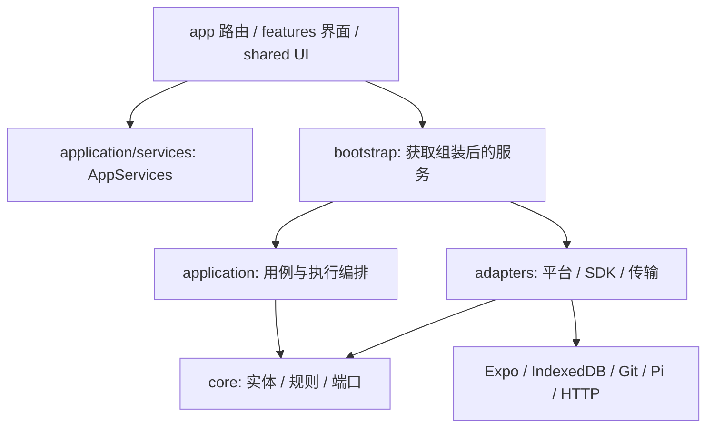
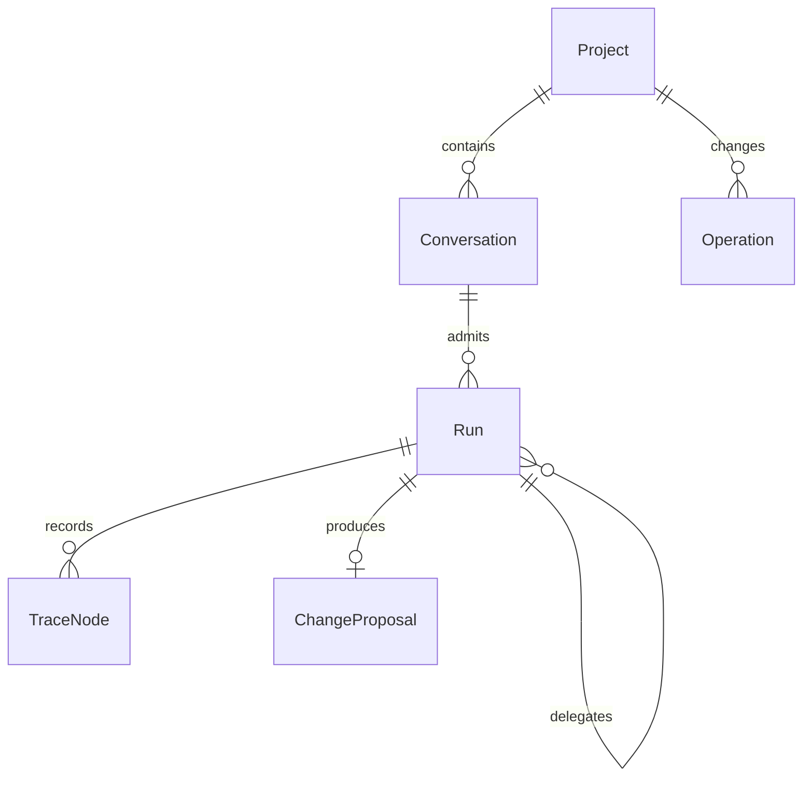

# 系统设计与实现范围

## 文档更新历史

| 文档版本 | 更新时间                  | 最新 Git 提交 ID（代码基线）             | 内容变化                                                                                   |
| -------- | ------------------------- | ---------------------------------------- | ------------------------------------------------------------------------------------------ |
| 2.5.0    | 2026-10-18T19:00:33+08:00 | 34f542b6f4e917f475d36c9f5ea8b369f5d74dda | 同步尚未提交源码：接入离线 CodeMirror/Markdown-it 文档内核、手势分块编辑和可恢复文件草稿。 |
| 2.4.0    | 2026-10-17T10:27:05+08:00 | ba5117e2ea7908376dec70267b60d3b5d95f5156 | 同步尚未提交源码：工作区职责收敛、原生文件移动及未实现能力。                               |
| 2.3.0    | 2026-10-17T00:09:49+08:00 | fd29c75e38d245b3a8e5cfb6a93c0b2156029d22 | 同步尚未提交源码：记录 edit_text、共享替换算法、权限与单次调用恢复边界。                   |
| 2.2.0    | 2026-10-16T23:47:05+08:00 | c6cde1a9724a790e02cbe4488d7e00542d5e1d76 | 同步尚未提交源码：扩展通用 UTF-8 文本、内容校验、原文预览与 writer 授权路径。              |
| 2.1.0    | 2026-10-16T23:27:39+08:00 | 798aea13020fdad314b8a34bc78d7eadb2ac0bf0 | 同步尚未提交源码：删除内置演示执行与模式开关，记录真实模型必选、供应商排序及连接摘要。     |
| 1.6.0    | 2026-10-16T22:42:39+08:00 | 798aea13020fdad314b8a34bc78d7eadb2ac0bf0 | 同步尚未提交源码的供应商图标、本地持久化和常用模板范围。                                   |
| 1.5.0    | 2026-10-16T22:25:42+08:00 | 798aea13020fdad314b8a34bc78d7eadb2ac0bf0 | 同步尚未提交源码的模型供应商模板列表及连接指示交互。                                       |
| 1.4.0    | 2026-10-16T19:41:16+08:00 | 8d0bc619e94b2fd44c22ae67d98e5cbd2b2e81e5 | 记录尚未提交源码的工作台职责分组、真实复用覆盖与 UI 入口静态约束。                         |
| 1.3.0    | 2026-10-16T15:39:09+08:00 | d409b141eeeb219779697a62544c17ea23288a12 | 记录尚未提交源码的全局 UI 一致性重构、真实差异摘要及分支来源。                             |
| 1.2.1    | 2026-10-16T09:00:36+08:00 | 1d594d1c2cda099d7d3633291dfded27628a9a23 | 记录尚未提交源码的单列数值设置、说明清理与对象操作修正。                                   |
| 1.2.0    | 2026-10-15T22:42:00+08:00 | 298238947e476284b56933f5f792230a575c5742 | 补充尚未提交源码的无项目四区导航、配置页面及弹层统一。                                     |
| 1.1.0    | 2026-10-15T22:25:24+08:00 | 5cbd3ef007f5742ee48147e91286ab1ca073a900 | 补充尚未提交源码中已接入业务的移动工作台与工具轨迹分组。                                   |
| 1.0.0    | 2026-10-15T17:24:30+08:00 | 9ad009be8a41df28a02060c5620ee12a29c3d901 | 按当前源码建立系统边界、分层、实体关系与实现状态说明。                                     |

## 1. 产品与运行边界

Agent Mobile 是手机端本地 Agent harness。项目文字、图片、对话、任务记录及文件历史由应用本地管理；远程模型负责生成和工具决策，宿主通过受控接口执行文件、Git、Skills 和远程 MCP 操作。本地表示数据与执行编排位于应用内，不表示模型推理离线运行。

当前支持任意文件的原始字节管理；UTF-8 文本不限扩展名，可编写代码和配置，Markdown 与支持的图片可预览，其他文件保留导出与 Git 能力。文本工具策略与字节存储分离，不执行代码。所有任务通过 Pi 使用用户配置的模型服务；缺少模型或凭证时拒绝运行并保留草稿。没有任意代码执行、shell、设备绝对路径访问或本地 MCP 进程管理能力。

同项目多个对话共享文件与 Git 历史，但隔离目标、草稿、历史消息和会话模型选择。单项目同一时刻只有一个根运行写工作区；不同项目可并发运行。子 Agent 使用冻结快照或私有提案，不能绕过根任务的权限与预算。

## 2. 技术组成

| 责任       | 当前实现                                                                 |
| ---------- | ------------------------------------------------------------------------ |
| 应用与界面 | React Native、Expo Development Build、Expo Router、TypeScript            |
| Agent 引擎 | Pi Agent Core 1.1.0，经 `AgentEnginePort` 隔离                           |
| 模型传输   | 自有 Chat Completions、Anthropic Messages、Gemini REST/SSE 适配          |
| 文件历史   | isomorphic-git 1.44.2，标准 Git 对象、index、HEAD 与私有 checkpoint refs |
| 原生持久化 | Expo FileSystem、Expo SQLite、Expo SecureStore                           |
| Web 持久化 | IndexedDB；凭证仅页面内存                                                |
| MCP        | MCP Client 2.3.1 + Streamable HTTP + 解释执行的 schema 校验              |
| Skills 包  | YAML frontmatter、fflate ZIP、独立 Git 技能库                            |
| 界面状态   | React 局部状态与 Zustand；业务事实通过 AppServices 查询                  |

版本安装以 [package-lock.json](../package-lock.json) 为准。当前 Expo SDK 57、React 19.2.3、React Native 0.86.3；不要以本表替代锁文件升级依赖。

## 3. 分层结构

| 目录               | 责任                                                       | 维护边界                                                                       |
| ------------------ | ---------------------------------------------------------- | ------------------------------------------------------------------------------ |
| `src/core`         | 平台无关实体、校验规则、数据契约、端口、信号和普通串行队列 | 不引用 React、Expo、Node、原生库或其他项目层；TypeBox 为允许的工具 schema 依赖 |
| `src/application`  | 工作区、配置、会话、运行、委派、提案与恢复用例             | 只引用 application/core；不接入 SDK 或平台 API                                 |
| `src/adapters`     | 文件、数据库、凭证、Git、模型/MCP、Pi 和生命周期适配       | 实现领域端口；SDK 类型保留在此层                                               |
| `src/bootstrap`    | 创建依赖、恢复顺序、资源工厂、公共 facade 与 DTO 投影      | 平台组合根，不能承载普通 UI 业务                                               |
| `src/features`     | 业务页面、hooks、交互与视图能力                            | 经 AppServices 调用业务，不引用 adapters                                       |
| `src/shared`       | 通用主题、UI、显示格式及工作台界面选择状态                 | 共享 UI/主题不依赖 features 或 adapters                                        |
| `src/app`          | Expo Router 页面映射、布局                                 | 路由薄层                                                                       |
| `plugins`          | Expo 可重建配置                                            | 不把配置只留在生成的 android/ios 工程                                          |
| `scripts`、`tests` | 本地工具、协议模拟、测试与故障注入                         | 部分脚本会修改隔离测试实例，见测试文档                                         |

[ESLint 架构规则](../scripts/architecture-rule.cjs) 检查静态 import/export、require、动态 import 和类型导入，解析别名与相对路径。实际规则不是完整安全沙箱：features 的自动规则主要禁止 adapters，原生数据库等直连仍由 AppServices 契约与代码审查约束。

当前没有 `modules/` 自定义原生实现。真正需要原生桥接时再创建 Expo Module，避免预留空目录。

## 4. 核心实体

- **Project**：本地共享文件、Git 仓库和业务项目元数据的范围。
- **Conversation**：属于一个项目，保存标题、归档状态、草稿与选择状态。Run 历史由独立运行表查询，未内嵌进 Conversation。
- **RunRecord**：当前执行实体；root/child 分别持久化，通过 `rootRunId` 与 `parentRunId` 关联。UI DTO 不等于持久化实体。
- **LaunchSnapshot**：角色、系统设置、模型、MCP、Skills 和选定路径的冻结输入，不保存秘密值。
- **RunGroupRecord**：根任务与子任务共用的截止时间、请求/工具额度和分配记录。
- **Operation**：文件或 Git 的可恢复修改意图；正文与摘要分存，阶段单向推进。
- **TraceNode / TraceTextChunk / TranscriptFrame**：公开展示轨迹、分块正文、引擎原始完成消息帧。三者用途不同，不能互相替代。
- **ChangeProposal**：writer 子任务的候选树、授权路径及合入回执。
- **ProviderConnection / ModelEntry**：服务连接和独立模型条目；项目授权的 MCP/Skills 另外管理。

## 5. 三个事实来源

Git 是项目文件历史和冻结文件快照的来源；SQLite 是原生会话、配置、运行、轨迹、操作回执与提案等业务事实的来源。Web 以 IndexedDB 实现相同 BusinessStore 契约。Zustand 只保存界面选择、主题、页签与提交说明草稿，不作为业务数据库。

Git、文件、业务数据库和凭证存储之间没有统一事务。用例采取“先持久化意图 → 执行效果 → 写回执 → 发布通知”，并在启动时校对。单次数据库 `writeBusiness` 可以原子更新多个业务记录，但不能宣称文件或远程服务已一起原子提交。

工作区是应用私有真实文件之上的授权与事务用例层：保留项目、相对路径、修订和恢复，移除按预览类型限制存储的策略。原生由 Expo FileSystem 读写真实文件，移动直接使用 File.move；Web 用 IndexedDB 实现相同端口。操作系统沙箱隔离应用，工作区约束 Agent 在该应用内的权限；不暴露绝对路径、`.git` 或应用数据库。`.gitignore`、`.gitattributes`、`.github` 作为普通项目路径可用。

## 6. 启动与运行依赖

`getAppServices()` 在进程/页面内缓存初始化 Promise。成功后各页面共用一套服务与运行内核，卸载页面不终止 Agent。初始化失败清除实例缓存，返回公开错误。

初始化顺序为：创建存储与项目工作区 → 模型与 Agent 设置 → MCP 配置和 runtime → 项目操作日志恢复 → MCP attempt 恢复 → Skills 库初始化/恢复 → 提案恢复 → 活跃 Run 收束为 interrupted → 对话与提交草稿回执对账 → RunKernel 与平台前台监听 → AppServices facade。详细失败路径见 [存储与恢复](storage-and-recovery.md)。

服务 facade 明确枚举可调用方法、绑定接收者、过滤内部字段并统一错误；没有把 application 实例强制转换后直接交给 UI。运行快照只投影公开展示字段，凭证租约与工具资源留在宿主内存。

## 7. 当前实施状态

Agent 文本编辑已接入 `edit_text` 批量精确替换：单文件同修订、唯一匹配、不重叠、整批预检，主任务和 writer 共用领域算法。新建和整体重写保留 `write_text`；失败不自动覆盖全文，编辑回执沿用工作区/候选日志恢复。

移动工作台已接入单层顶栏、项目/对话树形侧栏、对话/文件/Git/设置四区、紧凑卡片输入及连续工具调用折叠。公开推理与正文保持原始顺序，业务继续通过 AppServices 编排。UI 暂态不进入业务数据库。页面内视图切换、参数选择、顶栏操作及 Git 状态均复用 shared/ui 的语义组件；阅读器、首次配置、设置摘要和任务产物同步使用这些规则。对象行、展开入口、空状态、确认、输入、凭证编辑和保存反馈也统一复用共享组件；模型选择保留 FlatList，仅复用弹层外壳。工作台按项目/会话导航、任务执行、编辑、Git 和弹层导航分责，设置/侧栏/弹层使用各自接口；MCP 远端核对在列表和连接详情复用同一业务组件。模型供应商使用 14 个常用模板的直达列表、已有连接圆点及列表末尾的加号入口；列表/编辑/选择器共享本地品牌、自定义和默认图标，上传内容随连接原子保存；同一供应商的多连接在所属行下展开，长按拖拽排序持久化至配置。已保存连接仅在状态圆点左侧显示模型数；缺少凭证时按未保存展示。具体状态、复用调用方与交互约束见 [前端工作台](frontend.md)。

| 能力                                            | 当前状态与边界                                                                                    |
| ----------------------------------------------- | ------------------------------------------------------------------------------------------------- |
| 项目、文件导入管理与导出                        | 已实现；任意字节保留与 Git 管理，UTF-8 文本可编辑，Markdown/PNG/JPEG/WebP 可预览                  |
| Markdown 分块/全文编辑及统一阅读                | 已实现；CodeMirror 单文档、Markdown-it、离线 WebView/iframe、区域边界和手势保存；iOS 原生仍需验收 |
| 文件编辑草稿与保存中断恢复                      | 已实现；业务元数据保存区域/选区/基线和稳定操作 ID，外部变化拒绝覆盖；不承诺未落库输入             |
| 原生文件移动与恢复                              | 已实现；直接调用 File.move，记录两端字节与移动意图；SDK 模拟通过仍需原生运行验收                  |
| 多对话、草稿、归档与历史                        | 已实现；文件和 Git 共享，模型历史按项目/对话/模式隔离                                             |
| 明确暂存/提交、内部恢复点、任务撤销             | 已实现；没有分支管理、远程 clone/push/pull 或自动冲突合并 UI                                      |
| 三种模型协议、模型配置与诊断                    | 已实现，具有模拟测试；供应商真服务证据应按具体配置/平台记录                                       |
| 轨迹与公开推理                                  | 已实现；展示服务实际返回的 reasoning/summary，不推断隐藏推理                                      |
| 跨项目并发与一层 sub Agent                      | 已实现；内置 reader/reviewer/writer，共享预算及模型请求池                                         |
| Agent 批量精确替换                              | 已实现；单文件同修订、唯一且不重叠、整批预检和可恢复回执                                          |
| writer 隔离提案与可恢复合入                     | 已实现；整批预检，冲突时拒绝该批，无自动文本合并                                                  |
| 远程 MCP tools                                  | 已实现；Streamable HTTP、项目显式授权与 unknown 重试屏障                                          |
| Agent Skills                                    | 已实现；版本冻结、项目授权、按需读取，脚本不执行                                                  |
| 四区导航、共享配置与弹层                        | 已实现；无项目可切换，数值设置单列同排，低频恢复使用分组菜单                                      |
| libgit2 / 自定义原生 Git 桥接                   | 尚未实现；当前原生和 Web 都使用 isomorphic-git                                                    |
| 流式文件、监听、符号链接、权限位、外部目录授权  | 尚未实现；当前工作区用例完整缓冲与记录字节，单文件操作预算 20 MiB，文本策略 1 MiB                 |
| 手机后台持续执行 / 进程无缝续跑                 | 尚未实现；退后台停止新派发，重启仅恢复回执与展示结果                                              |
| 角色编辑、多层递归委派                          | 尚未实现                                                                                          |
| IntelligentUI / 网页沙箱 / 任意代码执行         | 尚未实现                                                                                          |
| 自动上下文压缩、费用硬预算、Git/业务记录自动 GC | 尚未实现；当前有次数、时长、长度等限制                                                            |
| iOS 原生与 arm64 真机完整验收                   | 仍需验证；导出成功不能替代运行验收                                                                |

## 8. 扩展与重构原则

新增能力先定位事实来源、授权范围、修改意图和中断行为，再决定端口。只有已有多个调用方或明确的平台替换需求才拆抽象，不因未来可能使用增加空目录或并行实现。

改 Pi 时仅替换 adapter 和资源工厂；改存储时保持当前 BusinessStore 的原子语义；改 Git 时保持 blob 修订、快照、index、操作幂等与恢复语义。内部契约可破坏性更新，但必须同时删掉旧实现、更新测试和本文状态表。

## 9. 源码与验证入口

- [公共接口](../src/application/services.ts)、[组合根](../src/bootstrap/index.ts)、[facade](../src/bootstrap/facade.ts)。
- [运行内核](../src/application/runs/kernel.ts)、[工作区用例](../src/application/workspace/service.ts)、[BusinessStore](../src/core/storage/business-store.ts)。
- [架构边界测试](../tests/architecture-boundaries.test.ts)、[AppServices 测试](../tests/app-services.test.ts)。
