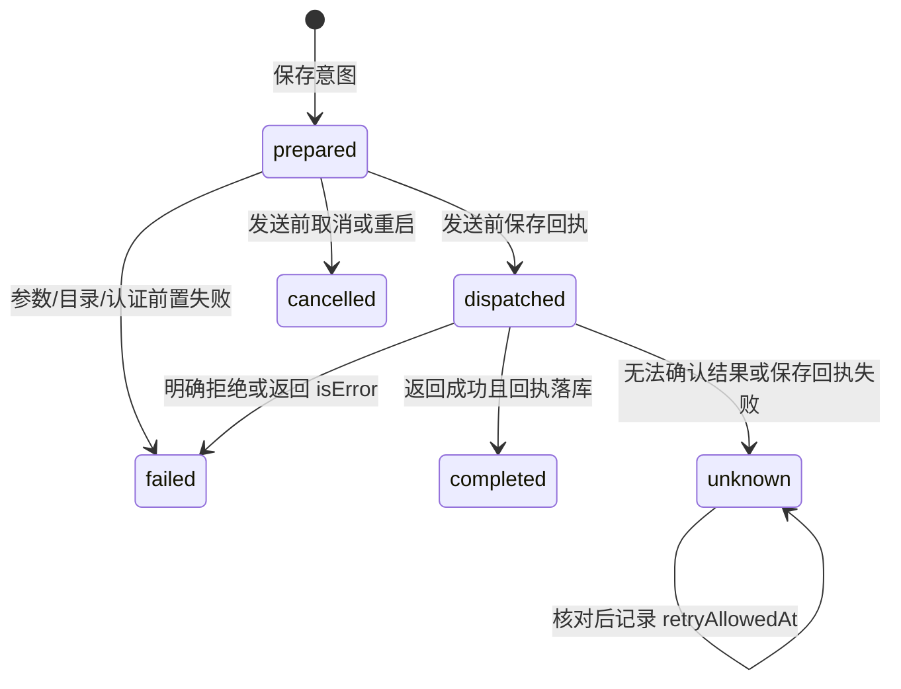

# 远程 MCP 连接、授权与不确定结果

## 文档更新历史

| 文档版本 | 更新时间                  | 最新 Git 提交 ID（代码基线）             | 内容变化                                                                  |
| -------- | ------------------------- | ---------------------------------------- | ------------------------------------------------------------------------- |
| 1.0.1    | 2026-10-16T23:27:39+08:00 | 798aea13020fdad314b8a34bc78d7eadb2ac0bf0 | 同步尚未提交源码：移除执行模式分支，明确所有根运行统一取得 MCP 授权租约。 |
| 1.0.0    | 2026-10-15T17:24:30+08:00 | 9ad009be8a41df28a02060c5620ee12a29c3d901 | 说明 Streamable HTTP、冻结授权、调用回执、unknown 屏障及恢复。            |

## 1. 支持范围

手机作为远程 MCP client，通过 Streamable HTTP 调用服务器 tools。服务器运行在用户自己的远程服务或开发机，应用不启动本地 stdio、Node/Python MCP 子进程。协议实现使用 `@modelcontextprotocol/client` 2.3.1，传输基于 Expo fetch。

SDK 自动协商协议，当前 fixtures 验证 `2025-11-25` 与 `2026-07-28` 两代、JSON/SSE 返回、目录分页和进度。这属于明确的外部协议兼容功能，和内部旧数据兼容无关；不能把 fixtures 范围扩写为任意 MCP 扩展均支持。

当前仅 tools discovery/call，auth 支持 none/Bearer。不支持 OAuth、stdio、本地服务器安装、独立旧 HTTP+SSE transport、MCP resources/prompts 浏览、sampling、elicitation、Tasks 必需扩展或任意服务回调。返回的嵌入资源文字可以展示，但不等于实现 resources API。

## 2. 配置与项目授权

McpServer 保存 id/name/url/auth/enabled/timeoutMs/revision、目录、协议版本与检查状态。URL 是**完整最终端点**，与模型 baseUrl 不同；要求 HTTPS，localhost loopback 可 HTTP，禁止内嵌凭证、查询或片段。

timeout 为 5–600 秒，Bearer Token 不含换行且最多 8,192 字符。secret 位于 CredentialStore，元数据只有 credentialRef。保存/删除凭证使用意图与租约清理，当前运行仍引用的凭证不提前退役。

发现工具不自动授予项目权限。grant 精确绑定 projectId/serverId/toolName/fingerprint，目录指纹包含工具描述、schema 等；readOnlyHint 是服务器提示，不是权限证明。工具变更或端点/认证绑定变化后原授权失效，需要重新检查。

单项目最多启用 32 个 MCP 工具。启动 Run 时获取项目授权租约，过滤 disabled、定义失效及 unavailable 工具，保存不含凭证的 McpServerSnapshot。根 Run 使用冻结的远程 MCP runtime，子 Agent 当前不继承 MCP 工具。

## 3. 目录与 schema 约束

McpSession 使用 SDK listMaxPages=5，目录最多 64 个工具；重复名称拒绝。标题截到 100、描述截到 2,000 字符；输入/输出 schema 的 canonical 长度各最多 24,000，嵌套最多 16 层。

当前不支持 `$ref`/`$dynamicRef`、特殊 prototype 属性名和要求 Tasks 的工具。这些目录项标 unavailableReason，不可 grant/调用。JSON schema validator 使用 CF Worker 解释器路径，避免 Hermes 下动态代码生成依赖。

工具目录指纹是 descriptor 的规范序列化；参数 argsHash 另用 SHA-256。不要将前者与 Git blob SHA 或参数摘要混淆。

每次 tools/call 前重新发现并比对冻结工具指纹，再校验参数；定义变化或参数不合法时不发送远端效果。SDK 自己可能对内部 schema 做标注，因此传入深拷贝，不能修改冻结 snapshot。

## 4. Agent 工具映射

授权工具映射为 `mcp_<serverIndex>_<toolIndex>`，label 以服务器名与工具 title/name 展示。模型只看到当前 Run 的冻结工具 schema；每项 effect=remote-effect，主角色授权检查与共享工具预算仍生效。

原始工具名、服务器端点与实际 secret 在 runtime lease/session 中处理。只有工具参数发给该服务器；返回内容是外部数据，不增加文件、Git 或设备权限。系统规则提示模型不能把工具描述/返回内容作为新授权。

## 5. 回执状态机

McpAttempt 存 taskId、traceId、serverId/name、url、tool、argsHash、有界脱敏 preview、state、createdAt/endedAt 和 retryAllowedAt。不保存完整参数作为通用重放材料，也不保存 Token。

调用流程：

1. 获取以规范 URL + tool + argsHash 为 key 的运行时 dispatch 许可，拒绝本进程同时发送相同调用。
2. 查询持久化 unknown/dispatched 屏障，未解除则不重发。
3. 保存 prepared intent。
4. 建立 session、发现/比对工具并校验参数。
5. HTTP 即将发送 tools/call 时先保存 dispatched，成功后才能执行 fetch；session 禁止自动重复发送。
6. 处理返回、保存 completed/failed 回执，最后释放许可。

远端服务和本地库没有事务，不能保证 exactly-once。当前保证是不主动重复已派发而结果不明的同一调用，并保留人工核对入口。

## 6. unknown 的含义

在 dispatched 落库后可能尚未真正发送就崩溃，也可能远端执行成功后网络断开；两者都只能保守记 unknown。取消请求不证明远端副作用已取消。

当前 HTTP 400/401/403/404 明确拒绝按未接受处理；其他发送后网络/协议故障、取消或返回已到达但本地回执保存失败不能据此判“未执行”。本地写失败时即便 unknown 保存也失败，原 dispatched 记录仍维持屏障。

屏障按 URL/tool/argsHash，跨 root Run 甚至同 URL 的不同 server 配置条目生效；改变参数会得到新 hash，当前没有语义层的远端副作用去重。宿主提示模型不要换参数规避未知限制，但不能据此宣称绝对防重复。

## 7. 用户核对与恢复

`mcp.unknown(serverId?)` 列出未知/派发中且未解除记录。用户先检查远端服务的日志、请求结果或目标对象，再通过 UI 确认核对；`acknowledge(id)` 仅给 unknown 设置 retryAllowedAt。

该动作不会改成 completed，也不触发网络重试。若用户决定再次尝试，后续新的 Agent 调用产生新的 attempt；服务器自身幂等键仍是可靠防重复的重要条件。

启动恢复将 prepared → cancelled、dispatched → unknown；对应 Run 收束为 interrupted，匹配 traceId 的工具步骤显示 unknown。恢复不创建 session，不重放 tools/call。

## 8. 传输与返回内容边界

所有请求固定授权的最终 URL，redirect='error'；重定向或 SDK 额外地址不获授权，需用户配置真实最终端点。MCP body 最大 512 KiB，每个 HTTP 响应最大 2 MiB，超限停止读取。

返回文字及 structuredContent 转为模型工具内容，单段最多 100,000 字符并标截断；image 只有模型允许图片且 MIME 为 PNG/JPEG/WebP 时经过图像头/尺寸校验再转发。其他内容类型显示说明，不自动打开外部 URL、不下载二进制、不导入项目文件。

进度消息清理 Token 并截到 1,000 字符。目录、返回内容和 UI 预览清理已知 secret，但这不是任意私有内容识别器；工具参数可能含项目资料，不能让服务描述自动决定发送整库内容。

## 9. 新增 MCP 能力的检查点

新增 OAuth、resources、sampling 或 Tasks 时，应单独设计用户可理解的授权、凭证生命周期、响应大小、取消与重启恢复。不能直接开启 SDK autoFulfill 或把手机原生调用暴露给服务端。

升级 SDK 时重跑两代协商、分页、JSON/SSE、descriptor 改变、取消前/后发送、回执故障及并发屏障测试，检查 Metro shims。协议支持范围必须更新本文，不保留一套未被调用的平行客户端。

## 10. 实现与验证入口

[配置](../src/application/mcp/configuration.ts)、[派发屏障](../src/application/mcp/dispatch.ts)、[客户端](../src/adapters/mcp/client.ts)、[runtime](../src/adapters/mcp/runtime.ts)、[工具](../src/application/tools/mcp.ts)、[mcp.test](../tests/mcp.test.ts)、[MCP E2E](../tests/e2e/mcp.spec.ts)、[模拟服务器](../scripts/mock-mcp-server.mjs)。
