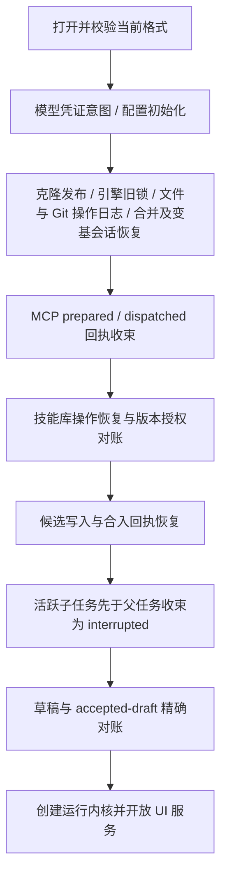

# 存储结构与中断恢复

## 文档更新历史

| 文档版本 | 更新时间                  | 最新 Git 提交 ID（代码基线）             | 内容变化                                                                             |
| -------- | ------------------------- | ---------------------------------------- | ------------------------------------------------------------------------------------ |
| 3.3.0    | 2026-10-19T17:56:09+08:00 | 414863fdcd788534b2232fea740024864a8726a4 | 对应已提交源码：保留文件、合并与变基恢复，收束已知根状态临时文件。                   |
| 3.2.0    | 2026-10-19T15:27:13+08:00 | 262940983352666ec86b8389fc656ed368f5680d | 同步尚未提交源码：git-rebases、逐步进度回执、原分支保护、变基状态和 UTF-8 预算预检。 |
| 3.1.0    | 2026-10-19T14:43:24+08:00 | 262940983352666ec86b8389fc656ed368f5680d | 同步尚未提交源码：合并会话、冲突/stages/状态意图、私有完成引用与回执恢复。           |
| 3.0.0    | 2026-10-19T12:10:29+08:00 | 262940983352666ec86b8389fc656ed368f5680d | 同步尚未提交源码：f7/schema 3 对象引用日志、原生锁恢复、克隆发布与未知推送对账。     |
| 2.3.0    | 2026-10-18T19:00:33+08:00 | 34f542b6f4e917f475d36c9f5ea8b369f5d74dda | 同步尚未提交源码：增加文件编辑草稿、修订墓碑及保存意图的跨存储对账。                 |
| 2.2.0    | 2026-10-17T10:27:05+08:00 | ba5117e2ea7908376dec70267b60d3b5d95f5156 | 同步尚未提交源码：真实原生移动、内部路径校验、fileMove 正文与部分效果恢复。          |
| 2.1.0    | 2026-10-17T00:09:49+08:00 | fd29c75e38d245b3a8e5cfb6a93c0b2156029d22 | 同步尚未提交源码：记录精确替换请求指纹、回执重建与候选检查点恢复。                   |
| 2.0.0    | 2026-10-16T23:27:39+08:00 | 798aea13020fdad314b8a34bc78d7eadb2ac0bf0 | 同步尚未提交源码：记录 f5、物理版本 6、Run schema 4 与移除执行模式索引字段。         |
| 1.0.0    | 2026-10-15T17:24:30+08:00 | 9ad009be8a41df28a02060c5620ee12a29c3d901 | 记录当前数据格式、数据库布局、事务边界、启动恢复与开发重建。                         |

## 1. 存储分工

| 数据                                     | Android/iOS                                   | Web                                | 事实来源                                 |
| ---------------------------------------- | --------------------------------------------- | ---------------------------------- | ---------------------------------------- |
| 项目/技能文件与 `.git`                   | 受控原生文件接口，应用私有目录 `agent-mobile` | IndexedDB `files` store            | Git 文件内容及快照；工作树是当前编辑状态 |
| 配置、项目/对话元数据、运行、轨迹、回执  | `agent-mobile.sqlite`                         | `agent-mobile-prototype` IndexedDB | BusinessStore                            |
| 模型/MCP/Git 秘密值                      | SecureStore                                   | 页面生命周期内 Map                 | CredentialStore，不序列化到业务记录      |
| 主题和项目选择偏好                       | 数据库 preferences record                     | records store                      | PreferencesService                       |
| 当前页签、对话选择投影、弹层、编辑中内容 | React/Zustand 内存                            | React/Zustand 内存                 | 界面临时状态                             |

[HostFileSystem / MetadataStore / CredentialStore](../src/core/storage/contracts.ts) 是平台无关端口。BusinessStore 扩展元数据端口，提供有类型的操作、运行和轨迹事务，不暴露 SQL 或 IDBTransaction。

Git adapter 使用内部逻辑目录 `/workspaces/<id>/repository`。这是宿主定位文件的逻辑路径，原生由平台 adapter 映射到私有根目录下的真实文件，不再施加文本/图片存储白名单。操作系统沙箱隔离应用，工作区用例负责项目授权、相对路径、版本与恢复；两者职责不同。项目 ID 与内部 storagePath 分别校验，Agent 仍拿不到设备绝对路径。技能库通过 `skills` 日志 namespace 与 `skill-projects` bucket 隔离，与用户项目共用底层存储但不混用业务查询范围。

HostFileSystem 提供字节读写、目录与 stat，以及不覆盖已有目标的 moveFile。原生正文由本地模块处理，移动使用原子 rename；Web 在一次 files 事务中迁移记录并刷新 contentVersion。GitTree 和恢复日志使用对象引用与 mode，大文件快照/恢复不经 JS 传输整仓 bytes。原生支持 lstat、受控 symlink 内容和执行位；正文工具不跟随链接。公共流式文件接口、文件监听与外部目录挂载仍未实现。文本与图片能否预览属于应用/工具策略，不影响原始字节存储；当前用例的 20 MiB 文件操作预算见 [工作区](workspace-and-git.md)。

## 2. 当前格式与实例身份

[CURRENT_DATA_FORMAT](../src/core/storage/business-store.ts) 当前为 `agent-mobile-f7`。SQLite `PRAGMA user_version` 和 IndexedDB physical version 当前为 `6`。三种版本的职责不同：

- format 标识校验整个当前开发实例的可读结构。
- physical version 表示平台数据库结构，不维护历史迁移链。
- 记录中的 schemaVersion 表示当前 DTO 契约，如 OperationHeader 为 3，RunRecord/Header 为 4，TranscriptFrame 为 1。

数据库同时生成 `instanceId`。Run 和轨迹游标绑定该身份，数据重建后旧游标会被拒绝，而不是误读新实例中的同名记录。格式检查失败阻断正常 bootstrap，不用历史字段读取或自动升级兜底。

## 3. SQLite 表布局

精确 DDL 见 [sqlite-business.ts](../src/adapters/storage/sqlite-business.ts)。启用 WAL 与 foreign_keys，写入通过 `withExclusiveTransactionAsync` 串行执行。

| 表                   | 主键/重要索引                                                              | 保存内容                                                    |
| -------------------- | -------------------------------------------------------------------------- | ----------------------------------------------------------- |
| `application_format` | 固定 id=1                                                                  | format 与 instance_id                                       |
| `records`            | `(bucket,id)`                                                              | 小规模配置、冻结快照、业务状态等 JSON payload               |
| `operation_headers`  | `(namespace,project_id,id)`；scope sequence 唯一；owner、pending 索引      | 阶段、revision、归属、路径、指纹和引用摘要                  |
| `operation_bodies`   | 与 header 相同；引用 header                                                | GitEntry before/after、indexChanges、fileMove 与 headChange |
| `operation_counters` | `(namespace,project_id)`                                                   | 范围内递增 operation sequence                               |
| `run_headers`        | id；admission_sequence 唯一；project/conversation/history/root/active 索引 | 运行摘要、状态、计数、快照引用、停止原因                    |
| `run_inputs`         | id → run_headers                                                           | 不可变 prompt                                               |
| `run_results`        | id → run_headers                                                           | response 与 skillActivations                                |
| `run_counters`       | 固定 id=1                                                                  | 全实例运行入队序号                                          |
| `trace_nodes`        | id；`(run_id,run_sequence)` 唯一                                           | 轨迹类型、顺序、状态、摘要与正文长度                        |
| `trace_text_chunks`  | `(node_id,ordinal)`；offset 索引                                           | 连续追加正文块与 UTF-16 偏移                                |
| `transcript_frames`  | `(run_id,ordinal)`                                                         | 引擎消息完成帧，独立 opaque payload                         |

索引列用于小范围查询，JSON payload 保存当前领域形状。列表读取 headers，不把完整 prompt、结果、文件操作正文和轨迹树放在同一个大 JSON record 中反复读写。

## 4. IndexedDB 对应布局

[indexeddb-business.ts](../src/adapters/storage/indexeddb-business.ts) 提供同名 operation/run/trace stores 和 `records`，格式 store 名为 `format`，另外有 `files`。域内索引使用组合 key；record key 是 `bucket/id`，`all(bucket)` 用前缀 key range，不全库扫描无关 buckets。

`files` 的 `stat` 索引包含 `[path,kind,size,mtime,contentVersion]`。stat 走 key cursor，不克隆文件 bytes；真正读取时才获取 StoredFile。Web 写入为每个文件生成新的 contentVersion，用于轻量缓存失效。

旧 IDB physical version 升级请求被中止，返回格式不匹配；不会在 onupgradeneeded 内迁移旧 stores。versionchange 会关闭连接，要求刷新；其他页面占用时返回 blocked 错误，需要先关闭旧连接。

虽然 Web 文件和业务数据放在同一个数据库，当前 HostFileSystem 与 BusinessStore 调用仍分别提交事务，**没有把 Git、files 和业务回执合并为一个跨层事务**。

## 5. `records` 的业务 bucket

| bucket                                              | 内容/键的范围                                                                         |
| --------------------------------------------------- | ------------------------------------------------------------------------------------- |
| `projects` / `skill-projects`                       | 用户项目 / 技能库内部项目，按项目 id                                                  |
| `conversations`                                     | `state`：对话目录、选中项与草稿                                                       |
| `model-config` / `model-key-ops`                    | 模型图配置 / 凭证新建与退役意图                                                       |
| `mcp-config` / `mcp-key-intents` / `mcp-attempts`   | 服务器与授权 / 凭证意图 / 远程调用回执                                                |
| `skills`                                            | `configuration`：库版本、摘要与项目 grants                                            |
| `settings`                                          | `agent`：系统提示词与 limits                                                          |
| `editor-drafts`                                     | projectId/相对文件路径：format=1 草稿及修订墓碑；新建文件使用 .new-document 元数据键  |
| `git-operations` / `git-clones` / `git-credentials` | 仓库元数据命令/传输意图、克隆发布意图、无秘密值的认证引用                             |
| `git-merges`                                        | 原始 HEAD/分支/raw 快照、来源与基础提交、触及路径、临时项、pending 操作和合并会话状态 |
| `git-rebases`                                       | 原始/目标提交、原作者/说明、步骤与重写进度、触及范围及 pending 操作的目标 Progress    |
| `preferences`                                       | `workbench`：工作台偏好                                                               |
| `run-launches`                                      | 按 launchSnapshotRef 的冻结配置                                                       |
| `accepted-drafts`                                   | `conversationId/revision`：已接纳目标的运行回执                                       |
| `run-groups` / `run-delegations`                    | 共享预算 / 委派幂等回执                                                               |
| `change-proposals` / `proposal-writes`              | 按提案 ID 保存候选状态 / 按调用 ID 保存候选写入意图                                   |

这是逻辑布局说明，新增业务不要直接将领域事实写到未归属的随意 bucket。持久化调用集中在相应 service/repository。

文件编辑草稿记录基础文件 revision、base/text、开放范围、模式、选区与原始换行约定。写文件前先保存 pendingSave、稳定 saveOperationId 和 savePath，再通过原有文件操作日志写入；草稿与文件分别提交。重开时若实际文件内容匹配 pendingSave.base，则采用该基线和剩余草稿；若匹配原基线则恢复原草稿；均不匹配时保留草稿并显示外部冲突，禁止盲目覆盖。丢弃使用带修订的 null 墓碑，阻止晚到写入复活；草稿服务不提供跨浏览器进程的全局锁。

## 6. 同数据库原子边界

`prepareOperation` 原子保存 operation body/header，并分配 scope sequence。精确替换仍使用 files 操作，OperationBody 的 textEditFingerprint 保存路径、基础 revision 与整批替换参数的请求指纹；移动命令的 fileMove 保存 from/to。这两类字段均纳入 bodyFingerprint 校验，不进入 header 或 UI 操作摘要。文本编辑重试核对指纹及 owner/path，以日志 before 重建并验证 after，recorded 回执直接返回原结果，不重新改写当前文件。这些正文元数据不新增 SQL/IDB stores 或历史格式读取分支。相同 ID 与相同不可变意图可复用；意图不匹配返回 CONFLICT。

`writeBusiness` 可以一次原子写入元数据、OperationHeader 更新、RunHeader/Input/Result 更新、TraceNode/Chunk/Frame。典型场景包括：

1. 根 Run 初次入队 + 冻结 launch + accepted-draft 回执。
2. 子 Run 创建 + 父 childCount + 委派回执 + 子预算 allocation + 父工具轨迹关联。
3. 轨迹增量与对应运行状态/结果的同批保存。
4. operation 最终 recorded 回执 + 项目 updatedAt。

更新使用 expectedRevision；不可变归属、sequence 和输入不能改，终态 Run 不能重新活跃。轨迹必须连续追加，不能由新块覆写已结束节点。具体约束见 core 的 assert 函数。

Git objects/refs、真实文件与 SecureStore 不参与此事务；模型和 MCP 的远端效果更不参与。故障处理要辨别“效果未发生”和“效果发生但回执未落库”。

项目初次创建当前按 init Git → 写初始文件 → 初始 commit → 保存项目元数据顺序执行，没有专用创建意图跨存储对账。中断可能留下未登记的内部仓库；自动扫描重新登记或回收这种孤立初始化资料尚未实现。操作日志的恢复保证主要覆盖已登记项目的受控修改，不能概括为全部启动/创建步骤均具备原子性。

文件日志的 before/after 是 `{revision,mode}` 或 null，正文只保存在 Git 对象中。意图保存前创建 before/target 私有 checkpoint，index 变化另固定前后树，防止恢复对象失去引用。headChange 保存引用前后状态，expectedBranch 与 expectedHead 一起防止同 OID 不同分支误恢复。对象校验和 fsync 已开启；这不证明硬件断电原子性。

merge 操作正文增加 conflictsChange（完整三方 stages before/after）、gitStateChange（固定受限合并/变基状态文件 before/after）、completionReceipt 和 commitDependencies；全部纳入 bodyFingerprint，不复制进 header。意图前用私有 checkpoint 固定提交依赖及全部冲突 stage 对象，覆盖没有来源提交引用的虚拟基础 blob。冲突中普通文件编辑不读取不支持冲突的 stage 0 index；有索引修改的操作仍完整验证索引基线。

合并按文件 → index/stages → 状态文件 → HEAD → 私有 applied ref → SQLite 回执推进。无 HEAD 更新时通过 applied ref 确认效果已完成，引用必须等于该意图 checkpoint；缺失回执不重新覆盖后续编辑。多状态文件逐字段允许 before/after 的混合现场，第三种内容阻断。统一文件日志恢复后再对账 git-merges；合并 session 和操作意图不构成跨存储事务。登记意图的确认丢失时暂停写入；无意图的预检拒绝撤回 pending，允许重试。详细流程见 [原生 Git](native-git.md)。

`git-rebases` 保存不可变原始/目标信息与逐步 Progress；pending 包含 operationId 和日志成功后的目标进度。session 先保存 pending，再登记统一 rebase 文件意图，recorded 后推进 Progress。无已登记意图时撤回 pending，确认丢失阻断。HEAD 分离期间，原分支保持原 OID；最终 headChange.branchGuard 比较原 OID 或已经完成的目标 OID，再完成引用与挂接。部分 Git 状态、原分支 CAS 后挂接前、完成引用后 SQLite 中断都通过同一日志收束。启动不自动推进尚未开始的下一 pick。

变基和合并复用固定 Git 状态白名单。应用层在任何文件意图前检查字段及 UTF-8 字节预算，不能将注定无法写入的超预算状态登记为可恢复意图。原生文件采用原子临时写，已知中断临时项先校验普通文件类型；未知项与 symlink 阻断，不递归删除 Git 状态目录。

克隆具有独立 git-clones 意图：下载完成后在项目私有父目录保存来源/操作 ID/HEAD 回执，再用不覆盖目标的 rename 发布 repository。启动时，完整暂存目录可以发布，已经发布但尚未登记的仓库补齐 Project 与完成回执；未完成下载只清理该导入的 clone-staging，不触及已发布项目。普通模板 create 的初始化孤立目录限制仍如上所述。

## 7. 启动恢复顺序

顺序由 [bootstrap](../src/bootstrap/index.ts) 固定。恢复只读取意图、对象和回执，不创建 Pi 引擎，不重新请求模型，不重放远程工具。

- **Git 引擎锁**：原生 C++ 每仓库 timed_mutex 与 flock 覆盖所有桥实例；取得独占租约后只清理已知 index/HEAD/config/ref/reflog 锁。锁或引用目录若是 symlink/特殊文件则整批拒绝。等待中的旧桥任务可取消，不能在新桥恢复期间继续写入。Web 不产生 libgit2 持久锁。
- **远程传输**：不在启动自动请求网络或重放 push。prepared 推送转 needs-review，界面显式 verifyPush；认证只允许同一远程地址。fetch 可以重新发起，未完成克隆按本地完成回执处理。
- **文件操作**：依 scope sequence 读取 pending headers，一次加载一条正文；先预检所有文件是否等于 before 或 after，再执行待完成效果；index 也核对 before/after，HEAD OID 与分支身份必须同时匹配基线，或已找到带 operation marker 的公开提交/已完成 headChange。引用已切换时只补业务回执，不重放文件覆盖后续用户编辑。移动意图验证两条记录一致，两端未执行时调用 moveFile；已完成时不重复移动，部分完成时按对象/模式记录收束。出现第三种内容保留现场并阻断该项目写入。文件、Git 与业务回执仍是分步持久化。
- **MCP**：prepared 转 cancelled；dispatched 转 unknown，保留重试屏障。
- **Skills**：恢复 skills namespace 工作区日志，再按 Git 最新库快照重建摘要并移除过期授权。
- **提案候选**：prepared 写入若有 checkpoint ref则验证路径并完成回执，没有 ref则取消该写入；合入用 operation 回执决定 applied/ready/interrupted。
- **Run**：按 depth 降序恢复子任务，然后父任务；活跃/排队运行转 interrupted。尽可能收集已持久化最终轮文本和本任务归属快照。
- **草稿**：只清理与已接纳 Run 完全匹配的 projectId/conversationId/revision，不清理后续新输入。

## 8. 失败后的行为

| 失败位置                                              | 当前行为                                         | 维护原则                                      |
| ----------------------------------------------------- | ------------------------------------------------ | --------------------------------------------- |
| operation 正文缺失/指纹不符、Git 对象损坏、基线不一致 | 受影响项目写入阻断并显示 recoveryIssues          | 保留现场；不猜测覆盖用户内容                  |
| 运行 checkpoint/终态保存失败                          | 内核 recovery_required，停止派发并请求重开       | 不把未持久化完成状态显示成成功                |
| 普通命令失败                                          | SerialQueue 拒绝该命令，后续独立命令仍可进入队列 | 不能把这一语义用于必须阻断后续工作的 recorder |
| Recorder 持久化失败                                   | 写链保留 rejection，最终保存无法跨过失败         | 保证轨迹/回执缺失可见                         |
| 凭证清理失败                                          | 保留意图，启动或租约释放后重试                   | 不提前删除当前配置或活跃运行引用的 Key        |
| 远端结果不明/回执保存失败                             | unknown 或 dispatched 屏障                       | 不自动重复同一远程效果                        |

## 9. 开发格式重建

仅在 bootstrap 因 DATA_FORMAT 失败、服务尚未创建时，`rebuildDevelopmentData()` 可触发重建。运行中的服务、普通 STORAGE 错误或任意用户数据异常不满足入口条件。

原生流程：校验私有根目录 → 在根目录外写 `agent-mobile-rebuild.pending` → 删除本应用 SQLite 数据库 → 删除本应用 `agent-mobile` 文件根 → 清除标记。中断后标记阻断下次正常启动，重新明确重建可完成残余步骤。SecureStore 不在删除范围；因业务引用已丢失，保留的凭证不一定会被新配置自动使用。

Web 只删除当前 origin 的 `agent-mobile-prototype` 数据库。其他标签页占用时要求关闭；不删除全部浏览器存储或其他 origin。内存 Key 随页面结束消失。

这不是面向已发布用户的数据迁移。没有旧格式读取、升级/降级或自动导入链；需要保留开发资料时先通过支持的导出或在受控测试现场留档。

## 10. 数据维护限制

当前没有自动 GC、历史清理、云同步或完整项目备份/恢复产品能力。日志 before/after、Git checkpoint 和 transcript 会积累；分页减少读取量，不降低已经持久化的数据总量。trace 的内部恢复路径仍可能读取整条运行轨迹，大任务不能仅凭分页 UI 宣称内存有固定上限。

文件内容缓存只用于减少读取；原生 contentStamp 使用原始 Git blob SHA，mode 由 stat 单独投影。缓存不作为授权或写前版本证据，实际修改前仍读取内容校验。

## 11. 验证入口

[当前格式/事务测试脚本](../scripts/storage-current-format.mjs)、[范围查询脚本](../scripts/storage-range.mjs)、[journal.test](../tests/journal.test.ts)、[字节存储与移动恢复](../tests/workspace-bytes.test.ts)、[原生 SDK 契约模拟](../tests/native-storage.test.ts)、[run-repository.test](../tests/run-repository.test.ts)、[trace-storage.test](../tests/trace-storage.test.ts)、[模型配置测试](../tests/model-config.test.ts)、[提案测试](../tests/proposals.test.ts)。SDK 模拟不证明真机文件移动与进程中断行为；原生故障注入脚本的范围与执行方法见 [测试与维护](testing-and-operations.md)。
