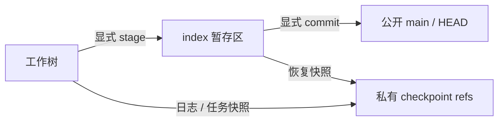

# 受控工作区与 Git 工作流

## 文档更新历史

| 文档版本 | 更新时间                  | 最新 Git 提交 ID（代码基线）             | 内容变化                                                     |
| -------- | ------------------------- | ---------------------------------------- | ------------------------------------------------------------ |
| 1.0.0    | 2026-10-15T17:24:30+08:00 | 9ad009be8a41df28a02060c5620ee12a29c3d901 | 整理路径与修订、文件日志、真实暂存提交、任务撤销和快照语义。 |

## 1. 工作区边界

用户项目有独立 Git repository 和共享工作树。UI 通过 WorkspaceApi 操作，Agent 通过明确工具操作。内部 HostFileSystem 和 GitPort 可以读写私有仓库，但不直接暴露给 Agent、技能正文或未来动态 UI。

[safePath](../src/core/workspace/path.ts) 将输入规范化为 NFC，要求工作区相对路径。长度最多 220 个 UTF-16 单位，拒绝前后空格、反斜杠、冒号、控制字符、绝对路径、空组件、`.`、`..`、`.git` 及其前缀、末尾点/空格和 Windows 保留设备名。校验不是对任意设备路径做简单字符串拼接。

`project.json` 是宿主管理文件，不允许普通写入、移动、删除、提案合入或手工暂存选取。Agent 只能生成 `.md`/`.txt` 文本，支持移动/删除授权图片，不能直接生成图片 bytes 或任意源码。

## 2. 支持的内容与修订

文本按 UTF-8 处理，单文件最多 1 MiB；一般文件最多 20 MiB。支持 PNG/JPEG/WebP，保存时验证格式头与尺寸，单边最多 16,000、总像素最多 2,400 万；这不是完整图像解码校验。转发模型的图片有独立 4 MiB 上限。详细常量见 [Agent 限制](agent-runtime.md)。

文件 revision 是标准 Git blob OID，按实际 bytes 计算。新建 expectedRevision=null 表示目标必须不存在；已有文件修改/删除/移动必须带当前 revision。相同大小/mtime 不代表内容相同；目录视图缓存用 Web contentVersion 或原生 contentStamp，写前仍读取真实 bytes。

`read_text` 的 offset/length 使用 UTF-16 单位，返回 revision、source、truncated 和 nextOffset。Agent 必须分段读完所需内容后再写；长度限制不是把被截断内容视为完整资料。`list_files` 默认 200、最多 500 条，游标与来源/manifest 绑定；`search_text` 最多返回 100 条匹配。

## 3. 项目队列与占用

MutationCoordinator 持有每项目 SerialQueue、运行 owner 和恢复 blocked 集合。查询 snapshot/status 与写命令按项目队列排列，使一次项目视图对应一致的用例时点。

根 Run claim 后，只有同 owner 的受控写入能修改项目；UI 即使保留了旧 revision，也会被占用检查拒绝。根任务最终回执收束后才释放占用。writer 子任务不 claim 真实工作树，只产生隔离 Git candidate；合入由 root owner 执行。

队列/锁属于当前进程实例，没有 Web 多标签页协作写锁或跨进程工作区服务。不要把同 origin 两个应用页面的同时编辑当成已支持协作场景。

## 4. 文件修改日志

[Operation](../src/core/workspace/journal.ts) 分为摘要 header 和正文 body。header 包含 scope、sequence、revision、expectedHead、bodyFingerprint、owner/actor/proposal 归属和 checkpoint/commit。body 保存文件 before/after 的 Base64 或 null 以及 indexChanges。

| kind           | 用途                                                    | 正常阶段                                                 |
| -------------- | ------------------------------------------------------- | -------------------------------------------------------- |
| `files`        | 保存、删除、移动、丢弃、恢复、任务撤销/合入中的文件变化 | prepared → applied → checkpointed → recorded             |
| `index`        | 暂存/取消暂存，仅更新 index                             | prepared → applied → checkpointed → recorded             |
| `commit`       | 将固定目标树变成公开提交                                | prepared → committed → recorded                          |
| `files_commit` | 技能库整包变更并固定为库版本                            | prepared → applied → checkpointed → committed → recorded |

阶段允许跳过不适用项，但不能倒退；recorded 不能再次更新。prepare 在业务库原子分配 sequence 并保存正文，后续先完成文件/index/Git 再写回执。文件系统不具备整批数据库事务，进程可能停在多个路径之间；日志恢复将其收束。

恢复读实际 before/after：等于 after 则跳过重复效果，等于 before 则继续，第三种内容则阻断。operation ID 不能用不同参数重试。commit 意图将 `AgentMobile-Operation: <id>` 放进提交说明，恢复可查到已生成提交并避免重复公开提交。

幂等范围是已经保存的 operation 意图及对应恢复。write_text 使用 run/round/callId 形成稳定操作 ID；当前普通 remove/move 用例内部生成新 ID，公共 WorkspaceApi 也不提供调用者通用幂等键。因此不能对所有新发起的文件命令承诺重复调用无效果；错误后先读当前状态，不能无条件自动重试。

recorded 与必要项目元数据写入成功后，才发送 `{projectId,paths,commit}` 变更通知。commit 字段表示通知时的公开 HEAD，**不表示每次文件操作生成了公开提交**。UI 据此实时刷新文件，无需等待完整 Agent 结束。

## 5. HEAD、index 与工作树

- **HEAD**：用户可浏览的公开历史；项目初始化创建一次初始提交。
- **index**：标准 Git 暂存区，保存将提交的内容版本；不是仅记录文件名。
- **worktree**：当前保存内容，可以与 index 不同。
- **checkpoint**：`refs/agent-mobile/checkpoints/<key>` 下的内部提交对象，通过 `noUpdateBranch` 创建，不移动 main/HEAD，也不显示在公开 HEAD 历史链。

因此底层每次持久化可能创建内部 Git commit object，但用户提交体验仍为显式暂存和 commit。此前“每次保存就提交”的公开工作流已不适用于当前实现。

## 6. 标准使用流程与并发字段

| 操作           | 前置证据                                             | 效果                                 |
| -------------- | ---------------------------------------------------- | ------------------------------------ |
| 保存           | 当前内容 revision/null                               | 修改 worktree，记录日志和 checkpoint |
| 暂存           | HEAD + indexRevision + 所选路径 revision/null        | 将所选当前内容写入 index             |
| 取消暂存       | HEAD + indexRevision                                 | 所选 index 退回 HEAD；工作树不变     |
| 提交           | HEAD + indexRevision + 非空说明                      | 固定 index 目标树生成公开提交        |
| 查看已暂存差异 | 当前状态                                             | HEAD 与 index 比较                   |
| 查看未暂存差异 | 当前状态                                             | index 与 worktree 比较               |
| 丢弃未暂存     | 完整 GitStatus 的 head/indexRevision/workingRevision | 所选 worktree 退回 index             |
| 恢复历史版本   | expectedHead，且无 staged/unstaged 改动              | 历史树写回 worktree，等待显式提交    |

indexRevision/workingRevision 是规范排序路径与 blob revision 映射的指纹。stage 读取真实 working bytes 再验证每个路径，避免提交按钮操作旧预览。提交说明 1–4,000 字符，禁止包含内部 operation marker。

示例：保存 A → 暂存 A → 再保存 B → 提交。公开提交包含 A，B 仍为未暂存更改。取消暂存后不会丢掉 B；discard 后恢复的是 index，不一定是 HEAD。

AppServices 的 commitStaged 提交当前所有已暂存变化；Agent 的 git_commit 额外限定所选 paths，避免夹带任务外用户暂存内容。

## 7. Agent 的 Git 授权

`git_status`、`git_diff` 为 read；`git_stage/git_unstage` 为 git-index；`git_commit` 为 git-commit。角色必须拥有对应 effect。

宿主验证所选路径由本 root Run 日志触及，并且任务开始时 HEAD、工作树、index 在该路径一致。开始前已有用户未提交修改，即使 Agent 后来编辑过该文件，也不能由 Agent 提交；交由用户 Git 面板处理。

“仅在用户要求提交时操作”还有系统规则提示，但这不是自然语言意图的代码级证明。当前宿主真正强制的是路径归属、干净基线、修订与角色 effect。新增自动提交策略不能只改提示词绕过这些边界。

## 8. 任务快照与撤销

根任务开始固定 HEAD、working base 与 index base；结束记录 final HEAD、working snapshot、index snapshot。任务 changedPaths 来自基线/最终差异与本任务 recorded 操作归属的交集，不把项目里的全部未提交变化算作任务产物。

`taskChanges` 展示工作树变化及仅发生于暂存区的变化。`undoTask` 对所选任务路径验证当前 worktree/index 仍等于任务最终版本，然后写回任务 base 工作树与 base index。已有后续修改则整批拒绝，并指出冲突路径。

撤销不会 rewinding HEAD 或删除既有公开提交；若任务明确提交过，撤销后是等待用户提交的反向工作树/index变化。子任务不能单独 undo，已合入 writer 提案计入 root 归属，统一撤销根任务。

重启恢复以任务归属日志和固定快照取最终状态，避免后来其他任务的项目变化被错误归到早先中断的任务。

## 9. Git adapter 实现要点

[repository.ts](../src/adapters/git/repository.ts) 通过 [filesystem adapter](../src/adapters/git/filesystem.ts) 运行 isomorphic-git，初始化 main 分支。它使用真实 Git blob/tree/commit/ref/index 格式，不依赖手机存在 git 命令行。

checkpoint 根据 bytes 计算 blob SHA。已有同 OID blob 时读取并逐字节校验，只有缺失对象才新建；损坏或不一致对象返回 STORAGE。不能仅用缓存里的 OID 跳过实际内容检查。

历史默认 30、最大 100 条，游标固定 projectId、head 和 next，沿第一父链读取。当前没有分支切换、merge/rebase、远程同步和 GC 产品能力；私有 refs、操作日志与大文件快照仍可能积累。原生大内容场景的性能需要独立测量，不能因 Git 格式正确就宣称移动端体验达标。

## 10. 验证入口

[file-read.test](../tests/file-read.test.ts)、[workspace.test](../tests/workspace.test.ts)、[journal.test](../tests/journal.test.ts)、[git-workflow.test](../tests/git-workflow.test.ts)、[workspace-live.test](../tests/workspace-live.test.ts)、[proposals.test](../tests/proposals.test.ts)，以及 [Git E2E](../tests/e2e/git-workflow.spec.ts)。
